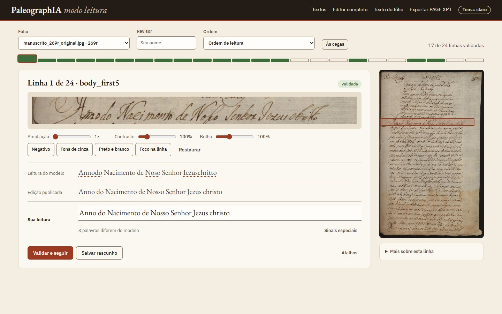
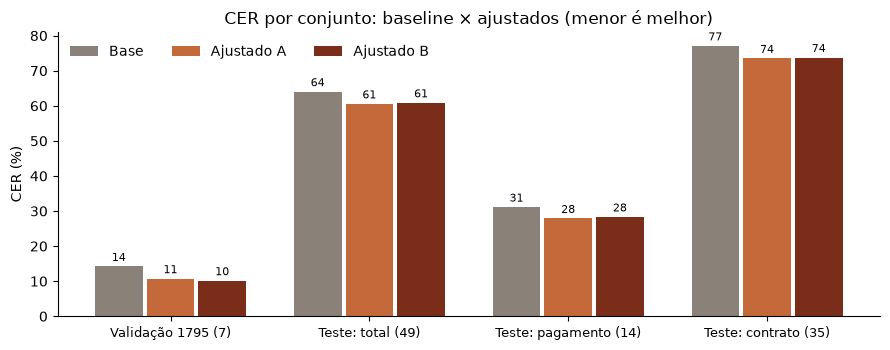
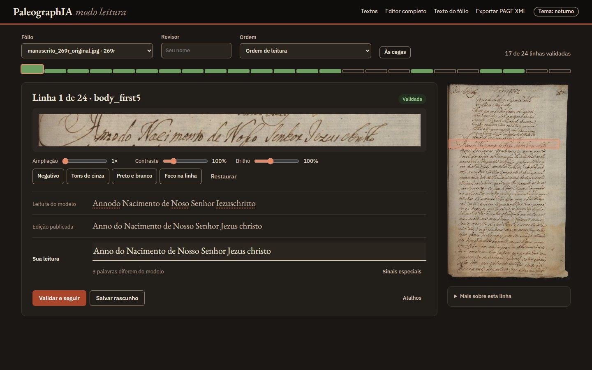
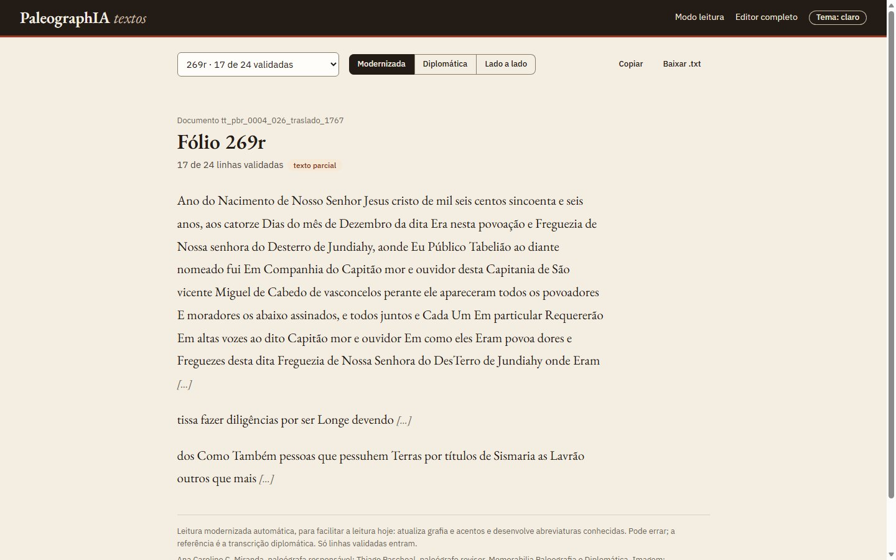
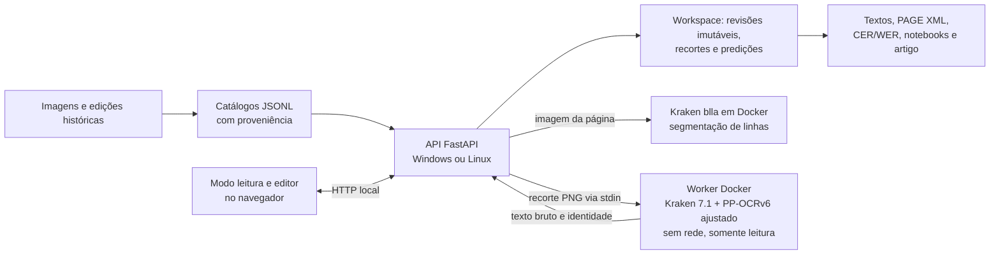

# PaleographIA — transcrição assistida de manuscritos

[](https://github.com/aj1no/paleographia-htr/actions/workflows/ci.yml)
[](LICENSE)


Aplicação web aberta de apoio à leitura de manuscritos históricos de Jundiaí (séculos XVII a XIX).
A página é segmentada em linhas, um reconhecedor ajustado com documentos do próprio acervo sugere a
leitura de cada linha, e uma pessoa confere na imagem, corrige e valida, com autoria e histórico.

**Reconhecimento bruto, edição publicada e transcrição humana validada ficam separados em todos os
registros.** Nenhuma sugestão vira referência sem conferência humana na imagem.

<p align="center">
  
</p>

Projeto Integrador IV e Processamento de Linguagem Natural (Fatec Jundiaí, Ciência de Dados).
Interface em português do Brasil.

## Estado em 09/11/2026

| Etapa | Situação |
| --- | --- |
| Aplicação | Modo leitura (padrão), editor completo, aba Textos, conferência às cegas, exportação em PAGE XML, tema claro e noturno |
| Modelo | PP-OCRv6 medium com ajuste fino em dois treinos gravados: A (191 linhas do Traslado) e B (A + 550 linhas públicas da Inquisição) |
| Validação | Sessão da Câmara de 1795, 7 linhas de outra mão, usadas para escolher o checkpoint |
| Teste reservado | 49 linhas de duas mãos inéditas (pagamento de 1759 e contrato de 1763), transcritas às cegas pela equipe, [congeladas e avaliadas uma única vez](docs/revisao_humana/teste_reservado_congelado_20261109/README.md) |
| Entregas | [Artigo de PLN](docs/entregas/artigo_20261107/README.md), [notebook comparativo](docs/entregas/notebook_comparativo_20261109/README.md), [Notebook 3 de PLN](docs/entregas/notebook_3_pln/README.md) e apresentação de 19/11 |

## Resultados

CER e WER (menor é melhor), em Unicode NFC, com espaços simplificados e preservando caixa, acentos e
grafia. Os três modelos leem os mesmos recortes.

| Conjunto | PP-OCRv6 base | Ajustado A | Ajustado B |
| --- | ---: | ---: | ---: |
| Validação 1795, 7 linhas (CER / WER) | 14,2% / 56,7% | 10,7% / 41,8% | 10,1% / 38,8% |
| **Teste reservado, 49 linhas (CER / WER)** | 64,0% / 95,3% | **60,5%** / 93,7% | 60,9% / 94,4% |
| Teste: pagamento de 1759, 14 linhas (CER) | 31,1% | 27,9% | 28,3% |
| Teste: contrato de 1763, 35 linhas (CER) | 77,1% | 73,5% | 73,8% |

<p align="center">
  
</p>

- **O ajuste fino melhora o modelo base de forma consistente.** Nas mesmas linhas do teste, a
  diferença pareada fica entre −1,4 e −5,6 pontos de CER (IC 95% por bootstrap).
- **A e B não se distinguem:** as linhas da Inquisição não trouxeram ganho mensurável.
- **A generalização ainda é o limite.** Fora da validação, o erro sobe para cerca de 28% numa letra
  regular e 74% numa escrita densa. Com um só documento de treino, o modelo aprende a mão que viu.
- **PLN depois do reconhecimento:** a [análise linguística dos erros](docs/entregas/notebook_3_pln/README.md)
  mostra que o ajuste reduz sobretudo a forma das letras e as palavras coladas. A pós-correção lexical
  (Levenshtein × TF-IDF de n-gramas) piorou o CER e fica só como sugestão ao revisor.
- Diagnósticos anteriores, de desenvolvimento: [24 recortes do 269r](docs/experimentos/traslado_269r_reconhecedores_24_20261020/README.md)
  (PP-OCRv5 latin 58,45% × PP-OCRv6 15,11% de CER), [ajuste fino](docs/experimentos/ppocrv6_ajuste_fino_20261105/README.md)
  e um [reconhecedor treinado do zero](docs/experimentos/modelo_do_zero_20261108/README.md).

## A aplicação

| Tela | O que faz |
| --- | --- |
| **Modo leitura** (`/leitura`, padrão) | Uma linha por vez: recorte ampliável, filtros de visualização (contraste, brilho, negativo, tons de cinza, preto e branco), foco na linha, leitura do modelo com as palavras divergentes marcadas, sinais paleográficos sob demanda e atalhos de teclado |
| **Às cegas** | Esconde o modelo e a edição para uma segunda leitura independente; mede a concordância entre revisores |
| **Textos** (`/textos`) | Só as linhas validadas, em leitura diplomática, modernizada ou lado a lado, com download em .txt |
| **Editor completo** (`/`) | Importar imagens, segmentar linhas (Kraken blla), ajustar recortes e ordem de leitura, catalogar fólio e face |
| **PAGE XML** | Exporta o fólio no padrão PAGE 2019, com geometria e estado de revisão, para abrir em ferramentas como Transkribus e eScriptorium |

<p align="center">
  
  
</p>



- **Persistência em arquivos**, sem servidor de banco de dados. Cada salvamento gera
  `revisions/<revisão>.json` com a revisão pai, e gravações concorrentes são recusadas com conflito.
- **O reconhecedor roda sob demanda** num contêiner com `--network none`, CPU e memória limitadas e
  pesos montados só para leitura. Sem Docker, a revisão manual continua disponível.
- **Pedaços cortados pelo blla** (primeira ou última palavra separada da linha) são juntados à linha
  automaticamente, antes de qualquer leitura humana.

## Instalar e abrir

Na raiz do repositório, com **Python 3.11 ou 3.12**:

```powershell
py -3.12 -m venv .venv
.venv/Scripts/python.exe -m pip install -e ".[test]"
.venv/Scripts/python.exe -m paleographia serve --config configs/traslado_269r.toml --host 127.0.0.1 --port 8011
```

Abra o [modo leitura do Traslado](http://127.0.0.1:8011/leitura). Em Linux, use `.venv/bin/python`.
A documentação da API fica em `/docs`.

Para **transcrever fólios novos** com sugestões do PP-OCRv6, abra o Docker Desktop e execute
`iniciar_editor.bat` (ou use `configs/editor_folios.toml` na porta 8010). O atalho confere o Docker,
a imagem e os pesos antes de abrir o navegador.

| Configuração | Uso | Porta sugerida |
| --- | --- | --- |
| `configs/editor_folios.toml` | Fólios novos, com sugestões do PP-OCRv6 (`iniciar_editor.bat`) | 8010 |
| `configs/traslado_269r.toml` | Traslado 269r, com sugestões experimentais | 8011 |
| `configs/curation_sessao_1795.toml` | Curadoria da validação de 1795 | 8012 |
| `configs/curation_teste_pagamento.toml` | Teste reservado, documento 1, **reconhecedor desligado** | 8014 |
| `configs/curation_teste_contrato12.toml` | Teste reservado, documento 2, **reconhecedor desligado** | 8017 |
| `configs/pilot.toml` | Piloto de 1831, sugestões desativadas (`start_safe.bat`) | 8000 |

Um clone novo começa **sem workspace**: iniciar o servidor não importa revisões de outra máquina. O
[guia de execução](docs/runbook.md) explica como importar o catálogo congelado num workspace vazio.
Use um único processo por workspace. O reconhecimento exige os pesos e o
[runtime Docker separado](runtime/kraken_ppocrv6/README.md); a instalação básica não os baixa.

## Conferir sem reconhecer de novo

```powershell
.venv/Scripts/python.exe -m pytest -q
node --test tests/web_review.test.cjs tests/web_leitura.test.cjs
.venv/Scripts/python.exe scripts/audit_dataset_expansion.py
```

Os testes usam dados sintéticos e evidências congeladas; não medem nova qualidade de reconhecimento.
A CI roda a suíte em Windows e Ubuntu, com Python 3.11 e 3.12, e uma tarefa acadêmica separada
reexecuta as entregas de 20/10 e 22/10 sem pesos nem inferência
([CI acadêmica](docs/manutencao/ci_academica_duas_versoes_20261022/README.md)).

Os resultados do teste também podem ser conferidos sem rodar nenhum modelo: o
[notebook comparativo](docs/entregas/notebook_comparativo_20261109/README.md) confere o SHA-256 da
referência congelada e recalcula tudo a partir das leituras gravadas.

## Reproduzir o ajuste fino e a avaliação

Registro completo: [ajuste fino do PP-OCRv6](docs/experimentos/ppocrv6_ajuste_fino_20261105/README.md),
com as provas dos treinos gravados ([A, 06/11](docs/experimentos/ppocrv6_ajuste_fino_20261105/gravacao_20261106/treino_A/README.md);
[B, 07/11](docs/experimentos/ppocrv6_ajuste_fino_20261105/gravacao_20261107/treino_B/README.md)).

1. **Modelos e dados públicos** (Zenodo; MD5 conferido; só os arquivos necessários):

   ```powershell
   .venv/Scripts/python.exe scripts/baixar_dados_publicos.py
   ```

   Baixa o PP-OCRv6 base, o modelo TraPrInq e o lote de 505 páginas do dataset *Portuguese
   Handwriting 16th–19th c.* (CC BY 4.0), cerca de 730 MB no total.
2. **Imagens do acervo de Jundiaí:** vêm do [Arquivo Histórico de Jundiaí / SISMU](https://jundiai.sismu.app/)
   e são restauradas por `restore-corpus` a partir do pacote do corpus v0.2. As imagens são públicas
   no Acervo Digital da prefeitura, e o Arquivo Histórico autorizou o uso sem fins comerciais, com
   crédito ao acervo. O pacote v0.2 ainda não foi publicado no repositório.
3. **Treino** (Docker com GPU NVIDIA; `configs/finetune_ppocrv6.toml`):

   ```powershell
   docker build --provenance=false -t paleographia-kraken:7.1.0-cu126 runtime/kraken_ppocrv6_gpu
   .venv/Scripts/python.exe scripts/treinar_ao_vivo.py A      # Traslado
   .venv/Scripts/python.exe scripts/treinar_ao_vivo.py B      # Traslado + Inquisição
   ```

   O progresso aparece ao vivo no terminal e fica em `output/treino_ao_vivo_*/console.log`.
   `gravar_treino.bat` prepara a gravação em vídeo. O código de treino recusa os documentos do teste
   reservado. Numa GTX 1650 (4 GB), cada época leva cerca de 40 min.
4. **Avaliação:** `scripts/avaliar_validacao.py` para a validação.
   `scripts/avaliar_teste_final.py` roda o teste reservado **uma única vez** por modelo e se recusa
   a repetir.

## Entregas acadêmicas

| Material | Conteúdo |
| --- | --- |
| [Artigo de PLN](docs/entregas/artigo_20261107/README.md) | Ajuste fino, análise de erros, pós-correção e teste reservado; 4 páginas, modelo PLN2026 |
| [Notebook comparativo (Entrega 06 do PI IV)](docs/entregas/notebook_comparativo_20261109/README.md) | Modelo base × ajustados na validação e no teste, com intervalos e tipos de erro |
| [Notebook 3 — PLN](docs/entregas/notebook_3_pln/README.md) | Análise linguística dos erros e pós-correção Levenshtein × TF-IDF |
| [Teste reservado congelado](docs/revisao_humana/teste_reservado_congelado_20261109/README.md) | Referência às cegas, hashes, avaliação única e intervalos |
| [Notebook 1 offline](docs/entregas/notebook_1_offline/README.md) | Reprodução das métricas com dados incorporados |
| [Notebook 2: carta de 1767](docs/entregas/continuidade_20261103/avaliacao_linhas_1767/README.md) | Avaliação por linha de outra mão |
| [Leitura modernizada](docs/experimentos/modernizacao_20261107/README.md) | Grafia atualizada para leitura e busca, separada da diplomática |
| [Roteiro da apresentação](docs/entregas/apresentacao_20261119/ROTEIRO.md) | Apresentação de 19/11 e perguntas prováveis |
| [Fechamento de 23/10](docs/entregas/pi_iv_pln_20261023_fechamento/README.md) e [pacotes de 20/10](docs/entregas/pi_iv_pln_20261020/README.md) e [22/10](docs/entregas/pi_iv_pln_20261022/README.md) | Entregas anteriores, congeladas e conferidas pela CI |

As [referências comentadas](docs/bibliografia/README.md) distinguem consulta parcial e leitura
integral. Pacotes datados e com hashes **não são editados** para recontar o estado atual:
atualizações entram em novos registros.

## Organização

| Caminho | Papel |
| --- | --- |
| `src/paleographia/` | Pacote: CLI, API, telas web, revisão, segmentação, ajuste fino e avaliação |
| `configs/`, `runtime/` | Configurações e ambientes Docker do reconhecedor |
| `data/manifests/`, `data/lexicon/` | Catálogos, repertório e base lexical |
| `docs/revisao_humana/`, `docs/experimentos/` | Revisões e experimentos publicados com hashes |
| `docs/entregas/`, `docs/interface/` | Notebooks, artigos, evidências acadêmicas e telas da aplicação |
| `scripts/`, `tests/`, `.github/workflows/` | Rotinas de preparo e avaliação, testes e CI |
| `legacy/`, scripts numerados, `client/` | Histórico e compatibilidade; consulte o [inventário](docs/manutencao/scripts_numerados_20261020/README.md) antes de remover |

[Índice da documentação](docs/README.md) · [Esquema dos dados](docs/data_schema.md) ·
[Política textual](docs/transcription_policy.md) · [Protocolo de avaliação](docs/evaluation_protocol.md) ·
[Consulta lexical](docs/lexico_historico.md) · [Contribuição](CONTRIBUTING.md)

## Equipe, licença e fontes

Caio Augusto de Souza Soares, Guilherme Rodrigues Veiga, Rodolfo Vinicius Cima Takemoto e Tiago
Galhardo Avelar.

Código sob [MIT](LICENSE). Imagens, manuscritos e edições têm créditos e condições de uso próprios: a
licença do código não concede permissão sobre esses materiais. Consulte as [fontes](docs/sources.md)
e a [declaração de uso de IA](docs/ai_comments.md).
