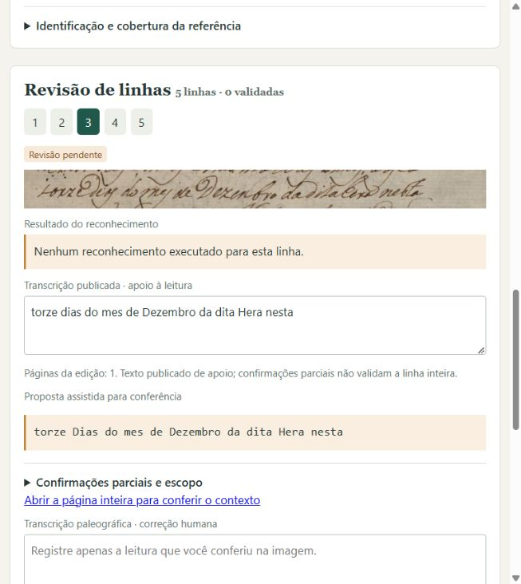
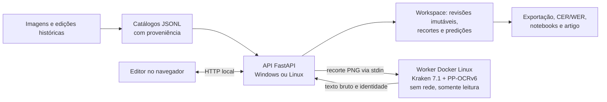

# PaleographIA — transcrição assistida de manuscritos

[](https://github.com/aj1no/paleographia-htr/actions/workflows/ci.yml)
[](LICENSE)


Protótipo local de apoio à leitura de manuscritos históricos de Jundiaí
(séculos XVII a XIX). O editor permite importar imagens, identificar
documento e fólio, ajustar recortes e ordem de leitura, pedir uma sugestão
experimental de reconhecimento, consultar vocabulário histórico com fontes e
salvar revisões humanas com autoria, proveniência e histórico.

**Reconhecimento bruto, edição publicada e transcrição humana validada
permanecem separados em todos os registros.** Nenhuma sugestão de OCR vira
referência sem conferência humana na imagem.

<p align="center">
  
</p>

Projeto Integrador IV e Processamento de Linguagem Natural. Interface em
português do Brasil.

## Estado em 05/11/2026

| Documento | Situação da referência humana | Uso atual |
| --- | --- | --- |
| Traslado da criação da vila, fólio 269r | 24 linhas em cinco blocos: 16 validadas e 8 com ressalvas visuais | Diagnóstico de desenvolvimento dos reconhecedores |
| Sessão de 25/06/1795, fólio 91r | 8 geometrias confirmadas; 7 referências diplomáticas validadas; 1 pendente | Sete pares no [dataset revisado](docs/entregas/continuidade_20261103/dataset_revisado_1795/README.md) |
| Carta de José Gomes de Gouveia, 1767, fólio 4r | 6 recortes aprovados; linhas 1, 3 e 4 validadas | [Notebook 2: avaliação por linha](docs/entregas/continuidade_20261103/avaliacao_linhas_1767/README.md) |
| Contrato de 1763, livro 13, p. 5 | 4 recortes exploratórios; faces e referências pendentes | Exploração de pré-processamento; nenhum pseudorrótulo aprovado |
| Catálogo de 1831 | 3 fólios, 94 recortes pendentes, nenhuma linha validada | Piloto inicial do editor |

**Próximo passo científico:** selecionar e reservar um grupo documental
independente para o teste final, conferir sua proveniência e preparar
referências diplomáticas *antes* de ajustar modelos ou escolher parâmetros.
Veja a [retomada de 04/11](docs/entregas/continuidade_20261103/RETOMADA_20261104.md).

## Resultados de desenvolvimento

CER e WER (menor é melhor) com normalização NFC e redução de espaços,
preservando maiúsculas, acentos e pontuação. **São diagnósticos de
desenvolvimento, sem teste reservado: não demonstram generalização.**
Implementações e pré-processamentos diferem entre os reconhecedores, então a
diferença não se atribui somente à versão do modelo.

| Conjunto | Reconhecedor | CER | WER |
| --- | --- | ---: | ---: |
| Traslado 269r, 24 recortes (1.112 caracteres, 203 palavras) | latin PP-OCRv5 mobile / ONNX | 58,45% | 94,58% |
| | PP-OCRv6 medium / Kraken 7.1 | 15,11% | 60,10% |
| Carta de 1767, 3 linhas validadas (128 caracteres, 26 palavras) | PP-OCRv5 | 79,69% | 100,00% |
| | PP-OCRv6 | 25,78% | 65,38% |
| Piloto VGSL, 10 linhas fora do treino do piloto | Kraken VGSL do zero | 96,83% | 100,00% |
| | Kraken VGSL com pré-treino autossupervisionado | 93,87% | 96,77% |

- [Referência assistida do 269r, decisões e dúvidas](docs/revisao_humana/traslado_269r/referencia_assistida_20261020/README.md)
  e [comparação dos 24 recortes](docs/experimentos/traslado_269r_reconhecedores_24_20261020/README.md).
- Diagnósticos integrais contra a edição, com outra seleção e fluxo:
  [269r](docs/experimentos/traslado_269r_integral_edicao_20261022/README.md) (CER 26,97%, WER 60,31%) e
  [269v](docs/experimentos/traslado_269v_integral_edicao_20261022/README.md) (CER 16,48%, WER 56,25%).
- Pilotos VGSL, com uma semente e leitura ainda insuficiente:
  [pré-treino](docs/experimentos/kraken_vgsl_pretrain_piloto/README.md) e
  [comparação](docs/experimentos/kraken_vgsl_comparacao_piloto/README.md).
- O [ensaio de ajuste fino do PP-OCRv6](docs/dataset_expansion_20261023/README.md) de 23/10 foi
  uma verificação técnica com dois passos de otimização. A
  [partição candidata](docs/entregas/continuidade_20261103/particoes_ppocrv6_20261104/README.md)
  tem 19 pares de treino, 7 de validação e **nenhum de teste** até a reserva do grupo independente.

## Como funciona



- **Persistência em arquivos**, sem servidor de banco de dados. Cada salvamento
  gera `revisions/<revisão>.json` com a revisão pai e atualiza `current.json`.
- **O reconhecedor roda sob demanda** em um contêiner com `--network none`,
  CPU, memória limitada e peso montado somente para leitura. Sem Docker, a
  revisão manual continua disponível.
- **Identidades conferidas:** o editor do Traslado só apresenta sugestões para o
  peso, a imagem Docker e o worker avaliados. Uma imagem reconstruída exige nova avaliação.

## Instalar e abrir

Na raiz do repositório, com **Python 3.11 ou 3.12**:

```powershell
py -3.12 -m venv .venv
.venv/Scripts/python.exe -m pip install -e ".[test]"
.venv/Scripts/python.exe -m paleographia serve --config configs/traslado_269r.toml --host 127.0.0.1 --port 8011
```

Abra [o editor do Traslado](http://127.0.0.1:8011/). Em Linux, use
`.venv/bin/python`. A documentação da API fica em `/docs`.

Para **transcrever fólios novos** com sugestões do PP-OCRv6, abra o Docker Desktop
e execute `iniciar_editor.bat` (ou use `configs/editor_folios.toml` na porta 8010).
O atalho confere Docker, imagem e peso antes de abrir o navegador.

| Configuração | Uso | Porta sugerida |
| --- | --- | --- |
| `configs/editor_folios.toml` | Fólios novos, com sugestões do PP-OCRv6 (`iniciar_editor.bat`) | 8010 |
| `configs/traslado_269r.toml` | Editor do Traslado, com sugestões experimentais | 8011 |
| `configs/pilot.toml` | Piloto de 1831, sugestões desativadas (`start_safe.bat`) | 8000 |
| `configs/curation_sessao_1795.toml` | Curadoria manual da sessão de 1795 | 8012 |

Um clone novo começa **sem workspace**: iniciar o servidor não importa revisões
de outra máquina. O [guia de execução](docs/runbook.md) explica a importação do
catálogo congelado em workspace vazio. Use um único processo por workspace.

O reconhecimento exige pesos e o [runtime Docker separado](runtime/kraken_ppocrv6/README.md);
a instalação básica não os baixa. PP-OCRv5 fica no experimento comparativo, e o
TrOCR está bloqueado para novas execuções, preservado só para rastreabilidade.

## Conferir sem reconhecer novamente

```powershell
.venv/Scripts/python.exe -m pytest -q
node --test tests/web_review.test.cjs
.venv/Scripts/python.exe scripts/audit_dataset_expansion.py
.venv/Scripts/python.exe docs/revisao_humana/traslado_269r/referencia_assistida_20261020/verificar.py
.venv/Scripts/python.exe docs/experimentos/traslado_269r_reconhecedores_24_20261020/verificar.py
```

Os testes usam dados sintéticos e evidências congeladas; não medem nova
qualidade de reconhecimento. A CI roda a suíte e as auditorias em Windows e
Ubuntu, Python 3.11 e 3.12. Uma tarefa acadêmica separada reexecuta as entregas
de 20/10 e 22/10 sem pesos nem inferência, e confere o fechamento de 23/10 no
commit em que ele foi fechado. Veja a [CI acadêmica](docs/manutencao/ci_academica_duas_versoes_20261022/README.md).

## Reproduzir o ajuste fino

Registro completo do experimento de 05/11: [fólio inteiro e ajuste fino do PP-OCRv6](docs/experimentos/ppocrv6_ajuste_fino_20261105/README.md).
Na validação de 1795, o ajuste fino baixou o CER de 14,20% para 10,72% (WER de 56,72% para 41,79%) só com o Traslado
e para 10,14% (WER 38,81%) com o Traslado e as linhas públicas da Inquisição, em treinos gravados em
06/11 e 07/11 ([provas do A](docs/experimentos/ppocrv6_ajuste_fino_20261105/gravacao_20261106/treino_A/README.md),
[provas do B](docs/experimentos/ppocrv6_ajuste_fino_20261105/gravacao_20261107/treino_B/README.md)).
A diferença entre A e B (cerca de 2 caracteres) está dentro da variação entre execuções.

1. **Modelos e dados públicos** (Zenodo; MD5 conferido; só os arquivos necessários):

   ```powershell
   .venv/Scripts/python.exe scripts/baixar_dados_publicos.py
   ```

   Baixa o PP-OCRv6 base, o modelo TraPrInq e o lote de 505 páginas do dataset
   *Portuguese Handwriting 16th–19th c.* (CC BY 4.0), cerca de 730 MB no total.
2. **Imagens do acervo de Jundiaí** (Traslado, sessão de 1795 e pagamento): vêm do
   [Arquivo Histórico de Jundiaí / SISMU](https://jundiai.sismu.app/) e são restauradas por
   `restore-corpus` a partir do pacote do corpus v0.2. As imagens são públicas no Acervo Digital da
   prefeitura, e o Arquivo Histórico autorizou o uso sem fins comerciais, com crédito ao acervo. O
   pacote v0.2 ainda não foi publicado no repositório.
3. **Treino:** `configs/finetune_ppocrv6.toml` e `src/paleographia/ppocrv6_finetune.py`. Requer
   Docker; com GPU NVIDIA, construa a imagem de treino:

   ```powershell
   docker build --provenance=false -t paleographia-kraken:7.1.0-cu126 runtime/kraken_ppocrv6_gpu
   ```

   Para acompanhar ou gravar o treino, rode-o no terminal com progresso ao vivo (cada lote, cada
   validação e o resumo final; tudo também fica em `output/treino_ao_vivo_*/console.log`):

   ```powershell
   .venv/Scripts/python.exe scripts/treinar_ao_vivo.py A      # Traslado
   .venv/Scripts/python.exe scripts/treinar_ao_vivo.py B      # Traslado + Inquisição
   ```

   Para gravar em vídeo, use `gravar_treino.bat`: ele pergunta o treino (A ou B), abre o monitor da
   GPU e espera uma tecla antes de começar. Rode um treino por vez; o script recusa iniciar outro.
   Durante o treino, `scripts/prints_treino.ps1` tira prints da janela do treino e do Docker Desktop
   a cada 10 minutos e no fim (`output/prints_treino_*`).
4. **Avaliação em CER/WER (NFC)** pelo worker de inferência do editor, nas linhas de validação:

   ```powershell
   .venv/Scripts/python.exe scripts/avaliar_validacao.py . docs/experimentos/ppocrv6_ajuste_fino_20261105/dados/pares_filtrados.json validation models/kraken_ppocrv6_medium/medium.safetensors CAMINHO/DO/PESO.safetensors
   ```
   Tempos medidos numa GTX 1650 (4 GB): cerca de 6 s por linha, 40 min por época com 382 amostras.
   Em CPU são cerca de 18 s por linha, o que torna o treino completo inviável; um notebook com
   caminho no Google Colab (GPU) está em preparação.

## Entregas acadêmicas

[](https://colab.research.google.com/github/aj1no/paleographia-htr/blob/main/docs/entregas/pi_iv_pln_20261023_colab/colaboracao_colab.ipynb)

| Material | Conteúdo |
| --- | --- |
| [Continuidade de 03–04/11](docs/entregas/continuidade_20261103/README.md) | Retomada, dataset de 1795, Notebook 2 da carta, partições candidatas |
| [Artigo de 07/11](docs/entregas/artigo_20261107/README.md) | Ajuste fino, análise de erros e pós-correção; 3 páginas, layout PLN2026 |
| [Notebook 3 — PLN](docs/entregas/notebook_3_pln/README.md) | Base × ajustados, análise linguística dos erros e pós-correção Levenshtein × TF-IDF |
| [Leitura modernizada (07/11)](docs/experimentos/modernizacao_20261107/README.md) | Normalização ortográfica histórica para leitura e busca, separada da diplomática; WER contra a edição do AHMJ de 14,9% para 2,1% em 10 linhas de desenvolvimento |
| [Roteiro de 5 minutos](docs/entregas/apresentacao_20261119/ROTEIRO.md) | Apresentação de 19/11 (ou 12/11) e perguntas prováveis |
| [Apresentação de 12/11](docs/entregas/apresentacao_20261112/README.md) | Roteiro e pendências da apresentação |
| [Fechamento de 23/10](docs/entregas/pi_iv_pln_20261023_fechamento/README.md) | Artigo atual, notebook baseline e verificador |
| [Notebook 1 offline](docs/entregas/notebook_1_offline/README.md) | Reprodução das métricas com dados incorporados |
| [Notebook da equipe no Colab](docs/entregas/pi_iv_pln_20261023_colab/README.md) | Guia para salvar uma cópia, executar e enviar relatos |
| [Artigo com fundamentação ampliada](docs/entregas/pi_iv_pln_20261023_fundamentacao/README.md) | Fichamentos de T1/T4; revisão dos autores pendente |
| [Pacotes de 20/10](docs/entregas/pi_iv_pln_20261020/README.md) e [22/10](docs/entregas/pi_iv_pln_20261022/README.md) | Entregas congeladas, conferidas pela CI |

As [referências comentadas](docs/bibliografia/README.md) distinguem consulta
parcial e leitura integral. Pacotes datados e com hashes **não são editados**
para recontar o estado atual; atualizações entram em novos registros.

## Organização

| Caminho | Papel |
| --- | --- |
| `src/paleographia/` | Pacote atual: CLI, API, editor, revisão e avaliação |
| `configs/`, `runtime/` | Configurações e ambiente Docker do reconhecedor |
| `data/manifests/`, `data/lexicon/` | Catálogos, repertório e base lexical |
| `docs/revisao_humana/`, `docs/experimentos/` | Revisões e experimentos publicados com hashes |
| `docs/entregas/` | Notebooks, artigos e evidências acadêmicas |
| `tests/`, `.github/workflows/` | Testes e CI |
| `legacy/`, scripts numerados, `client/` | Histórico e compatibilidade; consulte o [inventário](docs/manutencao/scripts_numerados_20261020/README.md) antes de remover |

[Índice da documentação](docs/README.md) · [Esquema dos dados](docs/data_schema.md) ·
[Política textual](docs/transcription_policy.md) · [Protocolo de avaliação](docs/evaluation_protocol.md) ·
[Consulta lexical](docs/lexico_historico.md) · [Contribuição](CONTRIBUTING.md)

A branch principal é `main`. A branch `codex/refatoracao-piloto` foi preservada
como registro da etapa anterior; veja a [nota sobre a adoção da main](docs/manutencao/main_20261020/README.md).

## Licença e fontes

Código sob [MIT](LICENSE). Imagens, manuscritos e edições têm créditos e
condições de uso próprios: a licença do código não concede permissão sobre
esses materiais. Consulte as [fontes](docs/sources.md) e a
[declaração de uso de IA](docs/ai_comments.md).
