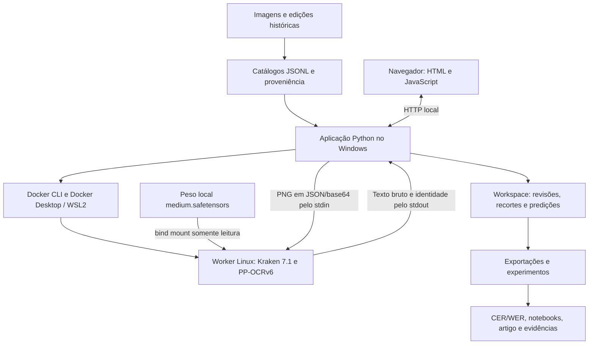

# Contexto completo do projeto PaleographIA

> **Versão publicada em `docs/`, sem caminhos locais.** Retrato do estado de 05/11/2026 antes da sessão de
> ajuste fino; o trabalho posterior está na [retomada de 05/11](entregas/continuidade_20261103/RETOMADA_20261105.md).

Documento de transferência de contexto, navegação e operação local. Elaborado em **05/11/2026**, com base nos arquivos deste checkout, nas configurações, nos workspaces e em consultas de leitura ao Docker. O estado de execução é uma fotografia dessa conferência e pode mudar depois.

## 1. Identificação e propósito

| Item | Informação |
| --- | --- |
| Nome | PaleographIA |
| Pacote Python | `paleographia`, versão `0.2.0` |
| Raiz local | `<raiz do projeto>` |
| Repositório remoto configurado | [aj1no/paleographia-htr](https://github.com/aj1no/paleographia-htr) |
| Branch local conferida | `main` |
| Commit-base deste levantamento | `309d863`, de 04/11/2026: `docs: publica pilotos Kraken e salva retomada de 04 de novembro` |
| Sistema local | Windows, PowerShell, Docker Desktop com WSL2 |
| Python da aplicação | `.venv/Scripts/python.exe`, versão observada `3.12.14` |
| Versões Python admitidas | `>=3.11,<3.13` |
| Contexto acadêmico | Projeto Integrador IV e Processamento de Linguagem Natural |
| Idioma da interface | Português do Brasil |

O PaleographIA é um protótipo local de transcrição assistida e revisão de manuscritos históricos de Jundiaí. Permite importar imagens, identificar documento/fólio, segmentar e ajustar recortes, executar reconhecimento experimental, consultar vocabulário histórico e registrar revisões humanas com autoria, proveniência e histórico.

O trabalho reúne três frentes: o editor de revisão, a organização de dados paleográficos e experimentos de reconhecimento/aprendizagem. Uma previsão de OCR, uma edição publicada e uma transcrição humana validada têm funções distintas e permanecem separadas nos registros.

Este arquivo é um mapa consolidado. Os manifests, o código e os relatórios datados continuam sendo as fontes detalhadas. O `README.md` principal descreve sobretudo o estado de 23/10; a retomada de 04/11 registra avanços posteriores.

## 2. Onde retomar primeiro

1. [Retomada mais recente, de 04/11](entregas/continuidade_20261103/RETOMADA_20261104.md): estado das curadorias, VGSL, partições e próximo passo.
2. [Índice da documentação](README.md): navegação geral.
3. [Guia de execução](runbook.md) e [ambientes](environment.md): aplicação e reprodução.
4. [Runtime Docker/Kraken](../runtime/kraken_ppocrv6/README.md): reconhecimento Linux separado.
5. [Continuidade acadêmica](entregas/continuidade_20261103/README.md): notebooks, requisitos e dados revisados.

O próximo passo científico registrado em 04/11 é selecionar um grupo documental independente para teste final, conferir sua proveniência e preparar referências diplomáticas antes de ajustar modelos ou escolher parâmetros.

## 3. Arquitetura e fluxo dos dados



- **Aplicação:** Python, FastAPI e Uvicorn no ambiente virtual do Windows.
- **Interface atual:** `src/paleographia/web/`, servida pela própria API; não depende de um servidor Node separado. A pasta `client/` está vazia nesta máquina.
- **Persistência:** arquivos JSON/JSONL, revisões imutáveis e um ponteiro para a revisão corrente. O fluxo examinado não usa PostgreSQL, MySQL, Redis ou um servidor de banco de dados.
- **Reconhecimento do editor:** backend `kraken_ppocrv6`, executado sob demanda em Docker Linux, CPU/float32.
- **PP-OCRv5:** execução ONNX separada para comparação; não é o backend selecionado pelo editor.
- **TrOCR:** código, dependências opcionais e pesos históricos permanecem para rastreabilidade; os pontos públicos atuais de carga/reconhecimento estão bloqueados.
- **Rede:** o navegador acessa a API local; a inferência Kraken recebe `--network none`. Instalação, construção de imagem e downloads explícitos precisam de rede.

Iniciar o editor não importa automaticamente o catálogo e não inicia automaticamente o Docker Desktop. A revisão manual permanece disponível se o reconhecedor estiver indisponível.

## 4. Estado consolidado dos dados e experimentos

### 4.1 Traslado da criação da vila, fólio 269r

O ato descrito é de 1656; a cópia/cabeçalho estudado é associado a 1767 nos registros. Essas datas têm funções diferentes e não devem ser fundidas.

O diagnóstico principal contém **24 linhas, cinco blocos, 16 referências validadas e oito ressalvas visuais**. A referência assistida das oito dúvidas incorpora apoio da edição com proveniência. Isso não transforma todas as 24 linhas em referência visual humana independente.

| Reconhecedor | CER | WER |
| --- | ---: | ---: |
| latin PP-OCRv5 mobile / ONNX | 58,45% | 94,58% |
| PP-OCRv6 medium / Kraken 7.1 | 15,11% | 60,10% |

São resultados arquivados de desenvolvimento, sobre 1.112 caracteres e 203 palavras. Implementações e pré-processamentos diferem; a comparação não isola apenas a versão do modelo nem demonstra generalização.

Fontes: [referência assistida](revisao_humana/traslado_269r/referencia_assistida_20261020/README.md) e [experimento dos 24 recortes](experimentos/traslado_269r_reconhecedores_24_20261020/README.md).

Existem ainda diagnósticos integrais separados contra a edição: [269r](experimentos/traslado_269r_integral_edicao_20261022/README.md), com CER 26,97% e WER 60,31%, e [269v](experimentos/traslado_269v_integral_edicao_20261022/README.md), com CER 16,48% e WER 56,25%. São outras seleções/fluxos e não substituem a tabela de 24 recortes.

### 4.2 Catálogo histórico de 1831

O workspace principal do piloto tem três páginas e 94 linhas pendentes, sem texto integral validado. O repertório do 100r contém exemplos e confirmações parciais. As métricas do Traslado não avaliam esse catálogo. `start_safe.bat` abre esse piloto, cuja apresentação automática de sugestões permanece desativada.

### 4.3 Sessão de 25/06/1795, fólio 91r

Foram confirmadas oito geometrias, sete referências diplomáticas por linha e a identificação/cobertura parcial. A oitava linha permanece provável/pendente e excluída dos alvos aprovados. Há sete pares estruturados no [dataset revisado](entregas/continuidade_20261103/dataset_revisado_1795/README.md).

O histórico está em [revisão da sessão de 1795](revisao_humana/sessao_1795/README.md). Entradas mais antigas nessa pasta descrevem estados anteriores; o fechamento após a observação 038 é a referência posterior para esta etapa.

### 4.4 Carta de José Gomes de Gouveia, 1767, fólio 4r

Os seis recortes da anotação superior têm geometria aprovada. As linhas **1, 3 e 4** têm referência diplomática validada. As linhas 2, 5 e 6 permanecem fora das métricas por referência integral pendente. A cobertura das seis linhas segue `complete=false`.

| Reconhecedor | CER em três linhas | WER em três linhas |
| --- | ---: | ---: |
| PP-OCRv5 | 79,69% | 100,00% |
| PP-OCRv6 | 25,78% | 65,38% |

O diagnóstico de 04/11 agrega 128 caracteres e 26 palavras. O [Notebook 2 e seu protocolo](entregas/continuidade_20261103/avaliacao_linhas_1767/README.md) usam previsões arquivadas por padrão. A inferência local é uma opção explícita do notebook e exige pesos e runtime preparados.

### 4.5 Contrato de 1763, livro 13

A página 5 tem quatro recortes exploratórios com cobertura conferida; identificação das faces das páginas 5/6 e referências diplomáticas continuam pendentes. Foram exploradas retificação, redução de trama e variantes de imagem. O consenso de previsões **não aprovou nenhuma das quatro linhas como pseudorrótulo**.

Os livros 12 e 13 ficam juntos em desenvolvimento exploratório. Fonte: [refinamento e semissupervisão](revisao_humana/contrato_livro13_1763/preparacao_20261104/refinamento_e_semissupervisao.md). Imagens e derivados completos ficam em `output/curadoria_contrato_livro13_1763/`.

### 4.6 Ajuste fino PP-OCRv6 e pilotos VGSL

O ensaio PP-OCRv6 de 23/10 executou dois passos reais de otimização como verificação técnica. Não demonstrou ganho científico nem substituiu os pesos do editor. Consulte a [expansão do corpus e evidências](dataset_expansion_20261023/README.md).

A [partição candidata de 04/11](entregas/continuidade_20261103/particoes_ppocrv6_20261104/README.md) propõe 19 pares para treino, sete para validação e **zero para teste**. Independência e partições oficiais ainda precisam ser formalizadas. A pré-checagem do alfabeto aceitou 26/26 referências em NFD e 11/26 em NFC. Testar NFD no fluxo de ajuste continua pendente; a avaliação permanece em NFC.

O pré-treinamento autossupervisionado VGSL usou 67 imagens sem texto para treino e quatro para validação técnica, executou 68 passos e exportou pesos. O ajuste comparativo posterior usou 12 linhas do Traslado para treino e quatro do mesmo documento para monitoramento, em 75 épocas para ambos os modelos.

| Piloto VGSL, dez linhas externas ao treino deste piloto | CER | WER |
| --- | ---: | ---: |
| Inicializado do zero | 96,83% | 100,00% |
| Com pré-treinamento | 93,87% | 96,77% |

As omissões dominaram, e a leitura continua insuficiente. Há uma semente; os documentos avaliados já apareceram em outras frentes do projeto. Isso não equivale ao teste científico final independente. Relatórios: [pré-treino](experimentos/kraken_vgsl_pretrain_piloto/README.md) e [comparação](experimentos/kraken_vgsl_comparacao_piloto/README.md).

## 5. Pastas da raiz e responsabilidades

Todos os caminhos relativos deste documento partem da raiz abaixo. Os manifests também resolvem caminhos em relação à raiz, **não em relação à pasta do próprio manifest**.

```text
<raiz do projeto>\
├── .git/                         Histórico Git local
├── .github/                      CI e modelos de issues/PR
├── .venv/                        Ambiente Python local
├── .pytest_cache/                Cache de testes
├── __pycache__/                  Bytecode Python
├── build/                        Derivados de empacotamento
├── client/                       Pasta histórica; vazia no levantamento
├── configs/                      Perfis TOML e especificações JSON
├── data/                         Fontes, manifests, léxico e workspaces
├── docs/                         Documentação, curadoria, artigos e evidências
├── experiments/                  Execuções locais e ensaios técnicos
├── legacy/                       Implementações e auxiliares arquivados
├── models/                       Pesos locais dos reconhecedores
├── output/                       Derivados, checkpoints, relatórios e exportações
├── runtime/                      Dockerfiles e ambiente Kraken
├── scripts/                      Preparação, auditorias e utilitários atuais
├── server/                       Entrada ASGI de compatibilidade
├── src/paleographia/             Código atual da aplicação
├── tests/                        Testes Python e JavaScript
├── tmp/                          Scripts transitórios, cópias e ambientes de trabalho
├── pyproject.toml                Pacote, dependências e entrada da CLI
├── requirements.txt              Instalação editável do pacote local
├── start_safe.bat                Inicia piloto padrão na porta 8000
├── README.md                     Apresentação geral
└── CONTEXTO_COMPLETO_PROJETO.md   Este documento
```

Também existem `.gitignore`, `.gitattributes`, `LICENSE`, `CONTRIBUTING.md`, `SECURITY.md`, `CODE_OF_CONDUCT.md`, `README.pt-br.md` e scripts numerados na raiz. Esses scripts numerados são pontos históricos/de compatibilidade; consultar [o inventário de manutenção](manutencao/scripts_numerados_20261020/README.md) antes de remover ou substituir.

### 5.1 Dados

```text
data/
├── lexicon/
│   ├── entries.jsonl              Registros lexicais
│   ├── sources.json               Fontes e proveniência
│   └── coverage.json              Cobertura da base
├── manifests/
│   ├── pages.jsonl                Catálogo inicial do piloto de 1831
│   ├── lines.jsonl                Linhas iniciais do piloto
│   ├── corpus_expandido_v02/      Catálogos da expansão de fontes
│   ├── traslado_269r/             Preparação inicial das cinco linhas do Traslado
│   ├── repertorio_100r.json        Repertório visual
│   └── repertorio_revisions/      Histórico do repertório
├── raw/
│   ├── corpus_expandido_v02/      Fontes locais restauradas da expansão
│   ├── import_20261015/            Imagens/PDFs extraídos na importação inicial
│   ├── inbox/                     Entrada de novas fontes
│   ├── transcriptions/            Materiais de transcrição
│   ├── Photos-*.zip               Arquivos originais locais
│   └── Transcrições.rar           Arquivo de fontes da importação
├── processed/
│   ├── neural_attempt/            Tentativa histórica de segmentação neural
│   ├── pilot_initial/             Preparação inicial
│   ├── pilot_projection/          Segmentação por projeção
│   ├── repertorio_100r/            Recortes do repertório
│   ├── review_inspection/          Derivados de inspeção
│   ├── train/                     Materiais de treino
│   ├── traslado_269r_conferencia/  Recortes de conferência
│   └── traslado_269r_revisoes/     Derivados das revisões
├── workspace/                     Workspace do piloto de 1831
│   ├── current.json
│   ├── revisions/
│   ├── predictions/
│   └── curation_sessao_1795/      Workspace separado da curadoria de 1795
└── workspace_traslado_269r/        Workspace do editor do Traslado
    ├── current.json
    ├── revisions/
    ├── predictions/
    ├── preparacao_06_10/
    └── preparacao_11_15/
```

`data/raw/uploads/` é o destino implementado para novos uploads pela API; a pasta é criada quando necessária. `crops/` e `segments/` também são criadas sob o workspace durante operações correspondentes.

**Atenção ao significado dos manifests do Traslado:** `data/manifests/traslado_269r/` registra a preparação inicial de cinco linhas. A referência publicada de 24 linhas está em `docs/revisao_humana/traslado_269r/referencia_assistida_20261020/`, e o estado vivo local está em `data/workspace_traslado_269r/`.

### 5.2 Documentação

| Pasta | Conteúdo |
| --- | --- |
| `docs/bibliografia/` | Buscas, referências comentadas, PDFs e fichamentos |
| `docs/correcoes/` | Evidências de correções |
| `docs/dataset_expansion_20261023/` | Expansão do corpus, curadoria inicial e ensaio PP-OCRv6 |
| `docs/entregas/` | Artigos, notebooks, pacotes de entrega e retomadas |
| `docs/experimentos/` | Experimentos documentados, previsões e métricas publicadas |
| `docs/lexico_evidencias/` | Evidências da consulta lexical |
| `docs/manutencao/` | Organização, integridade, CI e reprodução |
| `docs/repertorio/` | Exemplos visuais do repertório |
| `docs/revisao_humana/` | Sessões, decisões humanas, proveniência e referências |
| `docs/screenshots/` | Capturas locais, ignoradas pelo Git |
| `docs/testes/` | Evidências publicadas de verificações específicas |

Pastas de entrega que merecem consulta direta:

- `docs/entregas/continuidade_20261103/`: retomada de 04/11, dataset de 1795, avaliação da carta, partições candidatas e salvamento anterior.
- `docs/entregas/notebook_1_offline/`: primeira entrega com reprodução offline.
- `docs/entregas/pi_iv_pln_20261023_fechamento/`: artigo atual indicado nos guias, em Markdown/PDF/Word, e verificador.
- `docs/entregas/pi_iv_pln_20261023_colab/`: notebook para preenchimento no Google Colab.
- `docs/entregas/pi_iv_pln_20261023_equipe/`: atividades, relatos e roteiro da equipe.
- `docs/entregas/pi_iv_pln_20261023_fundamentacao/`: artigo com fundamentação ampliada.
- `docs/entregas/pi_iv_pln_20261020/` e `pi_iv_pln_20261022/`: pacotes históricos congelados.
- `docs/entregas/apresentacao_20261112/`: preparação da apresentação prevista para 12/11/2026. O plano registra até dez minutos de exposição e cinco de perguntas; os slides finais permaneciam pendentes no documento consultado.

### 5.3 Pesos, runtime e saídas

| Caminho | Função |
| --- | --- |
| `models/kraken_ppocrv6_medium/medium.safetensors` | Peso-base PP-OCRv6 medium |
| `models/kraken_ppocrv6_medium/provenance.json` | Origem e identidade do peso |
| `models/latin_PP-OCRv5_mobile_rec/model.onnx` | Peso ONNX do comparador PP-OCRv5 |
| `models/trocr-small-handwritten/` | Checkpoint e processador históricos TrOCR |
| `runtime/kraken_ppocrv6/Dockerfile` | Construção do ambiente Kraken de CPU |
| `runtime/kraken_ppocrv6/Dockerfile.locked` | Construção com dependências transitivas fixadas |
| `runtime/kraken_ppocrv6/requirements.lock` | 71 distribuições do ambiente registrado |
| `output/avaliacao_linhas_1767/` | Execuções locais da comparação da carta |
| `output/curadoria_contrato_livro13_1763/` | Reproduções, recortes e tratamentos do contrato |
| `output/kraken_vgsl_pretrain_smoke_01/` | Imagens, Arrow, pesos e logs do pré-treino |
| `output/kraken_vgsl_comparacao_01/` | Checkpoints de 25/75 épocas, previsões e logs |
| `output/entrega_academica_269r24_20261020/` | Derivados da reexecução acadêmica de 20/10 |
| `output/entrega_academica_269r24_20261022/` | Derivados da reexecução acadêmica de 22/10 |
| `experiments/ppocrv6_smoke_20261023_final/` | Execução técnica de ajuste PP-OCRv6 |
| `experiments/ppocrv6_scientific_gate_20261023/` | Evidência da pré-verificação científica |

`docs/experimentos/` contém evidências publicadas. `experiments/` contém execuções locais, em grande parte ignoradas pelo Git. `output/` guarda derivados locais, incluindo artefatos grandes necessários para retomar experimentos.

## 6. Código e pontos de entrada

| Arquivo ou conjunto em `src/paleographia/` | Responsabilidade |
| --- | --- |
| `__main__.py` | CLI, despacho dos comandos e inicialização do servidor |
| `api.py` | Rotas FastAPI, uploads, editor, revisão, léxico e exportação |
| `services.py` | Estado dos workspaces, revisões, geometria e reconhecimento |
| `config.py` | Leitura TOML |
| `data.py` | Modelos Page/Line, validação, inventário e divisão dos dados |
| `io.py` | JSON/JSONL, caminhos seguros, hashes e escrita |
| `segmentation.py` | Detecção e recortes de linhas |
| `backends.py` | Seleção explícita do reconhecedor |
| `kraken_recognition.py` | Cliente Docker e ciclo do worker persistente |
| `kraken_recognition_worker.py` | Processo Linux de inferência PP-OCRv6 |
| `latin_ocr.py` | Reconhecimento PP-OCRv5/ONNX |
| `recognition.py` | Contratos e funções de reconhecimento; bloqueios históricos |
| `presentation.py` | Política que controla a apresentação das sugestões |
| `lexicon.py` | Consulta lexical com fontes e registro da assistência |
| `preparation.py`, `corpus_expansion.py` | Preparação e restauração dos dados |
| `evaluation.py`, `experiments.py`, `frozen_experiment.py` | Métricas, proveniência e experimentos |
| `training.py`, `ppocrv6_training.py`, `ppocrv6_training_worker.py` | Validação e execução de treino |
| `neural_worker.py` | Rota histórica de segmentação Kraken 6, separada do reconhecedor 7.1 |
| `web/index.html`, `web/review.js`, `web/repertorio.html` | Interface atual |

`server/main.py` é uma entrada ASGI de compatibilidade que cria a aplicação padrão. A entrada recomendada é `python -m paleographia` ou o comando instalado `paleographia`.

Utilitários principais em `scripts/`: `prepare_pilot.py`, `prepare_traslado.py`, `materialize_pilot.py`, `build_repertoire.py`, `traslado_history.py`, `recognize_latin.py`, `audit_traslado_experiment.py`, `audit_ppocrv6_experiment.py`, `audit_dataset_expansion.py`, `ci_academica.py` e `ci_academica_guard.py`.

## 7. Configurações e caminhos efetivos

| Configuração | Workspace/entradas | Comportamento |
| --- | --- | --- |
| `configs/pilot.toml` | `data/workspace`; manifests iniciais de 1831 | Backend Kraken configurado, sugestões desativadas |
| `configs/traslado_269r.toml` | `data/workspace_traslado_269r` | Sugestões experimentais liberadas apenas para a identidade avaliada |
| `configs/curation_sessao_1795.toml` | `data/workspace/curation_sessao_1795` | Reconhecedor desativado; curadoria manual |
| `configs/training_ppocrv6_smoke.toml` | `core_pages.jsonl` e `core_lines.jsonl` da expansão | Ensaio técnico explícito com duas linhas de treino e uma de validação |
| `configs/training_ppocrv6_scientific.toml` | Catálogo expandido, linhas de curadoria e protocolo de partições | Candidata científica; bloqueia execução enquanto o contrato de dados não for atendido |
| `configs/trocr-download.toml` | Modelo histórico TrOCR | Não prepara o runtime atual |
| `configs/traslado_269r_source.json` | Imagem, PDF, hashes, caixas e crédito da preparação inicial | Proveniência de origem |
| `configs/curation_sessao_1795_bloco01.json` | Especificação do bloco de curadoria | Preparação de recortes candidatos |

Execute comandos a partir da raiz do projeto: a CLI usa `Path.cwd()` como raiz. Caminhos de dados são relativos à raiz e usam `/` nos manifests, inclusive em Windows. Não há necessidade de um arquivo `.env` para o fluxo básico examinado; `.env` está no `.gitignore`.

Variáveis encontradas em operações específicas incluem `OMP_NUM_THREADS=2`, `MKL_NUM_THREADS=2`, `HOME=/tmp` no contêiner de inferência e `TORCHDYNAMO_DISABLE=1` no treino. Na CI aparecem `HF_HUB_OFFLINE`, `TRANSFORMERS_OFFLINE`, `PYTHONDONTWRITEBYTECODE`, `MPLBACKEND`, `PALEOGRAPHIA_CI_ROOT` e `PALEOGRAPHIA_CI_LOG`; as duas últimas pertencem à proteção acadêmica.

## 8. Docker, WSL2 e conexões

### 8.1 Estado observado em 05/11/2026

| Item | Valor observado |
| --- | --- |
| Docker Desktop | `4.95.0 (242831)` |
| Docker CLI e Engine | `29.8.2` |
| API Docker | `1.56` |
| Contexto ativo | `desktop-linux` |
| Endpoint ativo | `npipe:////./pipe/dockerDesktopLinuxEngine` |
| Outro contexto | `default`, endpoint `npipe:////./pipe/docker_engine` |
| Engine | Linux/amd64 |
| Kernel | `6.6.87.2-microsoft-standard-WSL2` |
| Distribuição WSL observada | `docker-desktop`, em execução, WSL versão 2 |
| Projeto Compose ativo | Nenhum; `docker compose ls --format json` retornou `[]` |
| Arquivos Compose encontrados no projeto, fora de ambientes/temporários | Nenhum |
| Contêineres em execução | Nenhum na listagem conferida |
| Contêiner existente | `admiring_vaughan`, ID curto `44571d17b6df`, parado com `Exited (0)` |
| Contêiner existente: comando/rede | `python3`, rede `bridge`, sem mounts ou portas publicadas |

O contêiner parado é um artefato observado. Não é uma conexão ativa do editor. Os workers do código atual são criados por `docker run` com nomes `paleographia-rec-<id>` e removidos com `--rm` ao encerrar.

Não foi observada aplicação escutando nas portas 8000 ou 8011 nem processo Python com o comando do servidor durante a conferência. Docker disponível não significa editor aberto ou modelo carregado.

### 8.2 Imagem, peso e worker fixados

| Componente | Identidade |
| --- | --- |
| Tag local | `paleographia-kraken:7.1.0-cpu` |
| ID da imagem, conferido no Docker | `sha256:511fb2e2b76db8de0d3eb87dcf04398f7a02fc06b5d91887629b2492f826af5b` |
| Tamanho da imagem observado | `2.268.442.619` bytes, aproximadamente 2,27 GB |
| Peso-base | `models/kraken_ppocrv6_medium/medium.safetensors` |
| Tamanho do peso conferido | `63.779.644` bytes |
| SHA-256 do peso, conferido | `15313b51ace64cbfa81f8f6ef25ad64f04e5a6fb7f7823e67b107527bc081ac9` |
| SHA-256 do worker, conferido | `825d6bea5171187c9f6dfa310f1fd0a9cc8fe933e9f72417f3ea43a0c628029a` |
| Base do Dockerfile | `python:3.12-slim@sha256:a6e34c598f2467ed0e9a8d349809fcd8b5c603269512df273a0bb1784edc11b1` |
| Versões fixadas do runtime | Kraken `7.1.0`, torch `2.9.1`, torchvision `0.24.1` de CPU |
| Python registrado no runtime publicado | `3.12.15`; valor documental, sem iniciar novo contêiner nesta conferência |

A configuração do Traslado confere modelo, imagem e worker para apresentar sugestões. Reconstruir uma imagem pode produzir outro ID mesmo com versões iguais. Nesse caso, a orientação do runtime é criar configuração candidata com sugestões desativadas e avaliar a nova identidade; não substituir silenciosamente a configuração publicada.

### 8.3 Como Windows e contêiner se conectam

A aplicação chama `docker.exe` por subprocesso e comunica-se com o Docker Desktop pelo contexto ativo. Não existe uma API HTTP do OCR exposta em uma porta do contêiner.

| Origem no Windows | Destino no contêiner | Acesso |
| --- | --- | --- |
| `<raiz do projeto>\models\kraken_ppocrv6_medium\medium.safetensors` | `/model.safetensors` | Somente leitura |
| `<raiz do projeto>\src\paleographia\kraken_recognition_worker.py` | `/worker.py` | Somente leitura |
| Recorte PNG convertido em JSON/base64 | `stdin` do worker | Entrada por pipe |
| Resultado JSON, texto e identidade | `stdout` do worker | Retorno por pipe |
| Temporários internos | `/tmp` | `tmpfs`, 256 MiB |

O comando implementado usa `--network none`, `--cpus 2`, `--memory 4g`, `--read-only`, `--tmpfs /tmp:rw,size=256m` e `HOME=/tmp`. Não publica portas e não monta o projeto completo ou as referências humanas. Caminhos de mount contendo vírgula são recusados. O peso fica residente no worker, e o acesso é serializado.

O contrato do checkpoint usa RGB, altura 96, largura proporcional e padding horizontal 16, com transformações nativas. A ficha externa menciona outra altura; o projeto segue os metadados do peso, conforme o guia do runtime.

### 8.4 Treinamento e mounts distintos

O ajuste PP-OCRv6 de `ppocrv6_training.py` usa a mesma imagem fixada, rede desativada, limite de duas CPUs/4 GiB e `--pull never`. Os mounts são `/base.safetensors`, `/worker.py`, `/data` em leitura e `/output` em escrita. `TORCHDYNAMO_DISABLE=1` mantém autograd eager no runtime sem compilador C++.

Os pilotos VGSL possuem comandos próprios nos relatórios: pré-treino com `/input` e `/work`; comparação com `/data`, `/model` e `/initial`; inferência com `/models`, `/images` e `/predictions`. Esses mounts pertencem aos experimentos e não ao editor.

### 8.5 Diagnóstico e preparação

Consultas de leitura, na raiz:

```powershell
docker context show
docker context ls
docker version
docker ps -a
docker compose ls
docker image inspect paleographia-kraken:7.1.0-cpu --format '{{.Id}}'
wsl --list --verbose
```

Para uma máquina que ainda não tenha a imagem ou os pesos, seguir [a preparação do runtime](../runtime/kraken_ppocrv6/README.md). Exemplos documentados:

```powershell
docker build --provenance=false -t paleographia-kraken:7.1.0-cpu runtime/kraken_ppocrv6
.venv/Scripts/python.exe -m paleographia prepare-weights --config configs/traslado_269r.toml --output-dir models/kraken_ppocrv6_medium
```

O download exige diretório novo; não executá-lo sobre o peso já existente. Nesta máquina a imagem e o peso já foram encontrados e conferidos. Para transferir a imagem exata, o guia prevê `docker save`/`docker load`, mantendo o arquivo grande fora do Git.

## 9. Serviços, URLs e dependências externas

| Serviço ou fonte | Uso no projeto | Necessidade |
| --- | --- | --- |
| [GitHub](https://github.com/aj1no/paleographia-htr) | Código, evidências publicadas e CI | Rede para sincronizar e consultar remoto |
| [Zenodo: registro do PP-OCRv6](https://zenodo.org/records/21788410) | Origem do `medium.safetensors` | Download explícito; inferência usa arquivo local |
| [ModelScope: peso PP-OCRv5](https://www.modelscope.cn/models/RapidAI/RapidOCR/resolve/v3.10.0/onnx/PP-OCRv5/rec/latin_PP-OCRv5_rec_mobile.onnx) | Origem configurada do comparador ONNX | Download de preparação |
| [Acervo de Jundiaí](https://jundiai.sismu.app/) | Fichas e proveniência dos documentos | Consulta/coleta de fontes |
| [PyTorch CPU](https://download.pytorch.org/whl/cpu) | Pacotes de CPU na construção Docker | Rede na construção |
| PyPI, repositórios Debian e registro da imagem-base | Dependências Python, sistema e imagem-base | Instalação/construção |
| [Notebook colaborativo no Colab](https://colab.research.google.com/github/aj1no/paleographia-htr/blob/main/docs/entregas/pi_iv_pln_20261023_colab/colaboracao_colab.ipynb) | Execução e formulários da equipe | Uso pelo navegador; cópia no Drive conforme guia |
| OneDrive | A raiz deste checkout está sob uma pasta OneDrive | Sincronização é gerenciada pelo cliente local; não foi auditada |

As URLs de origem acima foram extraídas dos arquivos do projeto; não foi feita consulta web para revalidar a disponibilidade dos serviços. Não há dependência implementada de API OpenAI para a inferência Kraken examinada, nem configuração de chave de API necessária para esse fluxo local.

### 9.1 Endereços locais

| Endereço | Função |
| --- | --- |
| `http://127.0.0.1:8011/` | Editor do Traslado, quando iniciado com o comando específico |
| `http://127.0.0.1:8000/` | Piloto padrão de 1831, quando iniciado por `start_safe.bat` |
| `/health` | Estado da aplicação e do reconhecedor, sem forçar carga |
| `/docs` e `/openapi.json` | Documentação e esquema gerados pelo FastAPI |
| `/repertorio` | Interface do repertório |

As portas 8000/8011 são do servidor Windows. O worker Docker não publica uma porta de OCR.

### 9.2 Caminhos externos registrados

O arquivo [fontes dos requisitos](entregas/continuidade_20261103/fontes_requisitos.json) registra documentos acadêmicos fora do repositório, com hashes e páginas:

- `<pasta local de materiais da disciplina>`: versões de `01_Apresentação_Projeto Integrador PI IV 2026 _ 2.pdf`, incluindo a cópia com `(1)`.
- `<pasta local de materiais da disciplina>`: `01_Processamento de Linguagem Natural.pdf`, `04_ML_PLN_WordEmbeddings.pdf` e `05_The Transformer Revolution.pdf`.
- `<pasta local de materiais da disciplina>`.

São caminhos documentados de origem; a existência atual desses arquivos externos não foi verificada neste levantamento. Eles não são dependências do editor. O script `scripts/build_repertoire.py` também referencia a fonte do Windows `C:/Windows/Fonts/arial.ttf` para gerar material visual.

Executáveis encontrados nesta máquina:

| Ferramenta | Caminho |
| --- | --- |
| Python do projeto | `<raiz do projeto>\.venv\Scripts\python.exe` |
| Docker | `C:\Program Files\Docker\Docker\resources\bin\docker.exe` |
| Node.js | `C:\Program Files\nodejs\node.exe` |
| Git | `C:\Program Files\Git\cmd\git.exe` |
| WSL | `C:\WINDOWS\system32\wsl.exe` |
| Launcher Python | `<launcher py do Windows>` |

## 10. Execução local e instalação

Todos os comandos abaixo pressupõem a raiz do checkout:

```powershell
Set-Location -LiteralPath '<raiz do projeto>'
```

Em um checkout novo, criar e instalar o ambiente:

```powershell
py -3.12 -m venv .venv
.venv/Scripts/python.exe -m pip install -e ".[test]"
```

A `.venv` já existe nesta máquina, com o pacote instalado em modo editável. Não é necessário recriá-la para ler o projeto.

Abrir o editor do Traslado:

```powershell
.venv/Scripts/python.exe -m paleographia serve --config configs/traslado_269r.toml --host 127.0.0.1 --port 8011
```

Abrir o piloto de 1831:

```powershell
.venv/Scripts/python.exe -m paleographia serve --config configs/pilot.toml --host 127.0.0.1 --port 8000
```

Abrir a curadoria de 1795, usando uma porta livre:

```powershell
.venv/Scripts/python.exe -m paleographia serve --config configs/curation_sessao_1795.toml --host 127.0.0.1 --port 8012
```

A porta 8012 é uma escolha operacional deste exemplo; o TOML não fixa porta. Usar apenas um processo mutante por workspace. O comando do Traslado lê as revisões locais existentes; não importar outro catálogo sobre ele.

Um clone novo não recupera os workspaces locais. O [runbook](runbook.md) contém o comando de `import-catalog` para uma cópia vazia do catálogo congelado. Essa importação cria uma revisão inicial e não restaura toda a cadeia original de revisões.

### 10.1 Dependências Python

| Grupo | Dependências/finalidade |
| --- | --- |
| Básicas | Pillow 11.3.0, numpy 2.2.6, opencv-python-headless 4.12.0.88, fastapi 0.116.1, uvicorn 0.35.0, python-multipart 0.0.20, jiwer 4.0.0, pydantic 2.11.7 |
| `[test]` | pytest 8.4.1 e httpx 0.28.1 |
| `[pdf]` | pypdf 6.1.1 e rarfile 4.2; RAR exige extrator externo compatível no PATH |
| `[ocr]` | onnxruntime 1.23.2 para PP-OCRv5 |
| `[htr]` | Dependências históricas TrOCR; não habilitam o reconhecedor bloqueado |
| Runtime Kraken | Ambiente Docker separado; não instalar Kraken no Python básico como requisito do editor |
| Notebooks | Requisitos acadêmicos próprios nas pastas das entregas |

`requirements.txt` contém `-e .`; a especificação principal está em `pyproject.toml`.

### 10.2 Comandos disponíveis na CLI

`inventory`, `extract`, `expand-corpus`, `restore-corpus`, `prepare-review-block`, `extract-reference`, `associate`, `validate`, `split`, `segment`, `recognize`, `prepare-weights`, `evaluate`, `compare`, `train`, `import-catalog`, `export`, `review` e `serve`.

```powershell
.venv/Scripts/python.exe -m paleographia --help
.venv/Scripts/python.exe -m paleographia recognize --help
.venv/Scripts/python.exe -m paleographia train --help
```

`train` faz dry run por padrão, mas pode criar diretório de saída e registros; executar otimização requer `--execute` e dados aptos. Exportação e várias preparações exigem saída nova. Não reutilizar o nome de uma execução publicada.

## 11. API e persistência

| Método e rota | Operação |
| --- | --- |
| `GET /health` | Saúde e estado do reconhecedor |
| `GET /api/catalog` | Catálogo corrente e política de apresentação |
| `POST /api/pages` | Upload de imagem |
| `POST /process-folio` | Entrada de compatibilidade para importar/processar |
| `POST /api/pages/{page_id}/segment` | Segmentação da página |
| `POST /api/pages/{page_id}/recognize` | Reconhecimento sob demanda |
| `PATCH /api/pages/{page_id}` | Identificação/cobertura |
| `POST /api/pages/{page_id}/lines` | Inclusão de recorte manual |
| `PATCH /api/lines/{line_id}` | Geometria e revisão textual |
| `GET /api/pages/{page_id}/image` | Imagem de página |
| `POST /api/lexicon/query` | Consulta lexical sem persistir alteração |
| `GET /api/export` | Exportação ZIP de metadados e texto |
| `GET /api/repertorio` | Dados do repertório |

O upload aceita JPEG, PNG e TIFF; os limites implementados incluem 25 MiB e 40 milhões de pixels. A API registra conflitos com HTTP 409, IDs ausentes com 404, campos inválidos com 422 e indisponibilidade de modelo com 503. A documentação completa é gerada pelo FastAPI.

### 11.1 Estado vivo conferido

| Workspace relativo | Revisão corrente | Páginas | Linhas | Textos validados / pendentes | Predições no estado |
| --- | --- | ---: | ---: | --- | ---: |
| `data/workspace` | `20261015T152646_ce045fe6` | 3 | 94 | 0 / 94 | 32 |
| `data/workspace/curation_sessao_1795` | `20261103T163509_58d6a0ee` | 1 | 8 | 7 / 1 | 0 |
| `data/workspace_traslado_269r` | `20261020T170710_160e8f3f` | 1 | 24 | 16 / 8 | 24 |

As contagens foram lidas de `current.json` e do snapshot apontado; não contam automaticamente todo o histórico de arquivos de previsão. As revisões da carta também têm registros publicados próprios e não devem ser inferidas dessas três contagens.

Cada salvamento gera `revisions/<revision>.json`, com revisão pai, ação e instante, e atualiza `current.json`. Recortes novos recebem caminhos novos, e predições brutas permanecem preservadas.

O ZIP de exportação do editor reúne metadados e texto, mas **não é um backup autossuficiente das imagens**. Para restaurar a revisão, preservar fontes e recortes referenciados, além do workspace e das configurações.

## 12. Contrato dos dados e regras de revisão

- `pages.jsonl` e `lines.jsonl` são UTF-8, com um objeto JSON por linha. Os esquemas executáveis são `Page` e `Line` em `src/paleographia/data.py`.
- Página registra identidade documental, fólio/lado, imagem, dimensões, hash, crédito, fonte e cobertura.
- Linha registra IDs, região, ordem, recorte, caixa, transformação, textos, natureza da referência, revisão e partição.
- Caixas são `[x1,y1,x2,y2]` em pixels do original; os limites finais são exclusivos. Não inventar coordenadas para satisfazer esquema.
- Geometria, texto, correspondência documental e cobertura têm confirmações próprias. Um estado validado em uma dimensão não valida as outras.
- Estados textuais incluem `pending_review`, `validated` e `rejected`. Validar exige referência diplomática humana, revisor identificado e instante.
- Apoio lexical muda o rascunho; só o salvamento persiste a revisão e a proveniência. Não valida automaticamente a leitura.
- Conservar grafia histórica, caixa, sinais e abreviaturas confirmados. Modernização e expansão editorial ficam separadas.
- CER/WER usam NFC e redução de espaços, preservando maiúsculas, acentos e pontuação. Não converter essas taxas em “acurácia”.
- Treino científico exige divisão por documentos/grupos independentes, sem promover material de desenvolvimento exposto a teste reservado.

Referências: [esquema dos dados](data_schema.md), [política textual](transcription_policy.md) e [protocolo de avaliação](evaluation_protocol.md).

## 13. Verificações e CI

Comandos documentados para verificar código e evidências sem nova inferência:

```powershell
.venv/Scripts/python.exe -m pytest -q
node --test tests/web_review.test.cjs
.venv/Scripts/python.exe scripts/audit_dataset_expansion.py
.venv/Scripts/python.exe docs/revisao_humana/traslado_269r/referencia_assistida_20261020/verificar.py
.venv/Scripts/python.exe docs/experimentos/traslado_269r_reconhecedores_24_20261020/verificar.py
```

A CI em `.github/workflows/ci.yml` define Windows e Ubuntu com Python 3.11/3.12, Node 22, testes, compilação e auditorias. Uma tarefa acadêmica separada reexecuta as entregas de 20/10 e 22/10 em Ubuntu/Python 3.12, sem pesos ou nova inferência, com proteções e saídas separadas.

Testes e auditorias de evidências congeladas não medem uma nova qualidade de OCR. Nesta elaboração documental foram feitas inspeções e conferências de identidade; não se executaram a suíte completa, novos treinos ou novas inferências.

## 14. O que está no Git e o que exige cópia local

O `.gitignore` exclui `.venv*`, caches, `build/`, `dist/`, `models/`, `.env`, `tmp/`, `output/`, `docs/screenshots/` e os workspaces padrão. Grande parte de `data/raw/`, `data/processed/` e das execuções em `experiments/` também é ignorada; arquivos já versionados podem continuar presentes no histórico apesar dessas regras.

Por isso, **clonar o repositório não equivale a recuperar o estado integral desta máquina**.

| Conjunto a preservar para uma retomada completa | Motivo |
| --- | --- |
| Código, `configs/`, `docs/`, `data/manifests/` e `data/lexicon/` | Aplicação, método, identidades e evidências |
| `data/workspace/` e `data/workspace_traslado_269r/` | Revisões locais e ponteiros correntes, incluindo a curadoria de 1795 |
| Fontes em `data/raw/` e recortes referenciados em `data/processed/`, `docs/` e `output/` | Os manifests dependem desses arquivos |
| `models/` | Pesos disponíveis localmente |
| Imagem Docker exata, por exportação do Docker | Identidade do runtime avaliado |
| Saídas dos experimentos em `output/` e `experiments/` | Checkpoints, logs, dados compilados e possibilidade de retomada |

A `.venv` pode ser reconstruída a partir das dependências, respeitadas as diferenças de plataforma. Arquivos temporários precisam ser avaliados pelo conteúdo antes de limpeza; esta documentação não autoriza apagar pastas ou experimentos.

O checkout está sob OneDrive, mas não foi verificada a disponibilidade offline ou a conclusão da sincronização. A presença local e os hashes conferidos não comprovam backup remoto.

## 15. Pendências registradas para continuidade

1. Selecionar, identificar e reservar um grupo documental independente de teste final.
2. Formalizar partições e independência dos grupos antes do ajuste científico PP-OCRv6.
3. Testar NFD nas etiquetas de treino/validação, preservando referências e avaliação NFC.
4. Completar as referências diplomáticas pendentes da carta de 1767, mantendo as dúvidas.
5. Identificar faces/proveniência e validar referências dos contratos; manter os livros 12/13 no mesmo grupo exploratório.
6. Tratar resultados VGSL como pilotos de leitura insuficiente, com uma semente, sem transferir sua conclusão para o PP-OCRv6.
7. Consolidar material da apresentação de 12/11 e revisão dos autores, conforme registros acadêmicos.
8. Preservar pacotes históricos: acrescentar atualizações em novos registros, sem alterar evidências congeladas para recontar o estado atual.

## 16. Fontes e alcance deste levantamento

Foram consultados os READMEs, `pyproject.toml`, configurações, código da CLI/API/serviços, integração Docker, Dockerfiles, CI, esquema de dados, política de transcrição e relatórios de retomada/experimentos de 03–04/11. Também foram lidos os ponteiros e snapshots correntes dos três workspaces acima.

As consultas de ambiente incluíram Git local, versão/instalação Python, executáveis, portas 8000/8011, contexto Docker, versões, imagem, contêineres, Compose, WSL e hashes do peso/worker. Nenhum servidor, treino ou worker de inferência foi iniciado para produzir este documento; nenhum contêiner foi removido ou reconfigurado.

As árvores acima mostram a estrutura funcional e os caminhos relevantes, sem expandir bibliotecas de `.venv`, objetos de `.git`, caches, ambientes temporários ou cada arquivo de evidência. O apêndice abaixo inventaria as pastas funcionais locais existentes, inclusive pastas não versionadas; ele não é um inventário de cada arquivo nem inclui o conteúdo interno de `tmp/` e `build/`.

## 17. Inventário das pastas funcionais locais

Lista gerada a partir do disco em 05/11/2026. A indentação indica parentesco; todos os caminhos partem da raiz do projeto. Caches `__pycache__` e `.cache` foram omitidos. Os diretórios de infraestrutura e temporários da raiz já estão identificados na seção 5.

```text
.github/
  ISSUE_TEMPLATE/
  workflows/
client/
configs/
data/
  lexicon/
  manifests/
    corpus_expandido_v02/
      editorial/
        3348a51ef10d9d1b/
        3c0132189f5574d5/
        3fa01bf328add939/
        479bc2535feed70e/
        500a24d6a2ea8b93/
        ba07a3fb9769e23b/
        c7ffb34ac9b8c735/
        e1c779a4713340ad/
      pdf_images/
        3348a51ef10d9d1b/
        3c0132189f5574d5/
        3fa01bf328add939/
        479bc2535feed70e/
        500a24d6a2ea8b93/
        ba07a3fb9769e23b/
        c7ffb34ac9b8c735/
        e1c779a4713340ad/
    repertorio_revisions/
    traslado_269r/
  processed/
    neural_attempt/
      worker_8bc5ac665203/
    pilot_initial/
    pilot_projection/
    repertorio_100r/
    review_inspection/
    train/
    traslado_269r_conferencia/
    traslado_269r_revisoes/
      20261016T170313_0062eded/
        snapshots/
      20261016T171333_ab9cbde2/
        catalogo/
        snapshots/
      20261016T172615_7ca3ab1c/
        catalogo/
        snapshots/
  raw/
    corpus_expandido_v02/
      fontes/
        carta_jose_gomes_1767/
        contrato_livro12_1763/
        contrato_livro13_1763/
        pagamento_thomas_pardo/
        posturas_1831/
        sessao_1795/
        traslado_criacao_vila/
      imagens_do_facsimile/
      nucleo_anotado_269r/
        apoio/
        imagens/
          linhas/
          paginas/
        origem/
          reconferencia_20261021/
      textos_por_pagina/
        3348a51ef10d9d1b/
        3c0132189f5574d5/
        3fa01bf328add939/
        479bc2535feed70e/
        500a24d6a2ea8b93/
        ba07a3fb9769e23b/
        c7ffb34ac9b8c735/
        e1c779a4713340ad/
    import_20261015/
    inbox/
    transcriptions/
  workspace/
    curation_sessao_1795/
      crops/
        20261028T180723_c80a33f8/
      revisions/
    predictions/
    revisions/
  workspace_traslado_269r/
    predictions/
    preparacao_06_10/
      exportacao_preparada/
    preparacao_11_15/
      exportacao_preparada/
    revisions/
docs/
  bibliografia/
    arxiv_b01_b02_20261021/
    leitura_t1_t4_20261023/
      fontes/
    origem_referencias_20261023/
  correcoes/
  dataset_expansion_20261023/
    attempt01_failure/
    attempt02_execution/
    curation_sessao_1795_bloco01/
    incorporation_implementation/
    training_ppocrv6_smoke/
      data/
        train/
        validation/
      implementation/
  entregas/
    apresentacao_20261112/
    continuidade_20261103/
      avaliacao_linhas_1767/
        execucao_01/
          metricas/
          ppocrv5/
          ppocrv6/
      dataset_revisado_1795/
      particoes_ppocrv6_20261104/
      salvamento_20261103/
    notebook_1_offline/
    pi_iv_pln_20261020/
      figuras/
      tabelas/
    pi_iv_pln_20261022/
      figuras/
      tabelas/
    pi_iv_pln_20261023_colab/
    pi_iv_pln_20261023_entrega/
    pi_iv_pln_20261023_equipe/
    pi_iv_pln_20261023_fechamento/
    pi_iv_pln_20261023_fundamentacao/
  experimentos/
    implementation_31997a4/
      scripts/
      src/
        paleographia/
    implementation_3284e07/
      src/
        paleographia/
          web/
    implementation_75b7b24/
      runtime/
        kraken_ppocrv6/
      src/
        paleographia/
    kraken_vgsl_comparacao_piloto/
      evidencias/
    kraken_vgsl_pretrain_piloto/
      evidencias/
    traslado_269r_20261016/
      baseline_trocr/
        evaluation/
      latin_ppocrv5/
        evaluation/
      reference/
        catalogo/
        snapshots/
      support/
    traslado_269r_integral_edicao_20261022/
      ppocrv6/
      segmentacao/
    traslado_269r_ppocrv6_20261016/
      attempts/
      evaluation/
      images/
    traslado_269r_reconhecedores_24_20261020/
      ppocrv5/
      ppocrv6/
    traslado_269v_integral_edicao_20261022/
      ppocrv6/
      segmentacao/
  lexico_evidencias/
  manutencao/
    ci_academica_20261021/
    ci_academica_duas_versoes_20261022/
    main_20261020/
    reprodutibilidade_269v_20261022/
    scripts_numerados_20261020/
  repertorio/
  revisao_humana/
    100r_17_21/
    carta_jose_gomes_1767/
      preparacao_20261103/
      sessao_20261103/
    contrato_livro13_1763/
      preparacao_20261104/
    sessao_1795/
      consolidacao_20261028/
        estudo_visual/
        exportacao_editor/
      retificacao_juiz_20261028/
        exportacao_apos_preposicao_do/
        exportacao_apos_presidente/
        exportacao_apos_virgula/
        exportacao_editor/
      revisao_documental_20261028/
      sessao_20261026/
      sessao_20261028/
        exportacao_apos_Aos_ressalva/
        exportacao_apos_esclarecimento_corte/
        exportacao_apos_recorte_aprovado/
      sessao_20261103/
        exportacao_apos_observacao_028/
        exportacao_apos_observacao_030/
        exportacao_apos_observacao_032/
        exportacao_apos_observacao_034/
        exportacao_apos_observacao_035/
        exportacao_apos_observacao_036/
        exportacao_apos_observacao_037/
        exportacao_apos_observacao_038/
    traslado_269r/
      images/
        linhas/
      reconferencia_ressalvas_20261021/
      referencia_assistida_20261020/
        predicoes_originais/
        recortes/
      revisions/
      sessao_20261016/
        crops/
      sessao_20261019/
        editor/
        evidencias/
          linha_16_20261019T165002_3bde0d0e/
          linha_17_20261019T170028_e7556876/
          linha_18_20261019T172614_10348a78/
          linha_19_20261019T185430_fb0a4a01/
          linha_20_20261019T190125_8fb94b6c/
          linha_21_20261019T190506_061523b0/
  screenshots/
  testes/
    lexico_copia_20261019/
      evidencias/
        revisions/
experiments/
  api_real_inference/
  comparison_initial/
  ppocrv6_scientific_gate_20261023/
  ppocrv6_smoke_20261023_attempt01/
    checkpoints/
    data/
      train/
      validation/
  ppocrv6_smoke_20261023_attempt02/
    checkpoints/
    data/
      train/
      validation/
  ppocrv6_smoke_20261023_final/
    checkpoints/
    data/
      train/
      validation/
    implementation/
  ppocrv6_smoke_20261023_final_dryrun/
    data/
      train/
      validation/
    implementation/
  real_inference_smoke/
  reference_spotcheck_100r/
  training_dry_run/
  traslado_269r_20261016T172615_7ca3ab1c/
    evaluation/
  traslado_269r_latin_20261016/
    evaluation/
legacy/
  auxiliares_20261020/
    server/
models/
  kraken_ppocrv6_medium/
  latin_PP-OCRv5_mobile_rec/
  trocr-small-handwritten/
output/
  audit_before_ppocrv6/
    baseline_trocr/
    latin_ppocrv5/
  audit_historico_encerramento_20261016/
    baseline_trocr/
    latin_ppocrv5/
  audit_ppocrv6_encerramento_20261016/
  audit_ppocrv6_final/
  audit_previous_after_migration/
    baseline_trocr/
    latin_ppocrv5/
  auditoria_traslado_20261016/
    baseline_trocr/
    latin_ppocrv5/
  avaliacao_linhas_1767/
    demo_notebook_20261104T175417_445816/
      metricas/
      ppocrv5/
      ppocrv6/
    execucao_01/
      metricas/
      ppocrv5/
      ppocrv6/
  continuidade_20261103/
  curadoria_contrato_livro13_1763/
    piloto_pagina_05/
      diagnostico_linha_a_retificada_01/
        complemento_textura/
      diagnostico_linhas_bcd_01/
      diagnostico_ppocrv6_linha_a_01/
      diagnostico_refinamento_01/
      tratamentos_linha_a/
  doc/
  entrega_academica_269r24_20261020/
    figuras/
    tabelas/
  entrega_academica_269r24_20261022/
    figuras/
    tabelas/
  equipe_20261023/
    calculos/
      figuras/
      tabelas/
  equipe_colab_20261023/
    calculos/
      figuras/
      tabelas/
    validacao_linux/
    validacao_local/
  fechamento_20261023/
    baseline/
    baseline_final/
    bloqueio_cientifico/
  fontes/
  kraken_vgsl_comparacao_01/
    evaluation_images/
    models/
      pretreino/
        checkpoints/
        extended/
      zero/
        checkpoints/
        extended/
    monitor_preview/
      images/
      predictions/
    predictions/
    supervised/
      monitor/
      train/
    weights_initial/
  kraken_vgsl_pretrain_smoke_01/
    checkpoints/
    checkpoints_empty_text/
    handoff_checkpoints/
    handoff_data/
      train/
      validation/
    input/
      train/
      validation/
  pdf/
  relatorios/
    salvamento_lexical_20261019T151448_c676f483/
      evidencias/
        revisions/
  restore_sessao_269r_20261016/
    data/
      workspace_traslado_269r/
        predictions/
        preparacao_06_10/
          exportacao_preparada/
        preparacao_11_15/
          exportacao_preparada/
        revisions/
  revisao_269r/
    consolidacao_20261020/
    linha_16_20261019T165002_3bde0d0e/
    linha_17_20261019T170028_e7556876/
    linha_18_20261019T172614_10348a78/
    linha_19_20261019T185430_fb0a4a01/
    linha_20_20261019T190125_8fb94b6c/
    linha_21_20261019T190506_061523b0/
    linha_22_20261020T140507_6e52e126/
    linha_23_20261020T150507_05fd020e/
    linha_24_20261020T151118_38298d13/
    sessao_20261020/
  revisao_humana_100r/
runtime/
  kraken_ppocrv6/
scripts/
server/
src/
  paleographia/
    web/
  paleographia.egg-info/
tests/
```

Total inventariado neste apêndice: **391 pastas**, incluindo as raízes selecionadas.
