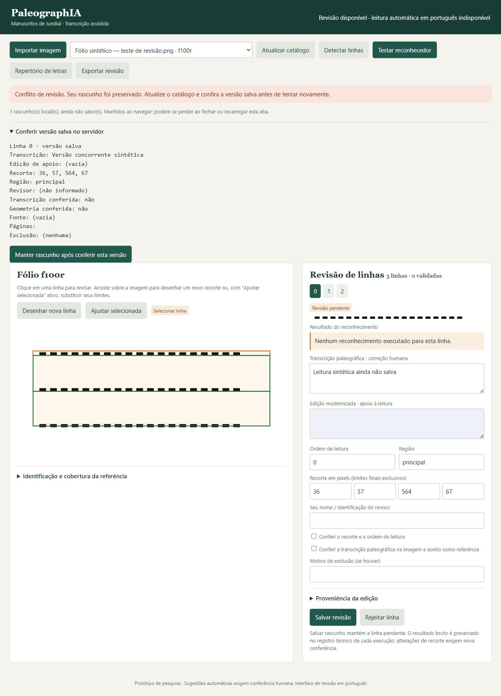

# Correções após revisão — 15/10/2026

Complemento da entrega inicial do commit `756492c`, na mesma branch
`codex/refatoracao-piloto`, com base em `master`. Os resultados anteriores de
reconhecimento em `execution_report.md` e `diagnostico_reconhecimento.json`
permanecem históricos. Esta entrega verifica software; não melhora nem avalia
pesos de HTR.

## Comportamentos corrigidos

| Problema | Implementação e efeito |
| --- | --- |
| Partição filtrada antes da validação | `experiments.py` valida a integridade e partição do catálogo completo; só depois exige referência humana na seleção. `validation.json` registra `global`, `selected` e a validade conjunta. Vazamento, catálogo inválido ou seleção vazia geram comparação não executada; a CLI retorna 2. |
| Cobertura truncada ao salvar identificação | `web/review.js` permite selecionar, adicionar e remover regiões explicitamente. Créditos/identificação não enviam coberturas sem alteração. Edição de uma região preserva as demais e seus campos adicionais. `services.py` preserva a proveniência das coberturas inalteradas, inclusive revisor e data; só atualiza as linhas/divisões se documento ou fólio mudarem. |
| Perda de alterações locais | Rascunhos por linha e página incluem todos os campos do formulário, regiões e geometria. Seleção, troca de fólio, atualização e diagnóstico os preservam. Erros 409/422/rede não limpam a edição. O salvamento confirmado limpa apenas o rascunho correspondente. |

A remoção ou renomeação de uma região com linhas associadas retorna conflito,
sem nova revisão. É preciso reatribuir essas linhas explicitamente antes da
remoção. Revisões anteriores continuam imutáveis.

Uma revisão concorrente da mesma entidade conserva a revisão base antiga do
rascunho: atualizar o catálogo não libera a sobrescrita. A interface mostra a
versão salva e exige **Manter rascunho após conferir esta versão** antes de
mudar a base. Campos e regiões sem edição local incorporam a versão atual;
a gravação ainda depende de **Salvar** e da conferência de revisão no servidor.
Alterações em outras entidades podem atualizar a revisão base quando a entidade
do rascunho permanece idêntica.

Os rascunhos ficam somente na memória da aba. Há aviso de saída/recarregamento
via `beforeunload`, sujeito ao navegador; não há promessa de recuperação após
fechamento. A tela distingue rascunho local de revisão persistida.

O JavaScript foi separado do HTML para testar o mesmo arquivo servido em
`/review.js`. `api.py` e `pyproject.toml` incluem sua rota e empacotamento.

## Verificações desta entrega

Ambiente local: Windows, Python 3.12.14 da `.venv`. Comandos na raiz:

```powershell
python -m pip install -e ".[test]"
python -m pytest -q
node --test tests/web_review.test.cjs
python -m compileall -q src server tests scripts
python -m paleographia --help
python -m pip check
```

- **46 testes Python passaram**, incluindo 14 novos casos. Continua um aviso
  de depreciação de Starlette/AnyIO, sem falha.
- **16 testes da interface passaram** em DOM simulado, usando o JavaScript real
  e os módulos nativos `node:test`/`vm`, sem pacote adicional. Node.js 22 é
  configurado na matriz de CI; a instalação básica da aplicação continua
  exigindo somente Python.
- Instalação editável, compilação, CLI e dependências passaram.
- As regressões de partição e proveniência falharam ao executar os testes
  selecionados sobre cópias dos módulos do commit anterior. As regressões de
  truncamento e descarte do texto também falharam contra seu JavaScript inline.
  Essas falhas foram esperadas e confirmam a detecção dos defeitos.

`tests/test_compare.py` cobre vazamento por documento, grupo, fólio, fonte,
derivação direta e ancestral compartilhado. Os testes bloqueados proíbem até
a inicialização do reconhecedor, além da segmentação e reconhecimento.
Também cobrem catálogo íntegro com referência pendente fora da seleção,
exploração de um único grupo, seleção vazia, registro inválido e código de
saída da CLI.

`tests/test_page_regions.py` confere zero/uma/duas regiões, proveniência e
histórico imutáveis, revisão otimista, edição da segunda região, reabertura
do serviço e tratamento explícito das linhas antes de remover uma região.
`tests/web_review.test.cjs` confere o PATCH produzido pela interface e os
comportamentos observáveis do editor, incluindo falhas e revisão concorrente.

Evidência sintética adicional: [correcoes_evidencias.json](correcoes_evidencias.json).
Na partição inválida, a seleção isolada era válida, mas o catálogo completo e
a validade final ficaram falsos: **zero chamadas de segmentação/reconhecimento**.
No caso independente, os três caminhos concluíram usando um reconhecedor e
segmentadores substitutos exclusivos do teste. Isso não executa Kraken real
nem mede qualidade de leitura de manuscrito.

## Conferência em navegador real

Foi usada uma instância isolada em `127.0.0.1:8001`, com marcas sintéticas e
reconhecedor exclusivo de teste, sem gravar no workspace do piloto. Conferidos:

1. Digitar, clicar na mesma linha, alternar linhas e atualizar o catálogo
   mantém o texto.
2. Salvar créditos mantém duas regiões e a proveniência anterior da primeira.
   Editar a segunda mantém a primeira integralmente.
3. Uma alteração concorrente por API causa 409 sem apagar o texto; atualizar
   mostra a versão concorrente junto do rascunho.
4. O diagnóstico preserva o texto; a conferência explícita da versão e o
   salvamento permitem reabrir a página com a leitura gravada e ambas as regiões.



A troca de fólios, todos os campos, os erros de rede/422, a proteção de saída e
a incorporação de campos remotos não editados foram cobertos pelo DOM simulado.
A caixa de saída nativa do navegador não foi acionada manualmente. Não se
declara teste automatizado completo em múltiplos navegadores.

## Preservação e pendências científicas

Os hashes de **274 arquivos anteriores**, abrangendo `data`, `output`,
`experiments`, `models` e o diagnóstico versionado, foram comparados antes e
depois: nenhum alterado. Catálogo, resultados brutos, revisões imutáveis e
originais permanecem iguais. O workspace continua em
`20261015T152646_ce045fe6`: três fólios, 94 candidatos e zero linhas completas
validadas. Repertório: 13 exemplos, seis confirmações parciais, `hum` provável.
Nenhum nome de revisor ou validação humana foi acrescentado ao piloto.

`automatic_transcription_enabled=false` foi preservado. Nesta entrega não
houve inferência real de TrOCR, download de modelos, Kraken real, ajuste fino
ou CER/WER do acervo. Referência diplomática, cobertura e protocolo continuam
pendentes; quantidades de linhas não criam grupos documentais independentes.
A próxima etapa humana está em [runbook.md](runbook.md).
