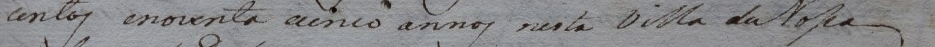
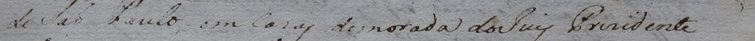
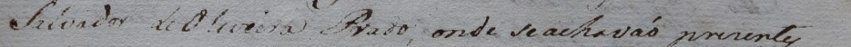
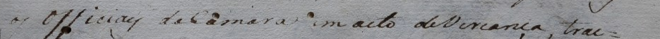
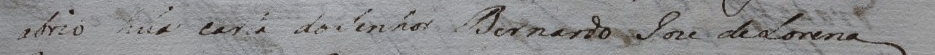

# Sessão de 1795 — primeiro bloco candidato

Oito recortes candidatos do corpo, correspondentes às linhas editoriais 4–11 da página 3. A edição é modernizada; o alvo histórico está vazio. Geometria, cobertura, alinhamento e texto continuam pendentes. Não houve nova aprovação humana.

Créditos: transcrição e edição de Gilson Santos Lino; revisão de Isabella Ferraro (AHMJ).

O nome original e a edição identificam o fólio 91r. Confirmar a correspondência e o numeral no canto superior direito. A reprodução também aparece na página 4 do PDF, com qualidade/codificação diferentes.

[Página inteira](context.jpg) · [Limites sobrepostos](overlay.jpg) · [Manifest de linhas](lines.jsonl) · [Manifest de página](pages.jsonl)

A revisão precisa confirmar os limites de cada recorte e registrar a forma histórica visível, preservando caixa, grafia, abreviaturas e sinais. O hífen de “trat-” na edição não é confirmação do sinal físico no manuscrito. Não completar letras com saídas de reconhecedores.

## Recorte 1 — linha editorial 4

ID: `l_24b904b9ad9473450172`. Coordenadas no original: `[95, 325, 1030, 377]`.


**Publicado (modernizado):** Aos vinte e cinco dias do mês de junho de mil sete

**Alvo histórico:** não adotado; aguarda leitura humana. **Geometria:** pendente.

## Recorte 2 — linha editorial 5

ID: `l_b8a06d58bd7cced4f3a2`. Coordenadas no original: `[95, 374, 1030, 421]`.



**Publicado (modernizado):** centos e noventa e cinco anos nesta Vila de Nossa

**Alvo histórico:** não adotado; aguarda leitura humana. **Geometria:** pendente.

## Recorte 3 — linha editorial 6

ID: `l_4882de66b18aa948f2a4`. Coordenadas no original: `[95, 416, 1030, 468]`.


**Publicado (modernizado):** senhora do Desterro de Jundiaí Comarca da Cidade

**Alvo histórico:** não adotado; aguarda leitura humana. **Geometria:** pendente.

## Recorte 4 — linha editorial 7

ID: `l_98962db568a2f74aab38`. Coordenadas no original: `[95, 466, 1030, 517]`.



**Publicado (modernizado):** de São Paulo em casas de morada do Juiz Presidente

**Alvo histórico:** não adotado; aguarda leitura humana. **Geometria:** pendente.

## Recorte 5 — linha editorial 8

ID: `l_27cb89d5763a6e64c484`. Coordenadas no original: `[95, 514, 1030, 566]`.



**Publicado (modernizado):** Salvador de Oliveira Prado, onde se achavam presentes

**Alvo histórico:** não adotado; aguarda leitura humana. **Geometria:** pendente.

## Recorte 6 — linha editorial 9

ID: `l_6077eea6d3ac418348ec`. Coordenadas no original: `[95, 563, 1030, 619]`.



**Publicado (modernizado):** os oficiais da Câmara em ato de vereança, trat-

**Alvo histórico:** não adotado; aguarda leitura humana. **Geometria:** pendente.

## Recorte 7 — linha editorial 10

ID: `l_40d2333b12328973de24`. Coordenadas no original: `[95, 614, 1030, 669]`.


**Publicado (modernizado):** ando sobre o bem comum do povo, na mesma se

**Alvo histórico:** não adotado; aguarda leitura humana. **Geometria:** pendente.

## Recorte 8 — linha editorial 11

ID: `l_53dcba6fe1e315e30873`. Coordenadas no original: `[95, 666, 1030, 721]`.



**Publicado (modernizado):** abriu uma carta do Senhor Bernardo José de Lorena

**Alvo histórico:** não adotado; aguarda leitura humana. **Geometria:** pendente.

## Revisar no editor existente

Usar um workspace novo e separado das revisões históricas. Estes comandos importam somente o bloco candidato; o catálogo já importado não deve ser sobrescrito.

```powershell
.venv/Scripts/python.exe -m paleographia import-catalog --config configs/curation_sessao_1795.toml --pages docs/dataset_expansion_20261023/curation_sessao_1795_bloco01/pages.jsonl --lines docs/dataset_expansion_20261023/curation_sessao_1795_bloco01/lines.jsonl
.venv/Scripts/python.exe -m paleographia serve --config configs/curation_sessao_1795.toml --host 127.0.0.1 --port 8012
```

O servidor não foi iniciado nesta entrega. A configuração desativa sugestões automáticas. Confirmar correspondência/cobertura e cada linha pelos controles explícitos do editor, registrando revisor e data; exportar a revisão para uma pasta nova.
