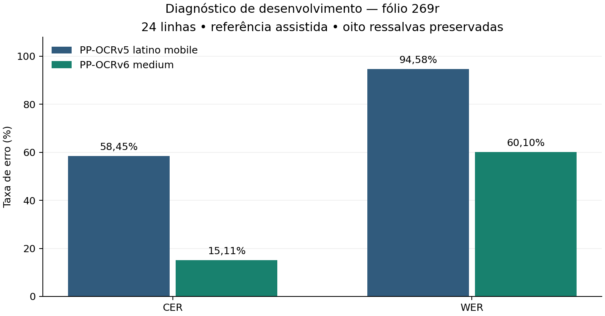

# Diagnóstico de PP-OCRv5 e PP-OCRv6 na transcrição assistida de 24 linhas do fólio 269r

**Rascunho com fundamentação ampliada — PI IV e PLN — 23 de outubro de 2026**

Versão aditiva ao rascunho de 22/10, com leitura integral de T1 e T4 por IA.
Revisão dos autores pendente; resultados do diagnóstico de 20/10 preservados.
**Diagnóstico de desenvolvimento; mesmos alvos, saídas e métricas.**

Caio Augusto de Souza Soares · Guilherme Rodrigues Veiga · Rodolfo Vinicius Cima Takemoto · Tiago Galhardo Avelar

caio.soares01@aluno.cps.sp.gov.br · guilherme.veiga1@aluno.cps.sp.gov.br · rodolfo.takemoto@aluno.cps.sp.gov.br · tiago.avelar@aluno.cps.sp.gov.br

**Professor informado:** Leonardo de Lellis Rossi — leoboralelis@gmail.com  
**Faculdade de Tecnologia de Jundiaí (FATEC Jundiaí)**  
Ciência de Dados — 5º semestre  
Jundiaí – SP  
**Modelo e limite de páginas:** a confirmar em cada disciplina.

## Resumo

Este trabalho apresenta um diagnóstico de desenvolvimento de dois reconhecedores
pré-treinados aplicados a 24 linhas consecutivas de um manuscrito histórico em
português. Comparam-se latin PP-OCRv5 mobile, em ONNX, e PP-OCRv6 medium, em
Kraken, usando os mesmos recortes do fólio 269r do Traslado do Auto de Criação da
Vila de Jundiaí. Os alvos combinam conferência humana e apoio de edição publicada,
preservando as oito ressalvas históricas da versão avaliada. Uma reconferência
posterior documentou confirmações pontuais e dúvidas remanescentes, sem mudar os alvos. O protocolo preserva grafia, caixa e diacríticos
e agrega contagens de cinco blocos completos. O PP-OCRv5 apresentou CER de
58,45% e WER de 94,58%; o PP-OCRv6, CER de 15,11% e WER de 60,10%. A análise
aponta perda de conteúdo no primeiro e problemas de espaçamento, letras e
acentuação no segundo. Os arquivos congelados e o notebook permitem auditar
os cálculos. O estudo permanece restrito a um documento usado no desenvolvimento,
sem teste reservado ou inferência de generalização.

**Palavras-chave:** reconhecimento de manuscritos; português histórico; referência assistida; CER; WER; reprodutibilidade.

## 1. Introdução

A conversão de documentos históricos em texto pesquisável depende de escolhas
que ultrapassam a identificação de letras. Grafias, abreviaturas, espaços e
sinais de pontuação precisam de representação explícita para que a avaliação
automática seja interpretável. No contexto do português histórico, a organização
de corpora e de suas representações já foi discutida por Sousa e Trippel (2006),
que relacionam a padronização da marcação ao aproveitamento e à preservação dos
recursos documentais. [Sousa e Trippel, 2006](https://aclanthology.org/L06-1222/).

O projeto PaleographIA dispõe de um fluxo local de reconhecimento e revisão
assistida. No diagnóstico de 20/10 aqui analisado, o escopo foi mantido: não
foram acrescentadas funções ao sistema, novos reconhecedores ou mecanismos de
pós-correção. O objetivo foi
organizar uma comparação verificável entre duas configurações já disponíveis.
A pergunta deste diagnóstico é: **como latin PP-OCRv5 mobile e PP-OCRv6 medium
se comportam sobre os mesmos 24 recortes, sob uma política de referência assistida
que preserva as dúvidas de leitura?**

A contribuição é um estudo piloto com alvos e saídas rastreáveis, contagens
reproduzíveis e análise de divergências. A comparação não constitui treinamento
de um novo modelo nem avaliação representativa de todo o acervo.

## 2. Fundamentação teórica

### 2.1. Reconhecimento de manuscritos e trabalho arquivístico

O reconhecimento de texto manuscrito (HTR) integra um processo que envolve
imagem, organização do layout, transcrição de referência e uso posterior do
texto. Muehlberger et al. (2019, p. 958–963), ao estudar o Transkribus,
descrevem essa articulação e distinguem a obtenção de texto pesquisável da
fidelidade de uma transcrição. O artigo reúne experiências arquivísticas com
línguas, mãos e condições diferentes; seus resultados não constituem um
benchmark uniforme. Para o PaleographIA, esse contexto fundamenta a separação
entre saída automática, edição de apoio e revisão humana, como decisão do
projeto, sem presumir economia de esforço ainda não medida.

### 2.2. Referência textual e decisões de representação

Muehlberger et al. (2019, p. 959–960) enfatizam a consistência das transcrições
usadas no treinamento, incluindo grafias, abreviaturas e símbolos, admitindo
também convenções normalizadas conforme a finalidade. Em diálogo com a
organização de corpora históricos discutida por Sousa e Trippel (2006), isso
exige declarar a representação adotada antes de interpretar divergências.
No diagnóstico local, conservar `Magᵈᵉ`, caixa, diacríticos e quebras físicas
é uma escolha documentada. As oito ressalvas permanecem parte da referência
assistida: consistência computacional não equivale a certeza paleográfica,
nem a literatura resolve as dúvidas de leitura do fólio.

### 2.3. Reconhecedores e adaptação ao domínio histórico

O relatório PaddleOCR 3.0 descreve PP-OCRv5 e configurações multilíngues
(Cui et al., 2025). Aqui, o objeto é um checkpoint latino mobile convertido
para ONNX, apoiado na documentação RapidOCR, não a reprodução de todo o
relatório. O PP-OCRv6 medium utilizado é distribuído para Kraken por Kiessling
(2026b), cuja ficha registra diversidade de convenções de transcrição no
pré-treino. A ficha de pesos e o estudo experimental são fontes distintas.

No preprint experimental, Kiessling (2026a, p. 3–6) adapta PP-OCRv6 para linhas
históricas com LCNetV4, LightSVTR e saída CTC, ampliando a altura das entradas
e preservando sua proporção com largura variável. O ramo autorregressivo NRTR
é auxiliar no treinamento e descartado na inferência; CTC não implica que a
arquitetura seja recorrente. A comparação com uma CRNN distingue treino do
zero, pré-treino generalista e ajuste fino. Os resultados dependem da variante,
dos dados e do orçamento; não sustentam uma vantagem universal da arquitetura.
No estudo, o CER pode aumentar após ajuste, inclusive com poucos exemplos
(Kiessling, 2026a, p. 8–9). Isso justifica avaliar adaptações com protocolo
próprio, sem tomar a execução de treinamento como prova de melhora.

### 2.4. Métricas, domínio e limites de comparação

CER e WER descrevem divergências em relação a uma referência definida, sob
normalização e agregação específicas. Kiessling (2026a, p. 6) usa Unicode NFD
e conversão dos caracteres de espaço para U+0020; este diagnóstico usa NFC e
colapso de espaços. A média macro por língua da tabela 5 daquele estudo
também difere da microagregação local de cinco blocos. Assim, suas taxas não
servem como comparação direta ou previsão de desempenho em Jundiaí.

O teste de poucos exemplos de T4 usa treino e avaliação da mesma página, e
o artigo explicita que MAKHZAN não tem teste separado por documento
(Kiessling, 2026a, p. 5). Esses limites reforçam a necessidade de declarar a
unidade de divisão. No PaleographIA, as 24 linhas de um documento de
desenvolvimento permitem diagnóstico local, sem estimar transferência para
outros documentos ou escribas.

T1 e T4 foram lidos integralmente por IA para esta versão, com páginas e limites
registrados nos fichamentos. As outras fontes mantêm o escopo de consulta
registrado na bibliografia. Esta fundamentação dirigida não conclui a revisão
sistemática de PI IV; a conferência humana e a seleção final continuam pendentes.

## 3. Corpus e construção dos alvos assistidos

O objeto está identificado no acervo municipal pelo código PT/TT/PBR/0004/026.
A ficha institucional descreve um traslado produzido em 1767, relativo ao ato
de criação da vila em 1656. Essa distinção impede tratar a data do acontecimento
como data direta da cópia analisada. O recorte experimental contém somente as
24 linhas do corpo do fólio 269 reto, sem cabeçalho, resumo ou verso.
[Acervo Digital de Jundiaí, ficha do traslado](https://jundiai.sismu.app/obra/102201/traslado-do-auto-de-criacao-da-vila-de-jundiai-no-ano-de-1656-a-14-dezembro).

A edição de apoio é atribuída a Ana Caroline Carvalho Miranda no catálogo;
o PDF consultado registra Thiago Paschoal como revisor. Rodolfo Vinícius Cima
Takemoto realizou a conferência humana registrada no projeto. A edição foi
adotada nas dúvidas, com manutenção das decisões e ressalvas no histórico.
[Ficha da transcrição paleográfica](https://jundiai.sismu.app/obra/100529/transcricao-paleografica-do-traslado-do-auto-de-criacao-da-vila-de-jundiai-no-ano-de-1656-a-14-dezembro).

Os limites, a ordem e a cobertura foram confirmados em cinco blocos: 1–5, 6–10,
11–15, 16–20 e 21–24. Na versão congelada de 20/10, dezesseis linhas têm estado validado
e oito preservam ressalvas históricas; esses estados não foram promovidos nesta
revisão. Todas as 24 foram incluídas. O conjunto de avaliação separado contém
`texto_alvo`, estado visual original e observações, sem alterar o catálogo humano
ou promover as pendências a validação independente.

| Linha | Ressalva histórica no alvo assistido de 20/10 |
| --- | --- |
| 11 | Requererão; sinal superior/final e pontuação |
| 15 | , e ficaram |
| 16 | , e da villa de |
| 17 | ministros, primeira vogal e segmentos intermediários/de Jus |
| 19 | orgente, inicial e pontuação |
| 20 | muito Grande detrimento de to |
| 23 | Justissa, especialmente os dois s |
| 24 | Base Mag e pontuação; de elevado confirmado |

Preservaram-se `Eram`, `Com` e `Como`, confirmados na conferência, e `que mais`
separado conforme a edição, com nota sobre a escrita ligada. A linha final
mantém `Magᵈᵉ`; `Magestade` é o desenvolvimento editorial registrado em campo
separado. As quebras físicas também foram conservadas, inclusive fragmentos
como `Capi/tão`, `Par/nahiba` e `Jus/tissa`.

### 3.1. Reconferência posterior e escopo das decisões

Em 21/10/2026, o mesmo revisor, Rodolfo Vinícius Cima Takemoto, reconferiu
os oito casos com recortes do manuscrito e apoio da edição. A consolidação
contém 17 registros humanos com autoria, horários e hashes. Trata-se de etapa
posterior ao experimento, sem segunda leitura humana independente, alteração
dos alvos ou novo total de linhas validadas no catálogo.

| Linha | Decisão posterior | Dúvida e limite mantidos |
| --- | --- | --- |
| 11 | Requererão conforme a edição | Natureza do sinal superior/final e pontuação em aberto |
| 15 | e ficaram e vírgula após moradores confirmados | Confirmação pontual, sem nova aprovação de toda a linha |
| 16 | e da villa de e vírgula após Paulo confirmados | Mantidas a quebra Par/nahiba e as decisões anteriores |
| 17 | e não poderem vir, m inicial, os, de Jus e vírgula após nahiba confirmados; ministros conforme a edição | Decisão mista, com menistros preservado no histórico; não é leitura independente da edição |
| 19 | orgente conforme a edição; vírgula confirmada | Inicial o/e permanece visualmente duvidosa; a consulta ao PDF por IA não confirma humanamente a letra |
| 20 | muito Grande detrimento de to confirmado | Mantidos Com maiúsculo e a quebra to/dos; confirmação do trecho |
| 23 | Justissa conforme a edição | Dois s continuam duvidosos; J antes confirmado; por falta de não recebeu nova confirmação isolada |
| 24 | Mag provável, de elevado reconfirmado | Pontuação final em aberto; Magᵈᵉ não é substituído por Magestade |

As confirmações pontuais nas linhas 15, 16 e 20 não apagam as ressalvas
históricas da avaliação. A linha 17 combina leitura visual e adoção editorial;
as linhas 11, 19, 23 e 24 conservam dúvidas visuais expressas. Não se atribuiu
automaticamente caixa às letras a partir da capitalização das mensagens do
revisor, nem se classificou o sinal final como ponto, til ou interrogação.

A [consolidação publicada](https://github.com/aj1no/paleographia-htr/blob/27b547d0203b566ca5cf17c1378f64ce46ae5b1a/docs/revisao_humana/traslado_269r/reconferencia_ressalvas_20261021/consolidacao.md)
vincula cada decisão a seus registros e recortes. O notebook exporta uma tabela
com o alvo e a ressalva originais, as decisões posteriores, os limites, a autoria
e os caminhos e hashes das evidências. O pacote de 20/10 permanece preservado.

## 4. Método

### 4.1. Condições da comparação

No experimento de 20/10, os alvos foram congelados antes das duas execuções
daquela etapa. Cada reconhecedor
recebeu os mesmos 24 PNGs, na mesma ordem, por meio de um manifesto sem texto
humano. Ambos operaram em CPU e float32, com pesos identificados por SHA-256.
O PP-OCRv5 utilizou ONNX Runtime; o PP-OCRv6, Kraken 7.1 em contêiner local com
imagem fixada. Cada configuração manteve seu pré-processamento nativo,
documentado nas saídas brutas.

Não foram executados detector de linhas, treinamento, ajuste fino ou pós-correção.
Logo, o experimento controla os recortes de entrada e compara as configurações
completas de reconhecimento; não isola o efeito causal de mudar apenas a versão
da arquitetura. Há diferenças de variante, pré-treino e implementação.

### 4.2. Métricas e unidade de agregação

Aplicaram-se Unicode NFC e colapso de espaços à referência e às saídas,
preservando caixa, diacríticos e grafia. Para cada bloco completo, concatenaram-se
as linhas em ordem com um espaço. Somaram-se as operações dos cinco blocos antes
da divisão, sem média simples de taxas por linha:

**CER = (S + D + I) / Ncar**  
**WER = (S + D + I) / Npal**

S representa substituições, D deleções e I inserções; Ncar e Npal são os totais
de caracteres e palavras da referência. Uma falha seria contada como saída
vazia, sem excluir a linha. As 48 inferências do experimento de 20/10 terminaram sem falhas.
Os denominadores microagregados foram 1.112 caracteres e 203 palavras. Os
espaços internos aos blocos entram em Ncar; os quatro limites entre blocos não
acrescentam caracteres. Taxas por linha foram usadas somente no diagnóstico.

### 4.3. Rastreabilidade e reprodução

As funções existentes `counts` e `aggregate` calcularam o diagnóstico assistido.
O validador estrito de referência humana permaneceu inalterado. A auditoria
verifica hashes, pixels, correspondência de IDs e preservação das ressalvas,
além de conferir as distâncias por uma implementação independente de Levenshtein.
Os casos de alteração de alvo, saída bruta e promoção indevida de ressalva foram
rejeitados em cópia de teste. O notebook recalcula os resultados sem carregar
modelos, e as duas inferências podem ser repetidas separadamente em nova pasta.

A reexecução de 22/10 reproduz somente os cálculos contra a referência congelada
de 20/10. A reconferência posterior é informação de proveniência e interpretação;
não foi usada para selecionar linhas, mudar o protocolo ou recalcular uma nova
referência. Não houve nova inferência, treinamento ou pós-correção.

## 5. Resultados

| Reconhecedor | CER | Operações / caracteres | WER | Operações / palavras |
| --- | ---: | ---: | ---: | ---: |
| latin PP-OCRv5 mobile / ONNX | 58,45% | 650 / 1.112 | 94,58% | 192 / 203 |
| PP-OCRv6 medium / Kraken | 15,11% | 168 / 1.112 | 60,10% | 122 / 203 |

O PP-OCRv6 apresentou menos divergências em ambos os níveis, com diferenças de
43,35 pontos percentuais em CER e 34,48 em WER. Esses valores descrevem apenas
o alvo e as condições deste diagnóstico. Não são porcentagens simples de acerto
nem evidência de superioridade geral em documentos desconhecidos.

**Figura 1.** Taxas microagregadas dos cinco blocos. Referência assistida pela
edição; oito ressalvas preservadas. Sem estimativa de intervalo de confiança.

Em caracteres, o PP-OCRv5 acumulou 200 substituições, 444 deleções e seis
inserções; o PP-OCRv6, 96 substituições, 54 deleções e 18 inserções. Em palavras,
os totais foram, respectivamente, 108/84/0 e 95/22/5. O bloco 21–24 apresentou
o maior CER em ambos os reconhecedores: 71,20% e 21,74%.

## 6. Discussão e análise de divergências

No PP-OCRv5, a perda de conteúdo domina o alinhamento. Na linha 22, o alvo
`por titullos de Sismaria as Lavrão outros que mais` resultou em `tiay cm es uhy g`.
O exemplo mostra por que uma configuração de OCR disponível não pode ser
considerada suficiente para este manuscrito sem avaliação local.

O PP-OCRv6 conserva mais conteúdo, mas junta palavras, como `Anno do → Annodo`,
e as separa indevidamente, como `Cabedo → Cabe do` e `onde → on de`. Há trocas
como `Jundiahy → Sundiahy`, `Sismaria → Sismario` e perda de letra em
`titullos → titllos`. `Capitão → Capitao.` combina divergência de acento e
pontuação. Essas diferenças ajudam a interpretar o WER ainda elevado: a
correspondência de palavras inteiras é afetada mesmo por diferenças pequenas.

Não se devem tratar todas as divergências como decisões paleográficas resolvidas.
`ministros/menistros`, `orgente/ergente`, `Justissa` e os sinais finais coincidem
com ressalvas históricas da referência. A reconferência posterior manteve
ministros conforme a edição, a inicial de orgente duvidosa e os dois s de Justissa
em aberto; portanto essas saídas não decidem as ambiguidades paleográficas. Na última linha, `Magᵈᵉ → Magi` envolve
também a convenção de representar uma abreviatura com caracteres elevados.
As operações são computadas contra o alvo escolhido, sem decidir a leitura
histórica somente pelo resultado do reconhecedor.

A distinção entre busca e transcrição discutida por Muehlberger et al.
(2019, p. 963) ajuda a interpretar a utilidade possível de uma saída imperfeita,
mas não demonstra eficácia de busca ou redução do trabalho de revisão neste
projeto. Kiessling (2026a, p. 8–9) acrescenta que adaptação e volume de exemplos
não produzem ganhos uniformes. No MAKHZAN, o medium aumenta o CER macro de
17,99% para 18,82% após ajuste, enquanto o WER macro diminui de 59,06% para
58,37%. Esse resultado externo sustenta cautela na interpretação de métricas,
sem explicar causalmente os erros locais ou validar o ajuste fino do PaleographIA.

## 7. Limitações e ameaças à validade

O estudo contém um documento e 24 linhas; as linhas não constituem amostras
documentais independentes. O fólio foi usado no desenvolvimento e em consultas
lexicais anteriores, portanto não é conjunto reservado. Não se realizou teste
estatístico, estimativa de generalização ou avaliação de escribas diferentes.

A referência avaliada utiliza a edição nas dúvidas e mantém oito ressalvas
históricas. As confirmações posteriores não tornam a referência independente
da edição nem constituem avaliação em dados reservados. Parte do erro
pode refletir essas escolhas de representação. As diferenças entre corpora de
pré-treino, variantes e ambientes também impedem atribuir a diferença somente
ao número da versão. Eventual sobreposição entre o documento e os corpora de
pré-treino externos não foi auditada. Os tempos de uma única execução, com
implementações e limites de CPU distintos, não sustentam conclusão de velocidade.
Não foram medidas economia de esforço humano ou qualidade de tarefas posteriores
de PLN, como busca ou extração de entidades.

Para uma ampliação, deve-se reservar outros documentos antes de usá-los em
seleção de configurações. A meta de 30–50 linhas é operacional, não garantia
de representatividade. A revisão sistemática e a adequação às rubricas de
PI IV e PLN permanecem pendentes. O protocolo bibliográfico foi atualizado em
21/10 e B01/B02 recuperaram cinco IDs distintos no arXiv. A leitura integral
por IA de T1 e T4 foi concluída em 23/10; as demais leituras, a triagem formal
e as decisões finais seguem pendentes. Recuperação ou fichamento por IA não
significam inclusão definitiva
([registros reais das buscas](../../bibliografia/arxiv_b01_b02_20261021/README.md)); não se presume aprovação acadêmica deste desenho.

## 8. Conclusão

Nos mesmos 24 recortes e sob a política textual explicitada, o PP-OCRv6 medium
apresentou menos divergências que o latin PP-OCRv5 mobile. O WER de 60,10%
mantém a revisão humana como componente necessário do fluxo observado.
O principal resultado desta etapa é um diagnóstico auditável, com saídas brutas,
alvos assistidos e dúvidas preservadas. A conclusão limita-se a esse documento
de desenvolvimento; sua extensão exige avaliação em novos documentos.

Esta versão conserva as taxas e microcontagens publicadas, sem novo experimento
ou inferência. A contribuição adicional é a fundamentação da política textual
e dos limites de transferência, articulada à reconferência já documentada;
não há evidência nova de melhora de desempenho.

## Disponibilidade e uso de ferramentas de IA

O [experimento congelado](https://github.com/aj1no/paleographia-htr/tree/7c9a1b7942fec4f5c7809ccc23e6f96ce44f665b/docs/experimentos/traslado_269r_reconhecedores_24_20261020)
reúne alvos, saídas, configuração, hashes e auditores. O
[notebook da entrega de 22/10](../pi_iv_pln_20261022/README.md) recalcula as métricas,
gera tabelas e figuras e verifica a preservação dos arquivos. Esta atualização
textual reutiliza esses resultados e a figura, sem gerar novo pacote experimental.
O ensaio técnico de ajuste fino de 23/10 está documentado separadamente no
[relatório de expansão](../../dataset_expansion_20261023/README.md); seus dois
passos de otimização não integram a comparação de reconhecedores deste artigo.
As condições de uso da edição e das imagens são próprias; a licença MIT refere-se
ao código do projeto.

Codex auxiliou a organização dos artefatos, a redação deste rascunho e a execução
das verificações. T1 e T4 foram lidos integralmente por IA, com
[fichamentos, PDFs e proveniência](../../bibliografia/leitura_t1_t4_20261023/README.md).
As decisões humanas de leitura e os respectivos escopos estão
no histórico, separadas das saídas de reconhecimento. Os autores devem revisar
o texto, as referências, os créditos e as interpretações antes da entrega.

## Referências

SOUSA, Maria Clara Paixão de; TRIPPEL, Thorsten. *Building a historical corpus for Classical Portuguese: some technological aspects*. LREC, 2006. [Registro e resumo](https://aclanthology.org/L06-1222/).

CUI, Cheng et al. *PaddleOCR 3.0 Technical Report*. arXiv:2507.05595, 2025. DOI: [10.48550/arXiv.2507.05595](https://doi.org/10.48550/arXiv.2507.05595).

MUEHLBERGER, Guenter et al. *Transforming scholarship in the archives through handwritten text recognition: Transkribus as a case study*. Journal of Documentation, v. 75, n. 5, p. 954–976, 2019. DOI: [10.1108/JD-07-2018-0114](https://doi.org/10.1108/JD-07-2018-0114).

KIESSLING, Benjamin. *A Free Lunch? Adapting PP-OCRv6 for Historical Text Recognition*. arXiv:2609.20064v1, 17 set. 2026a. Preprint; revisão por pares não comprovada. DOI: [10.48550/arXiv.2609.20064](https://doi.org/10.48550/arXiv.2609.20064). [Versão lida](https://arxiv.org/abs/2609.20064v1).

KIESSLING, Benjamin. *PP-OCRv6 (medium) multilingual handwritten and printed text recognition model*. Versão v1. Zenodo, 2026b. DOI: [10.5281/zenodo.21788410](https://doi.org/10.5281/zenodo.21788410).

RAPIDAI. *RapidOCR: lista de modelos*. Documentação técnica. [Fonte](https://rapidai.github.io/RapidOCRDocs/main/en/model_list/). Consulta em 20 out. 2026.

JUNDIAÍ. Acervo Digital. *Traslado do Auto de Criação da Vila de Jundiaí*. Ficha PT/TT/PBR/0004/026. [Fonte institucional](https://jundiai.sismu.app/obra/102201/traslado-do-auto-de-criacao-da-vila-de-jundiai-no-ano-de-1656-a-14-dezembro). Consulta em 20 out. 2026.

MIRANDA, Ana Caroline Carvalho. *Transcrição paleográfica do Traslado do Auto de Criação da Vila de Jundiaí*. Revisão de Thiago Paschoal, conforme PDF consultado. Memorabilia Paleografia e Diplomática, [s.d.]. [Ficha institucional](https://jundiai.sismu.app/obra/100529/transcricao-paleografica-do-traslado-do-auto-de-criacao-da-vila-de-jundiai-no-ano-de-1656-a-14-dezembro). Consulta em 20 out. 2026.
