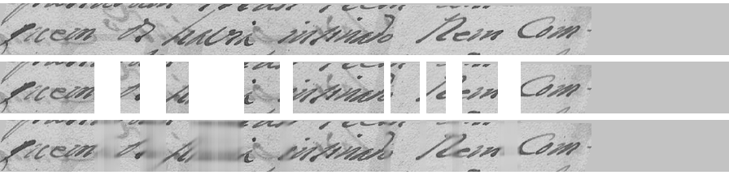

# Modelo do zero e treino não supervisionado — resultados

Dados: treino/inquisicao_zenodo13986218_cc_by_4_0: 12543, val_inq/inquisicao_zenodo13986218_cc_by_4_0: 953, treino/jundiai_ahmj_uso_nao_comercial: 191, val_jundiai/jundiai_ahmj_uso_nao_comercial: 10, alfabeto: 138, documentos_val_inq: 20

| Experimento | Linhas rotuladas | Passos | Checkpoint | CER val. Inquisição | CER 1795 | WER 1795 | CER 1767 | Min |
| --- | ---: | ---: | --- | ---: | ---: | ---: | ---: | ---: |
| Pesos aleatórios, todas as linhas rotuladas | 12734 | 25000 | passo 25000 | 20,60% | 16,23% | 53,73% | 32,81% | 138.9 |
| Pré-treino não supervisionado + todas as linhas rotuladas | 12734 | 25000 | passo 23000 | 16,32% | 15,94% | 50,75% | 24,22% | 131.4 |
| Pesos aleatórios, 5% das linhas rotuladas | 637 | 5000 | passo 3000 | 72,60% | 71,88% | 101,49% | 72,66% | 25.8 |
| Pré-treino não supervisionado + 5% das linhas rotuladas | 637 | 5000 | passo 5000 | 37,04% | 28,12% | 71,64% | 40,62% | 25.7 |
| Encoder aleatório congelado; só a saída aprende | 12734 | 3000 | passo 500 | 100,00% | 100,00% | 100,00% | 100,00% | 6.1 |
| Encoder do pré-treino congelado; só a saída aprende | 12734 | 3000 | passo 500 | 93,02% | 94,78% | 100,00% | 98,44% | 6.1 |

Referência do projeto principal na mesma validação de 1795 (7 linhas):

| Modelo | CER | WER |
| --- | ---: | ---: |
| PP-OCRv6 medium (pré-treinado, sem ajuste) | 14,20% | 56,72% |
| PP-OCRv6 ajustado A (Traslado) | 10,72% | 41,79% |
| PP-OCRv6 ajustado B (Traslado + Inquisição) | 10,14% | 38,81% |

De cima para baixo: linha original; linha com trechos apagados; trechos apagados preenchidos pelo modelo (contraste de cada coluna devolvido só para a figura).

## Linhas de Jundiaí transcritas pelo modelo do zero

| Documento | Referência | Modelo |
| --- | --- | --- |
| sessao_1795 | Aos vinte e cinco dias do mes de junho de mil sete | Aos vinte acenco dias do mes de Iunho de mil selhe |
| sessao_1795 | centos e noventa e cinco annos nesta Villa de Nˢᵃ | centos e nozenta uinco annos nesta villa da Nossa |
| sessao_1795 | senhora do Desterro de jundiahy comarca da cidade | Senhora do Pesterro de Jundiahi Comarça dez Cidade |
| sessao_1795 | de São Paulo, em casas de morada do Juiz Presidente | de saõ deuto em Cazas desnorada do Iuis Prezidente |
| sessao_1795 | Salvador de Oliveira Prado, onde se achavão presentes | Sivador de Oleveira Prado onde se achavaõ prezentes |
| sessao_1795 | os officiaes da Camara em acto de Vereança, trat- | os officiais de Camara, em acto devercança, traõ |
| sessao_1795 | ando sobre o bem commum do povo, na mesma se | lando sobre o bem commum do povo na mesma se |
| carta_jose_gomes_1767 | Paguem as Camaras, e a Razão por não | daquem as Camaras, calazao por q̄ nãõ |
| carta_jose_gomes_1767 | se as não tivessem seriam Srsˢ dos Desco- | peas nãõ tivessem Senão Srr.a dos Dezeu |
| carta_jose_gomes_1767 | bertos do campo verde, e de outros muⁱᵗᵒˢ que estão | dor do lampo erde, e de Outos m.to que esta |
