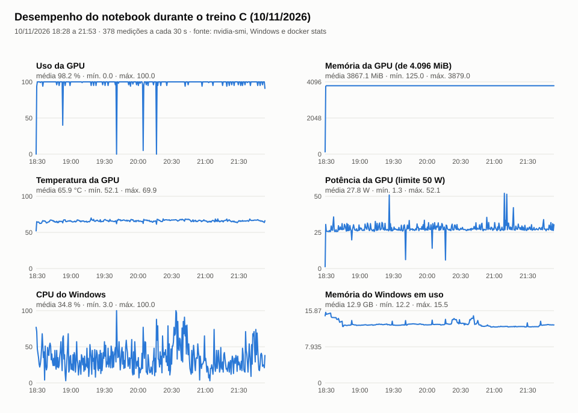

# Treino C gravado em 10/11/2026: PP-OCRv6 medium ajustado no Traslado + Posturas de 1831

Registro do ajuste fino feito com `gravar_treino.bat` (opção C), que chama
`scripts/treinar_ao_vivo.py C`. Como no B, a equipe gravou o começo em vídeo; o resto ficou
registrado pelos prints automáticos (`scripts/prints_treino.ps1`) e pelo registro de desempenho
(`scripts/desempenho_treino.ps1`).

## Execução

| Item | Valor |
|---|---|
| Início / fim | 10/11/2026 18h28 → 21h53 (204,7 min) |
| Commit do código | `6f1159055025f3713f5ec5d230c25da57c6c40bb` |
| Imagem Docker | `sha256:42207c02c3f0760e5fc576a5e07d0c2e408a88c0ea2279a223843bc9b8138fc5` (a mesma do B) |
| Dispositivo | NVIDIA GeForce GTX 1650 (4 GB), CUDA 12.6, FP32 |
| Dados de treino | 191 linhas do Traslado (as do A) + 94 linhas validadas das Posturas de 1831 (fólios 100r, 100v e 101r, revisão `20261110T183708_3179e19c` da aplicação oficial); 1 variante aumentada cada: 570 amostras. Sem a Inquisição do B. Pares em [`../../dados/pares_C.json`](../../dados/pares_C.json) |
| Validação | as mesmas 7 linhas humanas de 1795 do A e do B |
| Teste reservado | não usado (`test_used: false`) |
| Hiperparâmetros | iguais aos do A e do B: lote 2, acumula 4, taxa 2e-5 (cosseno, warmup 40), BatchNorm congelada, NFD, parada após 8 validações sem melhora |
| Passos do otimizador | 305: quatro épocas completas e 71 lotes da 5ª |
| Melhor checkpoint | `checkpoint_02-0.9109.ckpt` (passo 161, 3ª época), exportado como `best_0.9109.safetensors` |
| SHA-256 do peso exportado | `2b8e410fcb8d4d4c9d584ceb335e97719bbad1451fb853da8110df5da97150a2` |

O peso fica fora do Git por causa do tamanho: `models/ppocrv6_ajustado_C_20261110/medium_ajustado_C_gravado.safetensors`
na máquina que treinou. Uma tentativa anterior, às 15h38 no outro computador, foi interrompida antes do fim e não conta.

**Rótulos das Posturas não corrigidos.** Antes do treino, a comparação com a edição modernizada do
AHMJ mostrou leituras erradas em parte das 94 linhas validadas (lista no README da modernização,
seção "Versão 3"). Os pares foram usados como estavam; o C aprende também esses erros.

## Validações (acerto do `ketos`, 7 linhas)

| Época | Passo | Minutos | Caracteres | Palavras |
|---|---|---|---|---|
| 1 | 17 | 11,8 | 90,52% | 64,18% |
| 1 | 35 | 23,9 | 89,94% | 61,19% |
| 1 | 53 | 35,9 | 89,66% | 61,19% |
| 1 | 71 | 47,9 | 89,66% | 59,70% |
| 2 | 89 | 59,9 | 89,66% | 59,70% |
| 2 | 107 | 71,9 | 90,52% | 61,19% |
| 2 | 125 | 84,0 | 89,37% | 58,21% |
| 2 | 143 | 95,7 | 89,37% | 56,72% |
| **3** | **161** | **107,6** | **91,09%** | **61,19%** |
| 3 | 179 | 119,7 | 90,80% | 64,18% |
| 3 | 197 | 132,5 | 90,23% | 59,70% |
| 3 | 215 | 144,6 | 90,52% | 62,69% |
| 4 | 233 | 156,6 | 91,09% | 64,18% |
| 4 | 251 | 168,5 | 90,52% | 61,19% |
| 4 | 269 | 180,4 | 90,23% | 61,19% |
| 4 | 287 | 192,3 | 90,23% | 61,19% |
| 5 | 305 | 204,5 | 89,94% | 61,19% |

Diferente do B, o
melhor ponto não foi o primeiro: a 3ª época passou o recorde (91,09%). O passo 233 empatou e não
reiniciou a contagem, porque a melhora mínima é de 0,1 ponto.

## CER e WER em NFC (métrica do projeto)

Mesmas 7 linhas (345 caracteres), pelo worker de inferência do editor, com `scripts/avaliar_validacao.py`.
Base e A vêm do registro do B; B e C foram medidos de novo em 10/11 (o B deu o mesmo resultado;
[linhas](../../dados/avaliacao_validacao_B_C_nfc.json)):

| Modelo | CER | WER |
|---|---|---|
| PP-OCRv6 base | 14,20% | 56,72% |
| Ajustado A gravado (06/11) | 10,72% | 41,79% |
| Ajustado B gravado (07/11) | **10,14%** | **38,81%** |
| Ajustado C gravado (este treino) | 11,01% | 46,27% |

Em caracteres, o C fica 3 caracteres atrás do B (de 345). Ele lê melhor "São" e "Juis", que o B
lia "Saõ" e "Iuis", e piora em "vinte e cinco", "de mil sette", "dos" e "bem". Na contagem de
palavras o C perde mais (5 palavras em 67), porque junta palavras ("demil", "dopovo").
As 7 linhas são de outro documento (sessão de 1795), então elas não medem o que o C ganhou nas
Posturas. Essa medida é o experimento da noite de 10/11 (`scripts/treino_noturno.py`), que separa
o fólio 101r para a validação.

## Desempenho do notebook

Medições a cada 30 s ([CSV](desempenho.csv), 378 linhas): GPU com uso médio de 98%, cerca de 3,9 de 4 GB de
memória, 66 °C em média (máx. 70 °C) e 28 W em média. O contêiner ficou em cerca de 1 núcleo de
CPU e até 1,6 GB de memória (limite de 5 GB); o Windows usou em média 12,9 de 15,9 GB (pico de 15,5 GB).

## Arquivos

- `prints/treino_C_HHMMSS.png`: a janela do treino a cada 10 min (21 prints); `treino_C_final_215357.png`, o resumo final.
- `prints/docker_HHMMSS.png`: o Docker Desktop nos mesmos horários; `docker_final_215357.png`, no fim.
- `desempenho.csv`, `desempenho.svg`: GPU, CPU e memória durante o treino.
- `console.log`, `validation_history.json`, `losses.jsonl`, `worker_result.json`, `training.json`,
  `ketos_arguments.json` e `command.json` (com a pasta do projeto trocada por `<raiz do projeto>`).
