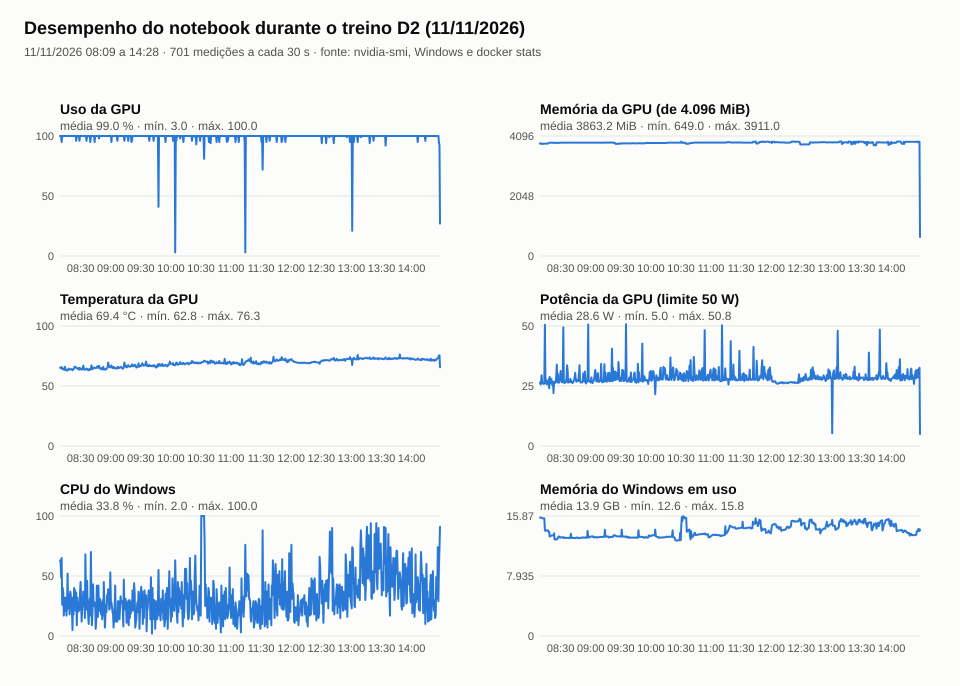

# Experimento da noite de 10 para 11/11/2026: o treino nas Posturas ajuda a ler as Posturas?

As 7 linhas de 1795 que validam o A, o B e o C são de outro documento, e por isso não mostram o
que o C ganhou nas Posturas de 1831. Para medir isso, o fólio **101r** (31 linhas, 1.414 caracteres)
saiu do treino e entrou na validação, junto com 1795 (`scripts/treino_noturno.py`):

- **treino:** 191 linhas do Traslado + 63 linhas das Posturas (100r e 100v), com 1 variante aumentada cada;
- **validação** (dev, 38 linhas): 101r + 1795 ([pares](pares_dev.json)). A parada antecipada e a escolha
  do checkpoint olham para essas 38 linhas;
- **hiperparâmetros:** os do C (taxa 2e-5, lote 2, acumula 4, BatchNorm congelada), com teto de 6 épocas.

Os rótulos do 101r têm as leituras erradas apontadas pela edição do AHMJ (ver o README do treino C).
Por isso, o CER no 101r mede a concordância com o que a equipe validou, e não com o texto certo.

## O que aconteceu

A fila está em [fila_noturna.log](fila_noturna.log):

- 21h55: as linhas de base foram avaliadas.
- 21h58: o D1 começou.
- **01h51:** o Windows reiniciou o computador sozinho para instalar uma atualização planejada (evento 1074 do
  TrustedInstaller). O D1 estava na 6ª e última época (passo 336, 228 min) e não exportou o peso. O D2
  (2 variantes aumentadas) não chegou a começar.

Os checkpoints do D1 ficaram no disco. O melhor deles, `checkpoint_03-0.8695.ckpt`, foi convertido à
mão para pesos com `ketos convert`, na mesma imagem Docker do treino. É o primeiro ponto com 86,95%, no
passo 239 da 4ª época; o passo 303 empatou depois. O peso convertido tem SHA-256
`13a1fa98d4dae668fbded047be73503dca2705a378a88fbc674ea4378558bdf7`. Como
o treino não terminou, as validações que faltavam (cerca de 2) não foram vistas. A seleção pode ser
diferente da que o `ketos` faria, mas só se uma delas passasse 86,95% + 0,1 ponto.

## Validações do D1 (acerto do `ketos`, 38 linhas)

Começou em 85,66% (passo 15), subiu devagar e chegou a **86,95%** nos passos 239 e 303. O histórico
completo está em [D1/validation_history.json](D1/validation_history.json) e no [console](D1/console.log).

## CER e WER em NFC (métrica do projeto)

Medidos com `scripts/avaliar_validacao.py`, o mesmo worker de inferência do editor ([linhas](avaliacao_dev_nfc.json)):

| Modelo | 101r: CER | 101r: WER | 1795: CER | 1795: WER |
|---|---|---|---|---|
| PP-OCRv6 base | 19,09% | 62,65% | 14,20% | 56,72% |
| Ajustado A | 17,54% | 56,03% | 10,72% | 41,79% |
| Ajustado B (na aplicação) | 17,11% | **54,86%** | 10,14% | 38,81% |
| **D1** (Traslado + 100r/100v) | 15,70% | 56,42% | **9,86%** | **38,81%** |
| D2 (idem, 2 variantes por linha) | **15,63%** | 56,03% | 10,72% | 44,78% |

O C não entra nesta tabela, porque treinou no 101r.

- **No 101r**, o D1 erra cerca de 20 caracteres a menos que o B (1,4 ponto de CER), mas acerta 1 ou 2
  palavras a menos (WER). O treino nas Posturas ajuda a ler as Posturas no nível dos caracteres. O
  ganho é pequeno, e o WER, mais sensível a palavra juntada ou partida, não acompanha.
- **Em 1795**, o D1 empata com o B em palavras e erra 1 caractere a menos. Treinar nas Posturas não
  piorou a leitura de outro documento.

## O que falta

- **D2** (2 variantes aumentadas): rodou de dia, em 11/11; ver a seção abaixo.
- **Teste reservado:** com o aval do usuário, rodou uma vez no D1, em 11/11. Resultado: CER total de 55,4%,
  contra 60,9% do B; a diferença pareada vai de −8,1 a −3,3 pontos (IC 95%), e o WER empata. O D1
  passou a ser o modelo da aplicação. Os detalhes estão no [README do teste reservado](../../../revisao_humana/teste_reservado_congelado_20261109/README.md).
  O peso fica em `models/ppocrv6_ajustado_D1_20261110/medium_ajustado_D1.safetensors`, fora do Git.

## D2, em 11/11/2026: duas variantes aumentadas por linha

Mesmos pares e mesma validação do D1. A única mudança é `augment_variants = 2`, contra 1 no D1:
cada linha de treino aparece 3 vezes por época, a original e 2 variações. O D2 rodou com
`python scripts/treino_noturno.py D2` das 08h05 às 14h29 (381,8 min), numa aba do Terminal.

| Item | Valor |
|---|---|
| Passos do otimizador | 395 (4 épocas completas e parte da 5ª; 350 lotes por época) |
| Parada | antecipada, 8 validações sem passar o recorde |
| Melhor checkpoint | `checkpoint_02-0.8701.ckpt` (passo 219, 3ª época): 87,01% de acerto de caracteres no dev |
| Peso exportado | `best_0.8701.safetensors`, SHA-256 `9b2c13226139b2b6cefb9a612effa6bbd55b8601734c40a02c8edd6b5cad0433` |
| Teste reservado | não usado |

No acerto do `ketos`, o melhor ponto do D2 (87,01%) fica 0,06 ponto acima do D1 (86,95%). Isso dá
cerca de 1 caractere em 1.760, ou seja, empate. A curva do D2 andou um pouco à frente nas épocas 2 e
3, e depois caiu.

Na métrica do projeto (tabela acima), o D2 empata com o D1 no 101r (15,63% × 15,70% de CER, 1
caractere de diferença; o D2 melhora 12 linhas do dev e piora 11) e fica atrás em 1795: 10,72% ×
9,86% de CER, 3 caracteres, e 44,78% × 38,81% de WER, 4 palavras. **Conclusão:** com estes dados,
dobrar o aumento não ajuda e custa cerca de 50% mais tempo de GPU. O D1 continua sendo o modelo da
aplicação, e o C2 (receita do D2 com todas as linhas) não foi treinado. Também não houve nova
rodada no teste reservado.

**Registro**, em [D2/](D2/):
- `console.log`, `validation_history.json`, `losses.jsonl`, `worker_result.json`, `training.json`,
  `ketos_arguments.json`, `command.json` e `plan.json`, com a pasta do projeto trocada por `<raiz do projeto>`;
- `desempenho.csv` e `desempenho.svg`: 701 medições, uma a cada 30 s. A GPU teve uso médio de 99%,
  3,9 de 4 GB de memória, 69 °C em média (máx. 76 °C) e 29 W em média. O Windows usou em média
  13,9 de 15,9 GB;
- `prints/`: a janela que acompanhava o log e o Docker Desktop, a cada 10 min, das 08h09 às 12h00.
  O script de prints parou às 12h, e a janela de acompanhamento já não estava aberta no fim; a causa não ficou registrada. O resto do
  treino está no `console.log`. Não há print final.

