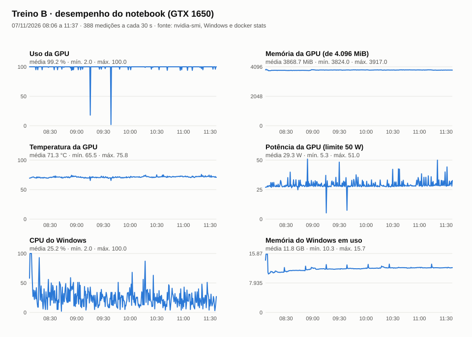

# Treino B gravado em 07/11/2026: PP-OCRv6 medium ajustado no Traslado + Inquisição

Registro do ajuste fino feito com `gravar_treino.bat` (opção B), que chama
`scripts/treinar_ao_vivo.py B`. A equipe gravou em vídeo o começo, com o cabeçalho, os
primeiros lotes e a primeira validação. O resto ficou registrado pelos prints automáticos
(`scripts/prints_treino.ps1`) e pelo registro de desempenho (`scripts/desempenho_treino.ps1`).

## Execução

| Item | Valor |
|---|---|
| Início / fim | 07/11/2026 08h01 → 11h37 (215,6 min) |
| Commit do código | `a948d5485955cb829cbd1ce7479788ff7846830a` |
| Imagem Docker | `sha256:42207c02c3f0760e5fc576a5e07d0c2e408a88c0ea2279a223843bc9b8138fc5` (reconstruída em 06/11 com o mesmo `Dockerfile` e `constraints.txt` da imagem usada no treino A; Kraken 7.1, torch 2.9.1+cu126) |
| Dispositivo | NVIDIA GeForce GTX 1650 (4 GB), CUDA 12.6, FP32 |
| Dados de treino | 191 linhas do Traslado (175 alinhadas à edição + 16 humanas; 1 variante cada) e 550 linhas públicas da Inquisição (CC BY 4.0, sem variante): 931 amostras |
| Validação | as mesmas 7 linhas humanas de 1795 do treino A |
| Teste reservado | não usado (`test_used: false`) |
| Hiperparâmetros | iguais aos do A: lote 2, acumula 4, taxa 2e-5 (cosseno, warmup 40), BatchNorm congelada, NFD, parada após 8 validações sem melhora |
| Passos do otimizador | 263: duas épocas completas e 116 lotes da 3ª (o resumo imprime "épocas 4" pelo contador do Lightning) |
| Melhor checkpoint | `checkpoint_00-0.9052.ckpt` (passo 29), exportado como `best_0.9052.safetensors` |
| SHA-256 do peso exportado | `52b2ad55829ad63d6e79c632de431521aeac0abe591fe60197dd1cbfc64fc384` |

O peso fica fora do Git por causa do tamanho: `models/ppocrv6_ajustado_B_20261107/` na máquina que treinou.

Uma primeira tentativa às 07h58 falhou antes de começar (`No such image`): a configuração ainda
apontava para o ID antigo da imagem. O ID foi corrigido no commit `a948d54` e o treino foi reiniciado às 08h01.

## Validações (acerto do `ketos`, 7 linhas)

| Época | Passo | Minutos | Caracteres | Palavras |
|---|---|---|---|---|
| **1** | **29** | **25,6** | **90,52%** | **64,18%** |
| 1 | 58 | 49,4 | 90,23% | 62,69% |
| 1 | 87 | 72,8 | 89,66% | 59,70% |
| 1 | 116 | 96,1 | 89,37% | 58,21% |
| 2 | 146 | 119,8 | 90,23% | 61,19% |
| 2 | 175 | 143,6 | 90,52% | 62,69% |
| 2 | 204 | 167,8 | 90,52% | 62,69% |
| 2 | 233 | 191,1 | 89,94% | 59,70% |
| 3 | 263 | 214,8 | 90,52% | 62,69% |

O melhor ponto saiu na primeira validação, como no B interrompido de 05/11 (mesmos 90,52% / 64,18%).

## CER e WER em NFC (métrica do projeto)

Mesmas 7 linhas (345 caracteres) pelo worker de inferência do editor, com
`scripts/avaliar_validacao.py` ([linhas](../../dados/avaliacao_validacao_base_A_B_nfc.json)):

| Modelo | CER | WER |
|---|---|---|
| PP-OCRv6 base | 14,20% | 56,72% |
| Ajustado A gravado (06/11) | 10,72% | 41,79% |
| **Ajustado B gravado (este treino)** | **10,14%** | **38,81%** |

Contra o A, o B melhora 4 linhas, empata 1 e piora 1 ("São … Juis" volta a "Saõ … Iuis"). A
diferença é de cerca de 2 caracteres em 345, dentro da variação entre execuções vista nos dois
treinos A (12,17% e 10,72%). Não dá para afirmar que os dados da Inquisição ajudam; o teste
reservado decide, uma única vez, no fim.

## Desempenho do notebook

Medições a cada 30 s ([CSV](desempenho.csv)): GPU com uso médio de 99%, cerca de 3,9 de 4 GB de
memória, 71 °C em média (máx. 76 °C) e 29 W em média (de 50 W). O contêiner ficou em cerca de 1
núcleo de CPU e até 1,7 GB de memória (limite de 5 GB); o Windows usou em média 11,8 de 15,9 GB,
com pico de 15,7 GB no começo, enquanto a tela era gravada. As duas quedas fundas no uso da GPU
(09h15 e 09h38) caem nas validações dos passos 87 e 116.

## Arquivos

- `prints/treino_B_HHMMSS.png`: a janela do treino a cada 10 min; `treino_B_final_*.png`, o resumo final.
- `prints/treino_B_validacao_passoNNNN.png`: a janela logo depois de cada validação.
- `prints/docker_*.png`: o Docker Desktop no início, com a imagem `42207c02c3f0` em uso.
- `desempenho.csv`, `desempenho.svg`: GPU, CPU e memória durante o treino.
- `console.log`, `validation_history.json`, `losses.jsonl`, `worker_result.json`, `training.json`,
  `ketos_arguments.json` e `command.json` (com a pasta do projeto trocada por `<raiz do projeto>`).
