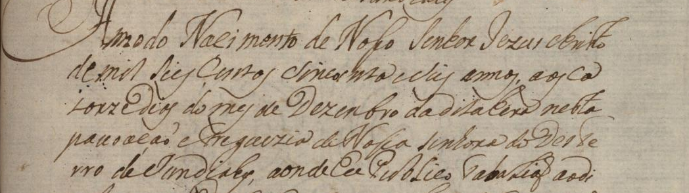
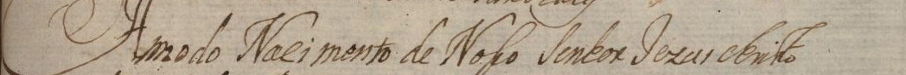
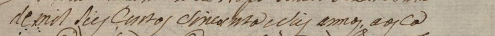
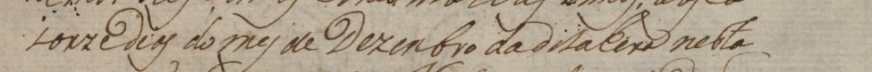
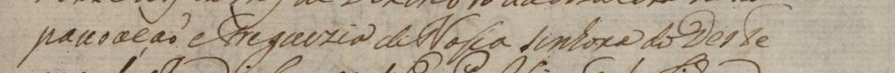
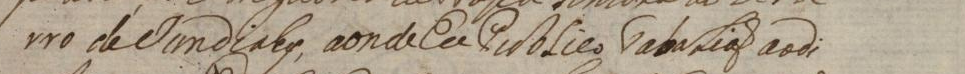
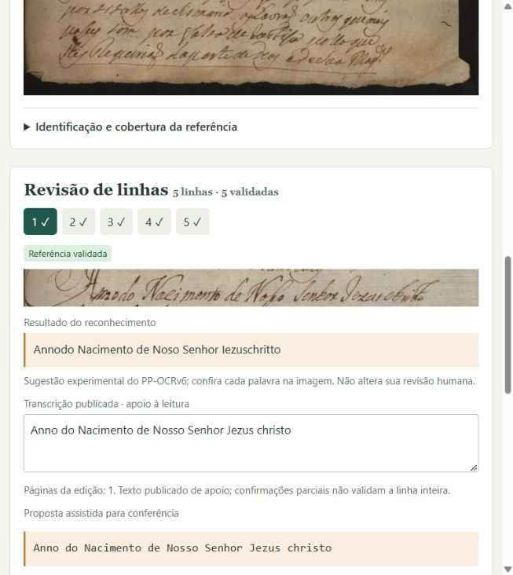

# PP-OCRv6 no Traslado 269r: leitura real e integração experimental

O PP-OCRv6 medium foi executado localmente nas mesmas cinco imagens e com a
mesma referência humana congelada da revisão `20261016T172615_7ca3ab1c`.
**O resultado é aproveitável como rascunho assistido neste bloco**, pois recupera
as frases e grande parte das palavras visíveis; ainda exige correção humana.
Essa avaliação qualitativa não valida automaticamente as saídas nem estima o
desempenho no restante do acervo. A referência aprovada permanece intacta.

| Reconhecedor | CER da região | WER da região |
|---|---:|---:|
| TrOCR small, histórico | 195/242 = 80,58% | 45/45 = 100% |
| PP-OCRv5 latino, histórico | 138/242 = 57,02% | 43/45 = 95,56% |
| **PP-OCRv6 medium / Kraken 7.1** | **30/242 = 12,40%** | **23/45 = 51,11%** |

Zero falhas nas cinco linhas. A métrica principal mantém Unicode NFC + redução
de espaços, caixa, acentos, grafia e sinais; concatena as linhas em ordem com
um espaço. Não recompõe palavras quebradas. As saídas brutas, inclusive sinais
Unicode decompostos, permanecem em [predictions.jsonl](predictions.jsonl).
O WER alto reflete trocas e junções de palavras: uma frase reconhecível ainda
requer várias correções. Não apresentamos `1−CER` como acurácia do acervo.



## Cinco entradas e saídas reais

Os recortes abaixo são os mesmos arquivos usados antes; não houve segmentação,
ajuste de limites ou edição da referência. `S/D/I` indica substituições,
deleções e inserções de caracteres. Métricas por linha são diagnósticas; a
métrica principal é a região inteira, com os quatro espaços entre linhas.

### Linha 1



- Referência humana: `Anno do Nacimento de Nosso Senhor Jezus christo`
- **Saída automática bruta:** `Annodo Nacimento de Noso Senhor Iezuschritto`
- CER: 5/47 = 10,64%; S/D/I = 2/3/0.
- WER: 5/8 = 62,50%.

### Linha 2



- Referência humana: `de mil seis centos sincoenta e seis annos, aos ca`
- **Saída automática bruta:** `demil sies Centos sincoenta e sus annos, aos ca`
- CER: 6/49 = 12,24%; S/D/I = 2/3/1.
- WER: 5/10 = 50,00%.

### Linha 3



- Referência humana: `torze Dias do mes de Dezembro da dita Hera nesta`
- **Saída automática bruta:** `iorze dios do mes de Dezenbro da ditaCera nesta`
- CER: 6/48 = 12,50%; S/D/I = 5/1/0.
- WER: 5/10 = 50,00%.

### Linha 4



- Referência humana: `povoação e Freguezia de Nossa senhora do Deste`
- **Saída automática bruta:** `pauoaçaõ eTreguezia de Nossa sinhora do Deste`
- CER: 7/46 = 15,22%; S/D/I = 6/1/0.
- WER: 4/8 = 50,00%.

### Linha 5



- Referência humana: `rro de Jundiahy, aonde Eu Publico Tabelião ao di`
- **Saída automática bruta:** `rro de Sundiahy, aonde Eu Publico TabaLiaõ aodi`
- CER: 6/48 = 12,50%; S/D/I = 5/1/0.
- WER: 4/9 = 44,44%.

## Ambiente e processamento

Aplicação: Windows/Python 3.12.14, ambiente anterior preservado. Reconhecedor:
Linux em Docker Desktop/WSL2, Python 3.12.15, Kraken 7.1, PyTorch 2.9.1+cpu,
torchvision 0.24.1+cpu, CPU/float32, seed 1831, CTC greedy sem amostragem,
correção textual ou filtro de confiança. O [runtime separado](../../../runtime/kraken_ppocrv6/README.md)
registra construção, versões completas, limites e solução do ambiente.

- Carga/imports dentro do worker: **11.43 s**.
- Inicialização total do backend, incluindo carga: **12.86 s**.
- Soma do reconhecimento das cinco linhas dentro do worker: **9.32 s**,
  incluindo leitura do PNG e pré-processamento; o transporte no processo Windows
  é separado. Não é um benchmark contra outras arquiteturas.
- Consumo observado após reconhecer: cerca de 534 MiB; pico não medido.

Peso: [Zenodo 21788410, v1](https://zenodo.org/records/21788410),
`medium.safetensors`, 63.779.644 bytes, SHA-256
`15313b51ace64cbfa81f8f6ef25ad64f04e5a6fb7f7823e67b107527bc081ac9`.
A ficha declara materiais históricos em português e licença Apache-2.0.
Os números de avaliação do autor não são os desta amostra.

**Divergência encontrada:** a ficha descreve altura 128, mas o arquivo v1 tem
`height=96` nos [metadados reais](model_metadata.json). A primeira tentativa
parou nessa checagem, antes de produzir predições; o [registro da falha](attempts/startup_contract.json)
e o código correspondente foram preservados. Antes de gerar texto, adotamos a
altura nativa 96 do checkpoint, mantendo os mesmos recortes. Não escolhemos
a altura com base nas métricas. O recibo ativo anterior à inferência é
[frozen_inputs_v2.json](frozen_inputs_v2.json); o primeiro recibo documenta
somente a tentativa de inicialização.

O worker usa `RecognitionTaskModel.load_model`, `ImageInputTransforms` nativo
e o caminho CTC `_rec_predict` conferido na API 7.1. Recebe RGB, redimensiona à
altura nativa, mantém largura proporcional e adiciona padding horizontal 16.
Desativa normalização de baseline, pois recebe linhas já extraídas. Não cria
baselines, não extrai polígonos e não chama `segment`. O caminho privado está
fixado à versão 7.1; outra versão exige conferir novamente esse contrato.

O contêiner não tem rede e monta somente os pesos e o arquivo do worker, ambos
somente leitura. As imagens passam por JSON/base64, verificadas por hash dos
pixels. O worker não recebe texto humano, edição ou o projeto inteiro.

## Uso no programa

O servidor nesta máquina está em [localhost:8011](http://127.0.0.1:8011/), com
`configs/traslado_269r.toml` e o workspace original do Traslado. Para iniciar:

```powershell
python -m paleographia serve --config configs/traslado_269r.toml --host 127.0.0.1 --port 8011
```

Selecione o 269r e clique em **Testar reconhecedor**. Selecione uma linha para
ver recorte e proposta experimental; registre correções no campo humano e
salve apenas sua revisão. A predição fica em histórico separado, sem substituir
texto aprovado ou promover linhas a `validated`. Rascunhos e conflitos 409
continuam protegidos. A indicação de erro mantém a revisão manual disponível.



A execução pelo botão/API gerou as cinco mesmas saídas da CLI. A comparação
integral antes/depois confirmou páginas, caixas, textos, autores, horários e
validações humanas intactos. [app_smoke.json](app_smoke.json) registra as
revisões e a política; [app_predictions.jsonl](app_predictions.jsonl) preserva
o segundo lote real. Essa repetição verifica a integração, não é outra amostra.

A liberação de sugestões está vinculada ao backend, SHA dos pesos, ID da imagem
Linux e SHA do worker efetivamente avaliados. Alterar essa identidade desabilita
a apresentação; predições de modelos históricos não são liberadas junto dela.
No piloto de 1831 a apresentação continua desativada, pois esse material não foi
avaliado com o novo modelo. TrOCR deixa de carregar/executar em API, botão, CLI,
comparação, preparação e treino; configurações antigas recebem mensagem de
migração. O treino do backend novo não foi implementado nesta entrega.

## Auditoria e reprodução

Na raiz desta revisão, sem Docker ou pesos:

```powershell
python -m pip install -e ".[test]"
python scripts/audit_ppocrv6_experiment.py --restore-support --output output/audit_ppocrv6_NEW
python scripts/audit_traslado_experiment.py --restore-support --output output/audit_historico_NEW
```

O primeiro comando de auditoria confere inventário, recibo congelado, IDs,
caixas, imagens e pixels recebidos pelo worker, recalcula todas as métricas e
confere a repetição no aplicativo. O histórico anterior mantém seus bytes e
hashes. Quando o código evolui, seus nove arquivos originais são verificados
na [cópia da implementação 31997a4](../implementation_31997a4/), sem reescrever
o inventário ou as configurações do experimento anterior.

Para repetir a inferência, prepare o [runtime e os pesos](../../../runtime/kraken_ppocrv6/README.md)
e use uma saída nova:

```powershell
python -m paleographia recognize --lines docs/experimentos/traslado_269r_20261016/reference/linhas_exploratorias.jsonl --config docs/experimentos/traslado_269r_ppocrv6_20261016/config.toml --output experiments/ppocrv6_NEW/predictions.jsonl
python -m paleographia evaluate --reference docs/experimentos/traslado_269r_20261016/reference/linhas_exploratorias.jsonl --pages docs/experimentos/traslado_269r_20261016/reference/catalogo/pages.jsonl --predictions experiments/ppocrv6_NEW/predictions.jsonl --output-dir experiments/ppocrv6_NEW/evaluation
```

A configuração experimental original mantém a apresentação desligada e seus
campos legados `generation` não são usados pelo CTC. A configuração posterior
de uso, [app_configuration.toml](app_configuration.toml), registra a liberação
experimental. Para uma imagem Docker reconstruída com outro ID, derive nova
configuração candidata e avalie antes de aprovar sua apresentação. Tempos e
identificadores de execução variam; as saídas históricas não são sobrescritas.

## Limites

Verificações locais: **71 testes Python e 20 testes JavaScript** passaram;
compilação, CLI e verificações de dependências da aplicação e do contêiner
passaram. Os testes de protocolo usam substitutos explicitamente sintéticos;
as cinco leituras acima e a execução no editor usaram o modelo real. A auditoria
offline reproduziu as métricas novas e as duas avaliações históricas.

São cinco linhas de desenvolvimento de um documento. A revisão visual observou
recuperação das frases junto de erros como `Annodo`, `Noso`, `Iezuschritto`,
`ditaCera`, `Sundiahy` e palavras aglutinadas. Essa conferência qualitativa não
substitui a revisão humana de cada proposta. Não houve treino, ajuste de
hiperparâmetros sobre as saídas, nova segmentação ou uso de respostas na geração.
Reservar outros trechos/grupos ao ampliar a referência, antes de escolher
configurações com eles. A geometria reutilizada é controle; os IoUs e contagens
de sobreposição não medem um segmentador. Código e condições de uso dos
manuscritos/edições permanecem separados.
