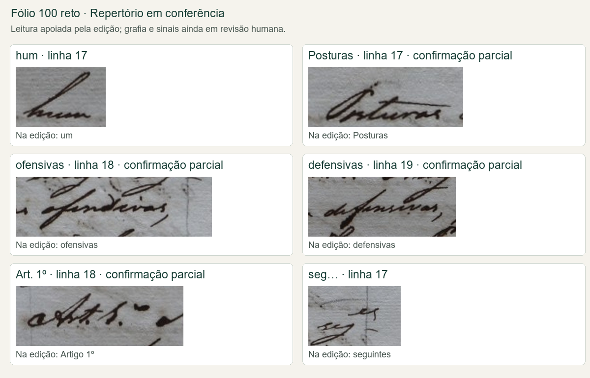

# Repertório inicial do fólio 100 reto

Abrir `/repertorio` na aplicação local. Há também um acesso chamado
“Repertório de letras” na página de revisão.

O catálogo inicial reúne 13 exemplos: dez palavras para comparar letras e três
exemplos de abreviaturas e sinais. Foram selecionados nas linhas editoriais 17–19
e 23, cobertas pela página 3 da edição modernizada disponível. A correspondência
dessas linhas com os recortes foi inspecionada visualmente; não se presume que a
numeração automática sempre equivalha à numeração editorial.

Cada exemplo mostra a leitura de trabalho, a forma da edição, a imagem ampliável,
as letras a comparar e o acesso à linha inteira. O filtro de uma letra usa a lista
de letras anotadas no exemplo. Para expressões maiores, busca nas leituras e no
tipo de exemplo. Os arquivos também guardam coordenadas e checksums para rastrear
os recortes até a imagem fonte.

## Distinções que precisamos preservar

- A edição oferece apoio ao conteúdo, mas moderniza a grafia e desenvolve
  abreviaturas. Não foi tratada como transcrição paleográfica validada.
- `hum`, `Projecto`, `Ninguem`, `offensivas` e as outras leituras são propostas
  assistidas pela edição. A presença de letras, caixa, acentos e pontuação ainda
  exige conferência humana.
- `Art. 1º` e `Art. 2º` são representações de trabalho. A caixa, o ponto e o ordinal
  precisam ser conferidos. A relação com “Artigo” vem da edição.
- `seg…` é somente um rótulo incompleto para a forma desenvolvida como
  “seguintes”. Não afirma a leitura de todos os sinais superiores. Nenhuma
  convenção definitiva foi escolhida para representá-los.
- Alguns traços vizinhos entram nos recortes porque a escrita se sobrepõe.
  Consulte a linha inteira antes de atribuir um traço à palavra.
- Todos os exemplos continuam sem revisor e sem validação. O repertório não foi
  incorporado aos dados de treinamento, às métricas ou às linhas revisadas.

## Arquivos

- Catálogo: `data/manifests/repertorio_100r.json`.
- Recortes e quadro inicial: `data/processed/repertorio_100r/`.
- Reconstrução dos recortes existentes: `python scripts/build_repertoire.py --materialize`.
- Preparação inicial de um catálogo novo, sem revisão: `python scripts/build_repertoire.py`.

O script confere a integridade da imagem e da edição antes de preparar os
exemplos. Recusa substituir um catálogo que contenha revisão humana registrada,
inclusive uma confirmação parcial de letras.
Não reconstrói a escrita nem acrescenta traços; a ampliação apenas redimensiona
os pixels existentes. A ferramenta é um repertório de exemplos, não um detector
automático de letras ou de abreviaturas.

## Como avançar na revisão

Começar por `hum`, comparar o P em `Projecto` e `Posturas`, e depois observar os
traços de f e s em `ofensivas` e `defensivas`. Conferir as duas ocorrências de
“Artigo” abreviado antes de decidir como registrar a forma. Manter “seguintes”
com a forma abreviada em aberto até esclarecer os sinais na imagem.

Créditos da edição: transcrição e edição de Paulo Vicentini (AHMJ); revisão de
Isabella Ferraro e Gilson Santos (AHMJ). A edição é o PDF associado ao grupo
“Código de Posturas — 1831”, página 3.

## Confirmação parcial recebida

O usuário confirmou nesta conversa a sequência de letras a–r–t nos dois exemplos
de “Artigo” abreviado (linhas 18 e 23). A confirmação foi registrada em cada item
com a mensagem de origem e a data do registro. Caixa, ponto, ordinal e demais
sinais não foram confirmados. O nome do revisor continua ausente, e os exemplos
não foram promovidos a referência paleográfica validada. A versão anterior do
catálogo foi preservada em `data/manifests/repertorio_revisions/`.

Em seguida, o usuário confirmou as leituras de “projecto” e “posturas” ao
comparar a forma da inicial P. As duas palavras receberam confirmação parcial,
sem fixar caixa, pontuação ou outros sinais. “Hum” permanece como provável,
conforme a orientação do usuário. O repertório soma quatro exemplos com
confirmações parciais; nenhuma linha integral foi validada.

Na comparação seguinte, o usuário leu “ofensivas” com somente um f, corrigindo
a hipótese anterior “offensivas”, e confirmou “defensivas”. O catálogo passou a
mostrar “ofensivas” como leitura de trabalho. O identificador técnico antigo foi
mantido para preservar os vínculos com as imagens e o histórico. O repertório
soma seis confirmações parciais; “hum” continua provável. A grafia da época não
foi usada para acrescentar uma consoante que o usuário não reconheceu na imagem.

## Quadro visual para revisão no GitHub

Os 13 recortes individuais estão na pasta `repertorio/`. O catálogo preserva as coordenadas no original, os hashes e o histórico das confirmações.
