# Conferência humana — 100 reto, linhas 17–21

## Ponto de retomada — encerramento de 15/10/2026

Revisor: **Rodolfo Vinícius Cima Takemoto**, identificado pelo próprio usuário.
Preparação de cinco linhas consecutivas cobertas pela página 3 da edição. A
conferência concentrou-se na linha 17; **zero linhas completas foram validadas**.

| Trecho / aspecto | Estado ao encerrar |
| --- | --- |
| Abertura «Leu se» | Leitura confirmada parcialmente pelo revisor, com **u**. Hífen e caixa não foram confirmados separadamente. |
| «hum» | Leitura provável, preservada da sessão anterior. |
| «Projecto» e «Posturas» | Confirmações parciais anteriores preservadas no repertório. |
| «com/em treze» | Em conferência. A sequência com «Artigos» e o início do Art. 1º favorecem a interpretação de quantidade; não foi validada como data. |
| Final «seg…» | Expansão «seguintes» provável por contexto e edição, sem substituir a abreviatura escrita. |
| Sinais superiores | O revisor observou aparência de **«es»**. Identificação provisória; não foi resolvida a forma completa da abreviatura. |
| Recortes, ordem e linhas completas | Pendentes. As margens dos recortes apresentados são de contexto e não são limites aprovados para avaliação. |

**Retomar pelos sinais superiores** e por sua ligação com «seg…»; depois resolver
«com/em», demais sinais e limites da linha 17, e seguir pelas linhas 18–21.
Somente após conferir as cinco linhas completas, a convenção de abreviaturas e a
cobertura será possível preparar uma referência de avaliação. Ampliar para
30–50 linhas permanece como etapa posterior.

O corpo deste caderno conserva as etapas anteriores, inclusive hipóteses já
superadas. Os quadros de comparação da vogal mostram o estado **anterior** à
confirmação de «Leu se». Consulte a tabela acima para o estado atual.

Preparação de 15/10/2026. Correspondência visual de trabalho com a página 3 da edição; nenhum texto ou recorte foi promovido a validação. As cinco linhas pertencem ao mesmo fólio, em sequência. A numeração editorial não deve ser generalizada aos demais recortes.

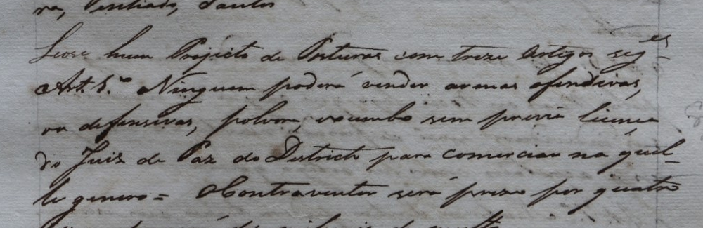

## Convenção em discussão

Preservar grafia, caixa, acentos, pontuação, quebras e abreviaturas visíveis. Expansões somente no apoio ou em nota. Não inserir o hífen de “Leu-se” nem desenvolver a abreviatura final de “seguintes” sem conferir os sinais. “Hum” permanece provável; “projecto” e “posturas” têm confirmação parcial anterior.

## Conferir linha a linha

Os recortes abaixo têm margens de contexto para mostrar hastes e descendentes. Podem incluir escrita vizinha e não são caixas finais aprovadas. Precisamos conferir os limites canônicos, a ordem e a transcrição completa antes de salvar como referência humana.

### Linha 17

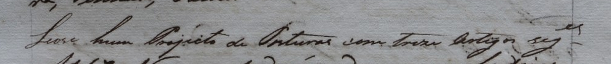

Apoio modernizado da edição: Leu-se um Projeto de Posturas com treze artigos seguintes

Identificação técnica: `l_cdcca7fc5eb63d322541`. Caixa atual: `[74, 913, 1162, 977]`. Caixa de contexto: `[100, 895, 1100, 1001]`.

Transcrição diplomática: **aguarda conferência**. Recorte, ordem, grafia e sinais: **pendentes**.

### Linha 18

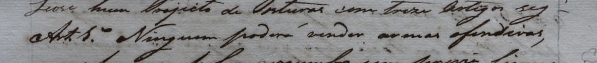

Apoio modernizado da edição: Artigo 1º – Ninguém poderá vender armas ofensivas,

Identificação técnica: `l_a0e12ce77bc93b0975fd`. Caixa atual: `[74, 977, 1162, 1026]`. Caixa de contexto: `[100, 948, 1100, 1054]`.

Transcrição diplomática: **aguarda conferência**. Recorte, ordem, grafia e sinais: **pendentes**.

### Linha 19

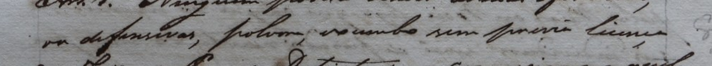

Apoio modernizado da edição: ou defensivas, pólvora, ou chumbo sem prévia licença

Identificação técnica: `l_ae7a34c22d6e8b5a96df`. Caixa atual: `[74, 1026, 1162, 1079]`. Caixa de contexto: `[100, 1009, 1100, 1103]`.

Transcrição diplomática: **aguarda conferência**. Recorte, ordem, grafia e sinais: **pendentes**.

### Linha 20

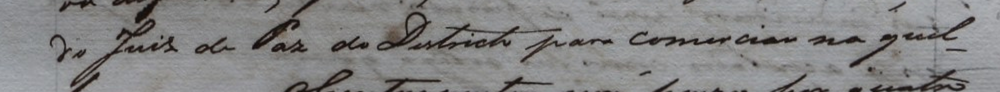

Apoio modernizado da edição: do Juiz de Paz do Distrito para comércio naque-

Identificação técnica: `l_1c9ee411b36d763f5d2e`. Caixa atual: `[74, 1079, 1162, 1122]`. Caixa de contexto: `[100, 1066, 1100, 1158]`.

Transcrição diplomática: **aguarda conferência**. Recorte, ordem, grafia e sinais: **pendentes**.

### Linha 21

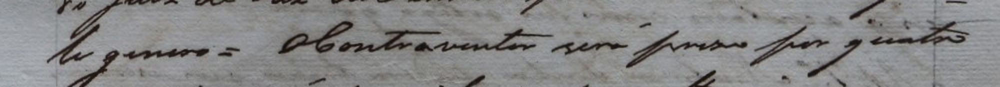

Apoio modernizado da edição: le gênero = O contraventor será preso por quatro

Identificação técnica: `l_e66cdf7250bda9782dcc`. Caixa atual: `[74, 1122, 1162, 1182]`. Caixa de contexto: `[100, 1114, 1100, 1201]`.

Transcrição diplomática: **aguarda conferência**. Recorte, ordem, grafia e sinais: **pendentes**.

## Fonte e preservação

Fonte: `data/raw/import_20261015/6e82cef18b04_198b675a9b65d183.jpg`. SHA-256: `413d1502555f62d45ef50cc9af5d0fb7df0ed55bf9652157f0fa874b2006a1ad`.

Edição: `data/raw/import_20261015/6e82cef18b04_094cbf86c7ec88ea.pdf`, página 3. Transcrição e edição: Paulo Vicentini (AHMJ); revisão de Isabella Ferraro e Gilson Santos (AHMJ).

Workspace consultado: `20261015T152646_ce045fe6`. Os arquivos de dados, revisões e catálogo existentes não foram alterados. Revisor identificado pelo próprio usuário: **Rodolfo Vinícius Cima Takemoto**. Essa identificação não valida as leituras, caixas, ordem ou cobertura; a conferência das cinco linhas continua pendente.

## Comparação da vogal em aberto

Por orientação do usuário, a vogal da primeira palavra continua em aberto. Comparamos recortes de «o» e «u» na mesma linha, mantendo «hum» como provável. Os intervalos das letras são aproximados; não constituem segmentação ou validação de caracteres.

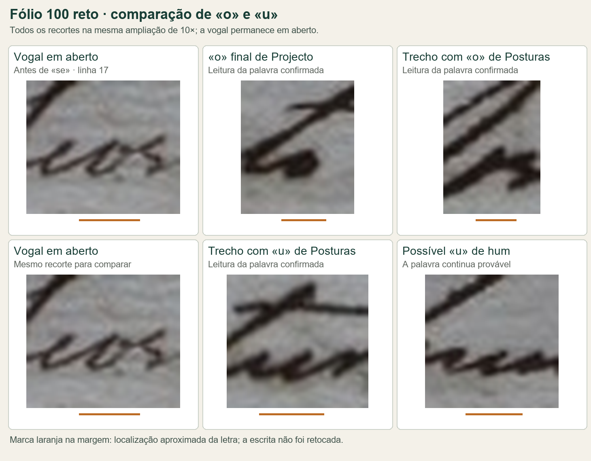

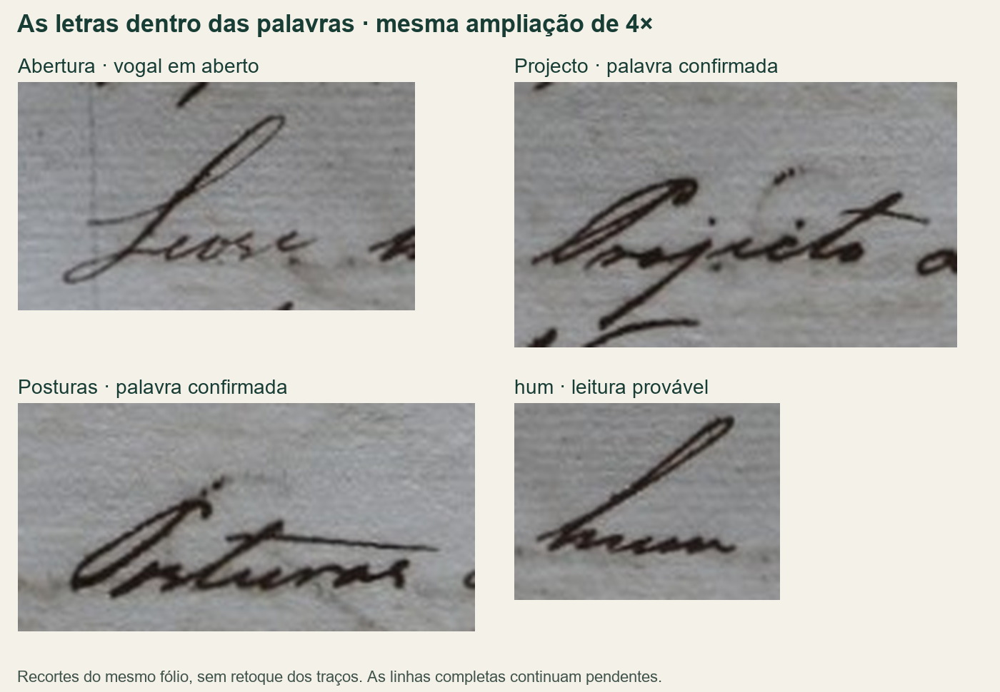

## Hipótese histórica para a abertura

Hipótese levantada pelo revisor: «Leo se hum Projecto…», equivalente em modernização a «Leu-se um projeto…». A vogal, a separação e o hífen permanecem pendentes na imagem.

A grafia «leo» para o pretérito tem apoio na [Orthographia da lingua portugueza, de Luís Caetano de Lima (1736), p. 121](https://pml.cel.utad.pt/ViewEntry.aspx?id_entry=15): a edição semidiplomática registra «Elle leo» entre os pretéritos. O [Semanário de Saúde Pública de 1831, n. 2](https://hemeroteca-pdf.bn.gov.br/702560/per702560_1831_00002.pdf) também apresenta «Leo-se» em relatos de sessões. A pesquisa apoia a plausibilidade linguística; a transcrição do manuscrito continua aguardando confirmação humana.

## Observação posterior do revisor sobre a abertura

Rodolfo Vinícius Cima Takemoto indicou: «realmente pode ser Leu se, pela grafia parece mais um U que o». Registrada a leitura provável **Leu se**, com preferência por **u**. A hipótese histórica com **o** foi mantida no histórico da preparação. O hífen, a confirmação definitiva da vogal e a linha completa continuam pendentes.

## Decisão do revisor: abertura «Leu se»

Rodolfo Vinícius Cima Takemoto decidiu adotar **Leu se** após comparar os traços e o contexto. Registrada como confirmação parcial da abertura, com vogal **u**. A hipótese histórica com **o** e a etapa anterior de leitura provável permanecem no histórico. A expressão antes de «treze» (com/em), o hífen, a caixa, a geometria e a transcrição integral ainda exigem conferência. Nenhuma linha completa foi validada.

## Última observação sobre os sinais superiores

O revisor indicou que os sinais parecem **«es»**, mantendo a dúvida sobre como
isso compõe a abreviatura. A observação foi guardada como provisória, sem
confirmar uma expansão ou validar a linha.

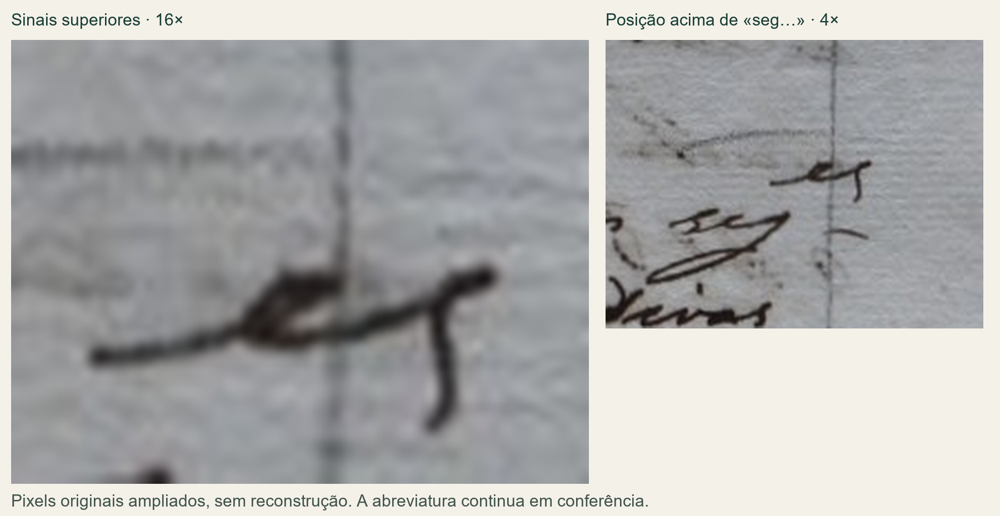

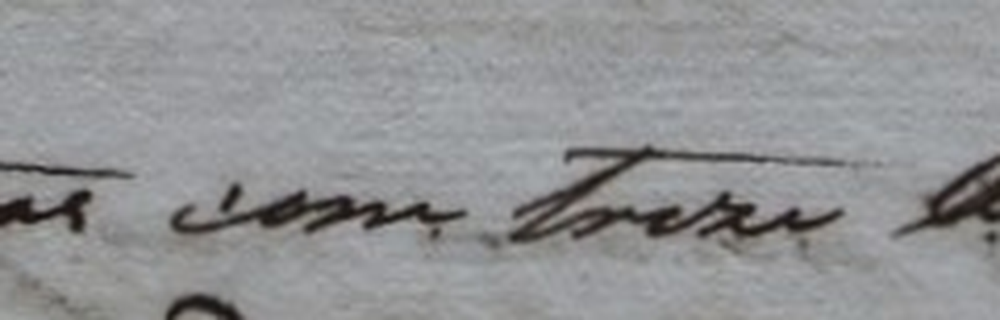

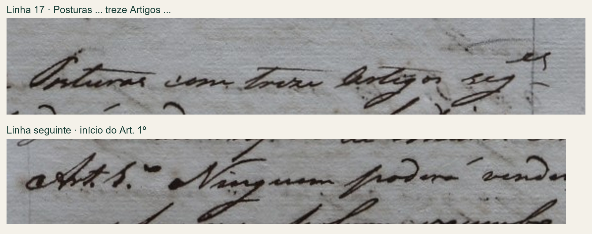

A sessão foi encerrada pelo usuário em 15/10/2026. O catálogo, o repertório
anterior e o workspace continuam preservados; esta publicação acrescenta
somente a preparação e as observações de conferência.
