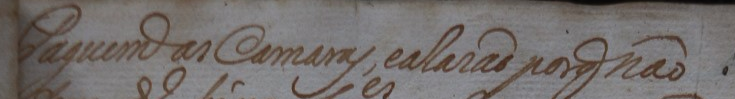
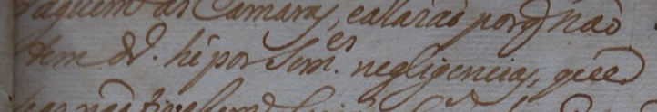
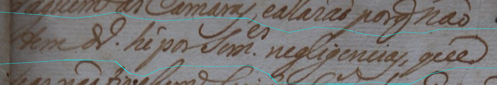
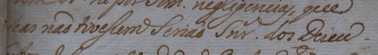
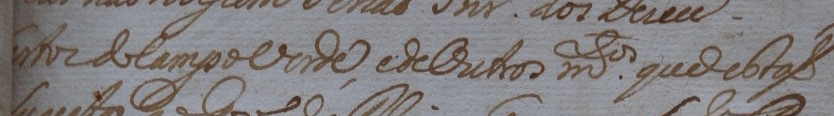
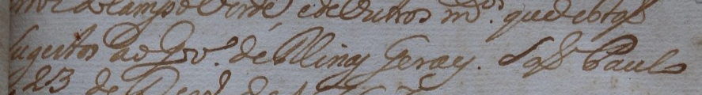
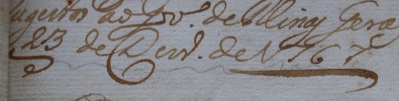

# Carta de José Gomes de Gouveia: preparação da próxima curadoria

**Primeira linha, 04/11.** Os limites foram aprovados com os traços da segunda linha na borda inferior. A transcrição diplomática **Paguem as Camaras, e a Razão por não** também foi validada. [Aprovação do recorte](../sessao_20261103/observacao_068_linha01_recorte_definitivo_aprovado.json) e [validação do texto](../sessao_20261103/observacao_079_linha01_transcricao_diplomatica_validada.json).

**Continuação:** o revisor informou a leitura parcial **Paguem as Camaras**, com dúvida no restante. A [sessão de 03/11 e as ampliações](../sessao_20261103/README.md) registram a observação 039 e permitem conferir as abreviaturas sem alterar os traços originais. O candidato de preparação abaixo permanece preservado.

Preparação em **03/11/2026**, após o fechamento da revisão de 1795. A ficha institucional informa registro de 23/12/1767, fólios 4r/4v do livro de Autos de Diligências Policiais e Mandados de Pagamentos (1742–1783), registro 0146. Em **04/11**, o revisor confirmou que o JPEG usado nos recortes mostra o fólio **4r**. [Ficha institucional](https://jundiai.sismu.app/obra/102967/registro-oficial-da-carta-enviada-por-jose-gomes-de-gouveia-nos-anais-da-camara-com-sugestoes-e-metodos-para-eliminar-movimentos-de-resistencia-pela-liberdade-de-africanos-afro-brasileiros-e-povos-originarios-em-1767), [página identificada](pagina_folio4r.json) e [confirmação](../sessao_20261103/observacao_099_folio_4r_correspondencia_confirmada.json).

A edição modernizada tem cinco páginas, com texto nas páginas 3–4 e reprodução na página 5. Créditos: transcrição e edição de Júlia Munhoz e Matheus Bellodi; revisão de Isabella Ferraro (AHMJ).

A região confirmada em **04/11** abrange as seis linhas da anotação superior à esquerda, de **Paguem** até a data. O cabeçalho à direita e o corpo da carta ficam fora. A caixa da região é o envelope dos recortes individuais, que delimitam a cobertura efetiva. A referência integral da região segue incompleta. [Registro da página e da cobertura](pagina_folio4r.json) e [confirmação humana](../sessao_20261103/observacao_100_cobertura_seis_linhas_anotacao_superior.json).

O registro 0146 difere do livro 0006 da sessão de 1795. A independência documental, as condições de uso e a partição científica seguem pendentes.

## Primeiro recorte candidato

A proposta usou somente pixels originais. A caixa `[40,8,775,107]` abrange a primeira linha da anotação superior, separada do endereço à direita. As observações 066 a 068 registram a cobertura, os traços vizinhos na margem inferior e a aprovação dos limites.

- [Candidato e proveniência](candidato.json).
- [Proposta de caixa](proposta_recorte.json).
- [Identificação e estado de preparação](preparacao.json).

As decisões de leitura estão reunidas no [registro de trabalho da anotação](../sessao_20261103/anotacao_superior_leitura_de_trabalho.md).

## Recorte definitivo da segunda linha

A caixa `[43, 50, 765, 174]` foi extraída da imagem original e aprovada para a linha de **tem** até o grupo final lido como **que**. As margens preservam espaço para as hastes e o **es** acima de **soment**. O revisor aceitou os traços das linhas vizinhas por não prejudicarem a leitura. [Aprovação dos limites](../sessao_20261103/observacao_071_linha02_recorte_retangular_definitivo_aprovado.json).

[Coordenadas e finalidade](proposta_recorte_linha02.json), [proveniência e hash do recorte](candidato_linha02.json) e [imagem em contexto](../sessao_20261103/linha02_contexto_amplo_2x.png).

O revisor observou a inclinação da linha e a área adicional nas duas bordas. Em seguida, confirmou que a segunda linha inteira está visível entre as marcas em ciano. O editor atual registra caixas retangulares, e o contorno serve como apoio visual para a decisão sobre os limites. [Observação das bordas](../sessao_20261103/observacao_069_linha02_inclinacao_e_tracos_nas_bordas.json), [confirmação da cobertura](../sessao_20261103/observacao_070_linha02_cobertura_entre_marcas_confirmada.json) e [coordenadas da proposta](linha02_contorno_proposto.json).

## Recorte definitivo da terceira linha

A caixa `[43, 115, 802, 227]` foi extraída da imagem original e aprovada para a linha de **se as** até **Desco-**. O revisor confirmou o **se** junto à dobra e o hífen final. Os traços das linhas vizinhas nas bordas foram aceitos por não prejudicarem a leitura. [Confirmação de cobertura](../sessao_20261103/observacao_072_linha03_cobertura_do_recorte_confirmada.json) e [aprovação dos limites](../sessao_20261103/observacao_073_linha03_recorte_definitivo_aprovado.json).

[Coordenadas e finalidade](proposta_recorte_linha03.json), [proveniência e hash do recorte](candidato_linha03.json) e [imagem em contexto](../sessao_20261103/linha03_contexto_amplo_2x.png).

A transcrição diplomática também foi validada como **se as não tivessem seriam Srsˢ dos Desco-**. [Validação do texto](../sessao_20261103/observacao_086_linha03_transcricao_diplomatica_validada.json).

## Recorte definitivo da quarta linha

A caixa `[43, 177, 877, 293]` foi extraída da imagem original e aprovada para a quarta linha, da continuação lida como **bertos** até o final lido como **que estão**. O revisor confirmou a cobertura integral e aceitou os traços das linhas vizinhas nas bordas por não prejudicarem a leitura. [Confirmação de cobertura](../sessao_20261103/observacao_074_linha04_cobertura_do_recorte_confirmada.json) e [aprovação dos limites](../sessao_20261103/observacao_075_linha04_recorte_definitivo_aprovado.json).

[Coordenadas e finalidade](proposta_recorte_linha04.json), [proveniência e hash do recorte](candidato_linha04.json) e [imagem em contexto](../sessao_20261103/linha04_contexto_amplo_2x.png).

A transcrição diplomática também foi validada como **bertos do campo verde, e de outros muⁱᵗᵒˢ que estão**. [Validação do texto](../sessao_20261103/observacao_091_linha04_transcricao_diplomatica_validada.json).

## Recorte definitivo da quinta linha

A caixa `[43, 227, 930, 347]` foi extraída da imagem original e aprovada para a quinta linha, do início lido como **sujeitos** até **Paulo**. O revisor confirmou o início junto à dobra e o **o** pequeno antes de **Paulo**. Os traços vizinhos nas bordas foram aceitos por não prejudicarem a leitura. [Aprovação dos limites](../sessao_20261103/observacao_076_linha05_recorte_definitivo_aprovado.json).

[Coordenadas e finalidade](proposta_recorte_linha05.json), [proveniência e hash do recorte](candidato_linha05.json) e [imagem em contexto](../sessao_20261103/anotacao_superior_contexto_aberto.png).

## Recorte definitivo da sexta linha

A caixa `[41, 271, 615, 417]` foi extraída da imagem original e aprovada para a sexta linha. O revisor confirmou a data inteira e os dois traços, antes de **23** e abaixo de **1767**. A parte da quinta linha na borda superior foi aceita por não prejudicar a leitura. [Aprovação dos limites](../sessao_20261103/observacao_077_linha06_recorte_definitivo_aprovado.json).

[Coordenadas e finalidade](proposta_recorte_linha06.json), [proveniência e hash do recorte](candidato_linha06.json) e [imagem em contexto](../sessao_20261103/anotacao_superior_contexto_aberto.png).

Ferramenta: Codex, da OpenAI. Utilização: consulta do catálogo e da edição, seleção de proposta geométrica e recorte rastreável com o código existente do projeto. Sem reconhecimento ou treinamento.
