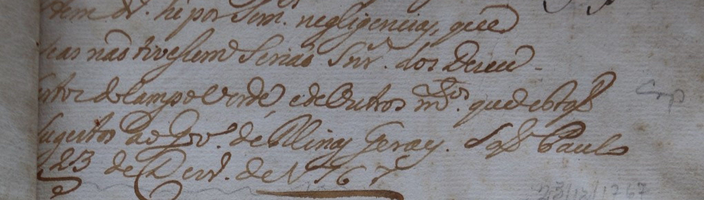
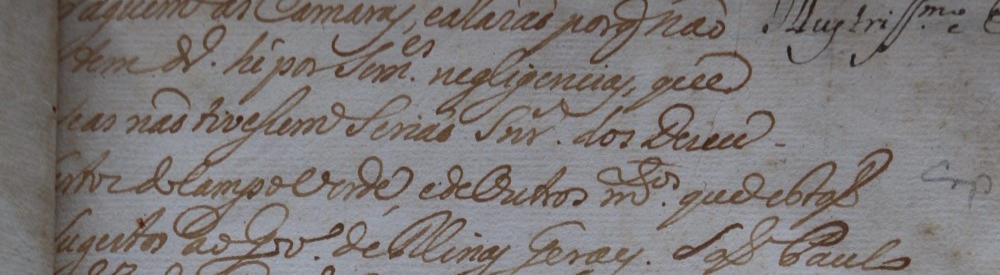
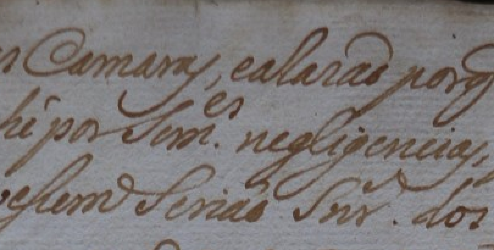
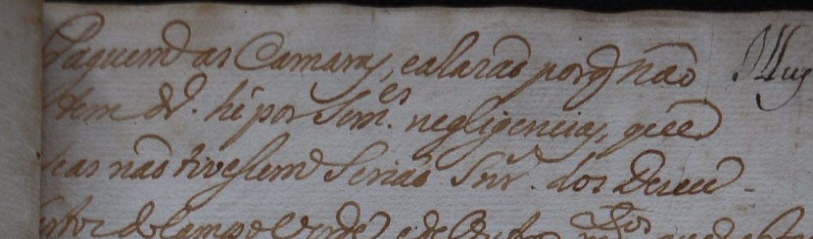
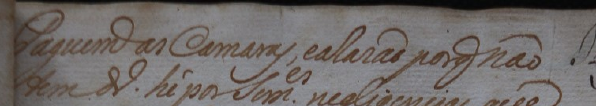
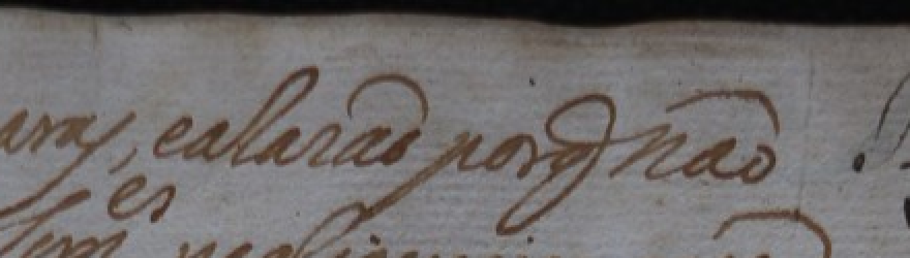
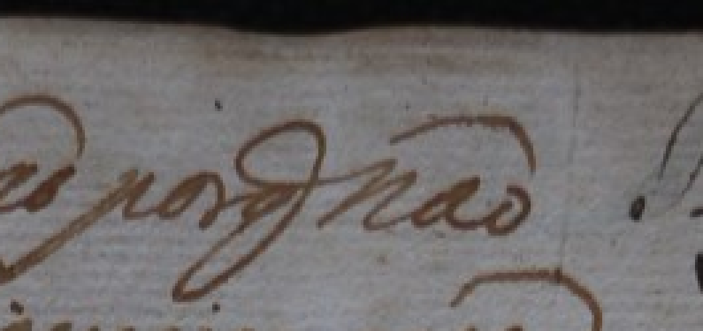

# Carta de 1767: revisão de 03/11/2026

**Continuidade 052:** o revisor confirmou [dos Desco com hífen ao final da terceira linha](observacao_052_linha03_dos_Desco_hifen.json). A leitura de trabalho fica **se as não tivessem seriam Srs dos Desco-**, preservando a situação da abreviatura registrada na 050. A interpretação da continuidade foi informada como dos Descobertos do campo verde; a conferência da forma literal da quarta linha prossegue abaixo. A linha integral ainda não foi formalmente validada.

## Quarta linha: conferência em contexto

| Manuscrito | Edição modernizada, página 3 |
| --- | --- |
|  | se as não tivessem seriam senhores dos Desco  **bertos do Campo verde, e de outros muitos que estão**  sujeitos ao Governo de Minas Gerais. São Paulo |

[Proveniência da visualização](linha04_contexto_proveniencia.json). Conferir inicialmente a caixa de campo/verde; a edição apresenta Campo com C maiúsculo. O hífen da terceira linha foi informado pelo revisor e permanece na leitura de trabalho, embora não apareça nessa quebra na edição.

**Continuidade 051:** o revisor confirmou [se as não tivessem seriam](observacao_051_linha03_inicio_confirmado.json), antes de Srs. A abreviatura permanece conforme a proposta registrada na observação 050. A [leitura parcial](linha03_leitura_de_trabalho.json) foi atualizada; a conferência segue para o final da terceira linha, correspondente a dos Desco na edição. Nenhuma pontuação ou marca de quebra foi inferida, e a linha integral continua pendente.

**Continuidade 050:** o revisor propôs a leitura abreviada [Srs](observacao_050_linha03_abreviatura_Srs.json), correspondente a senhores na edição. Ponto e letras elevadas não foram informados. A [leitura parcial da terceira linha](linha03_leitura_de_trabalho.json) preserva essa informação; seriam e as demais palavras continuam sem confirmação individual. Próximo passo: conferir o restante da terceira linha, mantendo manuscrito e edição lado a lado.

**Continuidade 049:** o revisor confirmou [negligencias sem acento e a vírgula antes do que final](observacao_049_negligencias_sem_acento_virgula.json). Dinheiro permanece provável, com a dúvida sobre a abreviatura preservada. He e a disposição soment/es continuam registrados. A leitura de trabalho integrada não foi convertida em alvo diplomático aprovado. A revisão segue para a terceira linha, com apoio da edição ao lado.

## Terceira linha: conferência em contexto

| Manuscrito | Edição modernizada, página 3 |
| --- | --- |
|  | tem dinheiro é por somentes negligências, que  **se as não tivessem seriam senhores dos Desco**  bertos do Campo verde, e de outros muitos que estão |

[Proveniência da visualização](linha03_contexto_proveniencia.json). A nova faixa é contextual, sem aprovação de limites. A primeira conferência focaliza as formas correspondentes a seriam e senhores, incluindo grafia, caixa e possíveis letras elevadas. As palavras da edição não foram copiadas para uma referência humana da terceira linha.

**Continuidade 048:** o revisor descreveu [soment na linha e es pequeno acima](observacao_048_soment_es_acima.json), interpretando o trecho como palavra por extenso com correção superior. A leitura integrada de trabalho é somentes; a disposição gráfica e a interpretação humana foram preservadas, sem classificar automaticamente o mecanismo como abreviatura. A conferência segue para a forma correspondente a negligências e a vírgula antes do que final.

A [proveniência da ampliação](linha02_soment_es_proveniencia.json) preserva as caixas e os hashes. A representação diplomática definitiva da disposição ainda não foi fixada; nenhum alvo integral foi validado.

**Continuidade 047:** o revisor informou [he com h](observacao_047_linha02_he.json) depois da abreviatura de dinheiro. A leitura foi preservada sem modernização para é. A presença de eventual diacrítico não foi decidida isoladamente. Dinheiro continua provável; a conferência segue para a forma correspondente a somentes, com manuscrito e edição lado a lado.

**Continuidade 046:** o revisor decidiu manter [dinheiro como provável](observacao_046_dinheiro_provavel_abreviatura_incerta.json), com possível d e ponto à direita observados, preservando a dúvida sobre a forma literal da abreviatura. A [leitura parcial de trabalho](linha02_leitura_de_trabalho.json) permanece separada de um alvo diplomático. A conferência segue para o restante da segunda linha, sem repetir a decisão sobre dinheiro.

**Continuidade 045:** o revisor relatou melhora na visualização e pediu ampliação da abreviatura após tem. A [comparação preparada](linha02_abreviatura_comparacao.md) mostra o detalhe em 5× e o contexto em 3×. Na edição modernizada, página 3, a forma é desenvolvida como dinheiro. A representação literal ainda precisa de conferência; não houve nova aprovação de texto ou geometria.

**Continuidade após a observação 043:** foram confirmados **e a Razão por**, com R maiúsculo, a **vírgula após Camaras** e **não como última palavra**. A leitura interpretativa que permanece provável, com o sinal incerto. A revisão segue para a segunda linha. Os registros anteriores abaixo preservam a sequência da conferência.

## Leitura de trabalho da primeira linha

> Paguem as Camaras, e a Razão por que não

**que é provável** e funciona aqui como leitura interpretativa. A forma literal observada é q com haste descendente, sem decisão sobre o sinal ou letra elevada. A [observação 043](observacao_043_linha01_Razao_virgula_nao.json) e a [leitura de trabalho estruturada](linha01_leitura_de_trabalho.json) preservam a distinção. Não é uma transcrição diplomática integral validada nem um alvo de treinamento.

## Próxima linha: segunda linha da anotação superior

A [observação 044](observacao_044_linha02_contexto_cortado.json) informa que a visualização anterior estava cortada e levanta a hipótese de distorção na digitalização. A conferência da fonte mostrou que a faixa escolhida era estreita para as hastes e volutas da escrita. A foto apresenta curvatura e perspectiva, mas a causa digital sugerida não foi demonstrada. O novo contexto 2× usa a caixa [15,0,845,245], sem retificação ou reconstrução. A segunda linha é a que começa por tem. As linhas vizinhas permanecem visíveis para não cortar as partes altas ou baixas dos caracteres. [Proveniência das visualizações novas](linha02_contexto_amplo_proveniencia.json) e [contexto superior completo](anotacao_superior_contexto_aberto.png). A [imagem anterior](linha02_contexto_2x.png) e sua [proveniência](linha02_contexto_proveniencia.json) foram preservadas como histórico. Nenhuma geometria foi aprovada por esta correção de visualização.

## Histórico da primeira linha

A [observação 039](observacao_039_linha01_leitura_parcial.json) registra a leitura humana parcial **Paguem as Camaras**, com dúvida no restante da primeira linha e pedido de ampliação. O restante não foi completado com a edição ou por inferência.

A [observação 040](observacao_040_q_descendente_elevacao_incerta.json) registra **q com haste descendente**, com elevação ainda incerta. A [comparação com outras ocorrências e a transcrição de apoio](comparacao_abreviaturas.md) reúne as ampliações da mesma anotação superior e a primeira linha da edição modernizada. Nenhuma letra elevada foi inferida como confirmada.

**Decisão posterior — observação 042:** o revisor decidiu manter [que como leitura provável, com sinal incerto](observacao_042_que_provavel_sinal_incerto.json). A observação literal de q com haste descendente está preservada. Não foram inseridos e elevado, ponto ou interrogação, nem adotada a expansão editorial como alvo validado. A próxima conferência trata das palavras entre Camaras e o grupo q e da última palavra, sem repetir a decisão de leitura provável.

## Ampliações para conferência

Recortes da imagem original, ampliados por repetição de pixels em escala inteira. Sem alteração de contraste, nitidez ou reconstrução dos traços. A recuperação dos pixels nativos foi conferida. As caixas, escalas e hashes estão na [proveniência](ampliacoes_proveniencia.json).

### Contexto da primeira linha, 2×

### Trecho após Camaras, 3×

### Final da linha, 4×

A faixa preserva um pouco da linha inferior como contexto. Conferir somente a primeira linha nesta rodada. A ampliação não recupera informação ausente da fonte e não substitui o recorte canônico.

Transcrição integral, geometria e correspondência documental continuam pendentes. A leitura parcial não foi convertida em referência validada ou arquivo de alvo para treinamento. Próximo passo: registrar as letras e os sinais que o revisor efetivamente distingue no restante da linha, com as incertezas preservadas.
