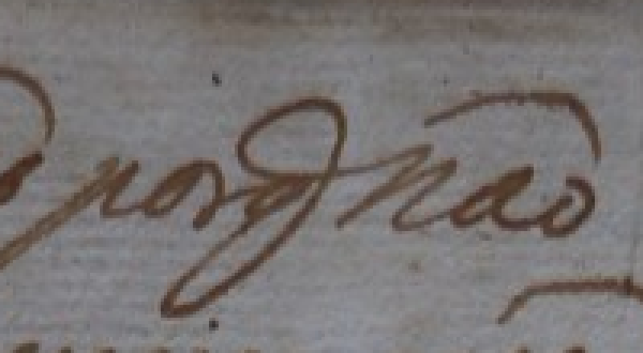
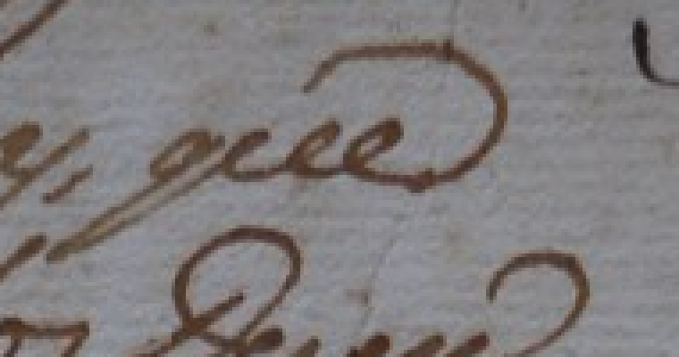
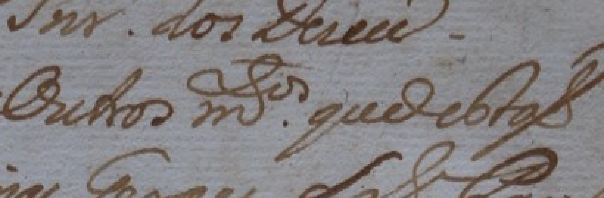

# Comparação gráfica e transcrição de apoio

Conferência de 03/11/2026. A [observação 040](observacao_040_q_descendente_elevacao_incerta.json) registra a leitura humana de **q com haste descendente**, sem confirmação da presença ou ausência de letra elevada. Essa incerteza permanece.

## Transcrição existente

A [edição modernizada em PDF](../../../../data/raw/corpus_expandido_v02/fontes/carta_jose_gomes_1767/modernized_edition_500a24d6a2ea8b93.pdf), página 3, apresenta:

> Paguem as Câmaras, e a razão por que não

Transcrição e edição: Júlia Munhoz e Matheus Bellodi (AHMJ). Revisão: Isabella Ferraro (AHMJ). A página foi extraída e renderizada para conferência. A edição desenvolve abreviaturas e atualiza grafia/pontuação; por isso, sua forma por que não decide automaticamente a representação literal da abreviatura no manuscrito.

## Comparadores da mesma página

Os comparadores vêm da anotação superior, para reduzir a diferença de aparência em relação ao corpo principal. Estar na mesma página não demonstra, por si, autoria pela mesma mão. A análise abaixo é de Codex (IA), não nova confirmação humana.

### A: grupo da primeira linha

### B: final da segunda linha

### C: trecho intermediário da anotação

O grupo A e as ocorrências candidatas de q nos comparadores apresentam laço e haste descendente semelhantes. Em B, a leitura visual parece compatível com que por extenso, servindo à comparação do desenho e das ligações. Esses comparadores reforçam a interpretação do q já informado pelo revisor. Não permitem confirmar com segurança uma letra elevada no grupo A.

A expansão que na edição oferece apoio de contexto, mas não prova se o alvo literal deve ser q, q com letra elevada ou outra convenção. Não foram adotados qᵉ, q., porq ou a frase editorial como transcrição validada.

## Preservação e continuidade

As imagens foram ampliadas em 4× por repetição de pixels, com recuperação exata da matriz nativa conferida. [Caixas, hashes e análise estruturada](comparacao_abreviaturas_proveniencia.json).

Manter como decisões humanas Paguem as Camaras e a observação localizada de q descendente. O restante da linha e a elevação continuam pendentes. Candidato, geometria e alvos de treinamento não foram promovidos nesta comparação.

Ferramenta: Codex, da OpenAI. Utilização: extração e renderização da edição, criação de comparadores rastreáveis da imagem e análise visual assistida, com distinção entre expansão editorial e forma manuscrita.

## Hipótese de pontuação e hábito gráfico

A [observação 041](observacao_041_hipotese_sinal_que_pontuacao.json) preserva a proposta do revisor de interpretar o sinal como pontuação ou hábito gráfico, incluindo a possibilidade de interrogação. A leitura que foi mencionada no contexto da pergunta, sem especificação definitiva dos grafemas e sinais.

A análise visual por IA favorece forma do q/ligação gráfica ou sinal abreviativo, sem demonstrar interrogação: há desenho semelhante em outros q da anotação e não foi isolado com segurança um sinal interrogativo independente. O arco sobre a última palavra é compatível com til de não. O contexto editorial por que não tem... favorece a leitura da conjunção, mas não decide sozinho a pontuação manuscrita.

Não é necessário encontrar letra elevada para admitir uma abreviatura. O [estudo de documentos setecentistas de Diamantina](https://revistas.ufpr.br/letras/article/view/36430) distingue sinais abreviativos de pontuação, mesmo quando a forma gráfica é parecida. A [revisão metodológica de exame de escrita](https://archives.fbi.gov/archives/about-us/lab/forensic-science-communications/fsc/oct2009/review/2009_10_review02.htm) trata a comparação como análise da combinação de características; um sinal isolado não identifica nominalmente o autor.

As hipóteses não foram convertidas em ?, e elevado ou outro caractere no alvo. Permanece o registro humano de q com haste descendente e a dúvida sobre o sinal.

## Decisão humana posterior

A [observação 042](observacao_042_que_provavel_sinal_incerto.json) adota que como leitura provável e mantém a dúvida sobre o sinal. A decisão não acrescenta uma interrogação ou letra elevada ao texto literal. Continuar a leitura dos segmentos restantes da primeira linha, preservando o nível de certeza informado.
