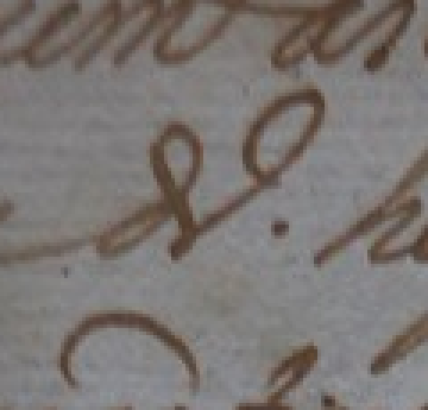
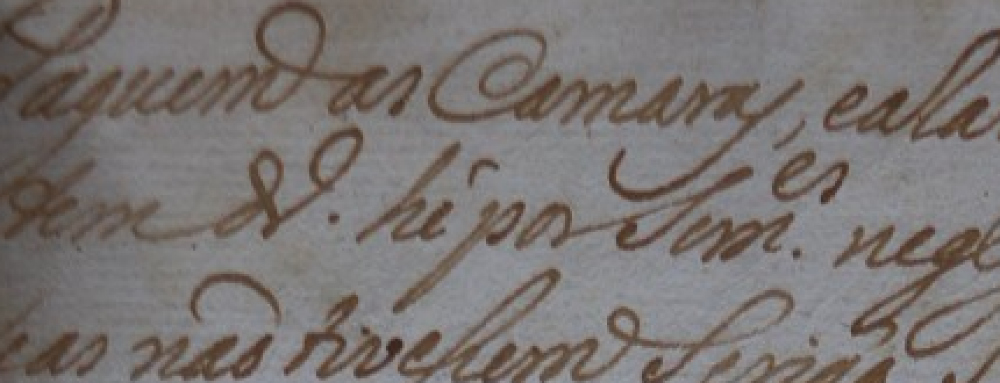

# Abreviatura após tem: imagem e edição

Conferência de 03/11/2026, em resposta à [observação 045](observacao_045_pedido_comparacao_abreviatura_apos_tem.json).

## Detalhe em 5×

Recorte contextual `[135,50,255,165]` da imagem original, ampliado em escala inteira por repetição de pixels. Sem reconstrução, rotação ou filtros. A faixa preserva partes das linhas vizinhas para não cortar os laços. [Caixas, escalas e hashes](linha02_abreviatura_ampliacoes_proveniencia.json).

## Contexto em 3×

## Comparação editorial

Na página 3 da [edição modernizada](../../../../data/raw/corpus_expandido_v02/fontes/carta_jose_gomes_1767/modernized_edition_500a24d6a2ea8b93.pdf), o trecho correspondente está como:

> tem dinheiro é por somentes negligências, que

Portanto, a edição desenvolve o sinal após tem como **dinheiro**. Essa correspondência editorial ajuda a interpretar o contexto. A imagem mostra laços e um pequeno ponto à direita do sinal, mas as letras e a função do ponto ainda precisam de leitura humana específica. Não foi adotada automaticamente uma forma como d., dº ou drº, nem a palavra dinheiro por extenso, no alvo diplomático.

O relato Agora ficou melhor foi registrado como melhora de visualização, sem convertê-lo em aprovação integral da geometria. A transcrição da segunda linha e os limites canônicos continuam pendentes.

Ferramenta: Codex, da OpenAI. Utilização: ampliação rastreável, extração e comparação do trecho da edição e organização da conferência. Transcrição e edição de apoio: Júlia Munhoz e Matheus Bellodi (AHMJ); revisão de Isabella Ferraro (AHMJ).

## Decisão humana posterior

A [observação 046](observacao_046_dinheiro_provavel_abreviatura_incerta.json) informa algo parecido com d e o ponto à direita. O revisor escolhe dinheiro como provável, mantendo incerta a abreviatura. O ponto visível não foi convertido automaticamente em pontuação da frase ou em convenção abreviativa definida. A leitura continua no restante da linha, sem completar alvos por inferência.
