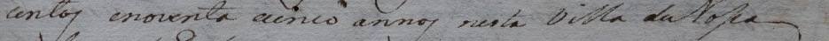
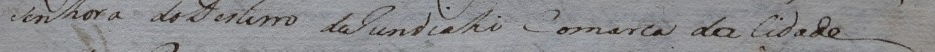
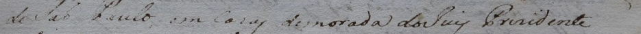
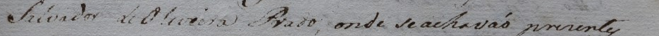
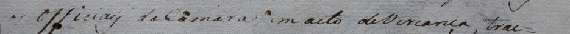
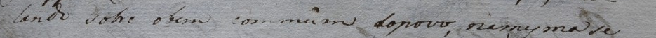
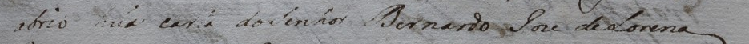

# Revisão humana de 03/11/2026

Continuação do bloco de oito linhas de 1795. Revisor identificado nos registros anteriores: Rodolfo Vinicius Cima Takemoto.

**Estado após a observação 038:** sete textos validados (linhas 1–7), linha 8 provável e pendente, oito geometrias validadas. Associação ao fólio 91r da sessão de 25/06/1795 e descrição da cobertura parcial de oito linhas confirmadas. A dúvida abriu/abrio e a exclusão da oitava linha estão preservadas; a região mantém complete=false. [Exportação atual](exportacao_apos_observacao_038/lines.jsonl), [verificação](verificacao_observacao_038.json), [fechamento da curadoria](fechamento_curadoria_038.md) e [pacote dos sete pares revisados](../../../entregas/continuidade_20261103/dataset_revisado_1795/README.md). As partições científicas continuam pendentes.

A [observação 037](observacao_037_confirmacao_integral_linhas_1_2_3_5_7.json) encerra a conferência integral das linhas 1, 2, 3, 5 e 7. As descrições das decisões localizadas abaixo preservam sua origem e foram sucedidas por essa confirmação. Não solicitar novamente aprovação textual das linhas 1–7. A [identificação e cobertura foram confirmadas na observação 038](observacao_038_identificacao_cobertura_parcial.json).

## Linha 1: confirmação localizada

A [observação 027](observacao_027_linha01_dias_junho.json) registra a resposta humana de que **dias está por extenso** e **junho começa com minúscula**. As formas já constam no rascunho:

> Aos vinte e cinco dias do mes de junho de mil sete

Aos, a geometria da primeira linha e o uso do recorte atual já estavam confirmados nas observações 024–026. Os dois pontos adicionais de dias/junho estão resolvidos e não precisam ser perguntados novamente.

O registro é aditivo. Texto, imagem, revisão do editor, geometria e estados de aprovação integral foram preservados. A confirmação localizada não foi convertida em aprovação integral ou em novos pares aptos para treino.

## Linha 2: abreviatura confirmada

Rascunho existente:

> centos e noventa e cinco annos nesta Villa de Nˢᵃ

A [observação 007](../sessao_20261026/observacao_007_linha02_leitura_limites.json) já registra a leitura da linha, as grafias annos/Villa e os limites completos. A [observação 028](observacao_028_linha02_Nossa_abreviada.json) confirma que **Nossa está abreviada e não há pontuação depois**. Esses dois pontos estão resolvidos.

A [observação 035](observacao_035_linha02_Nsa_elevado.json) esclarece a forma literal: **N com sa elevado, sem pontuação depois**. O rascunho usa **Nˢᵃ**, com s e a elevados em Unicode conforme a descrição humana. A expansão Nossa permanece na edição de apoio. A exclusão específica por abreviatura não representada foi resolvida e removida do editor; a linha permaneceu pendente até sua confirmação integral na observação 037. Não repetir a pergunta sobre a abreviatura.

- [Exportação após o registro 028](exportacao_apos_observacao_028/lines.jsonl).
- [Verificação da aplicação e preservação](verificacao_observacao_028.json).

## Linha 3: iniciais minúsculas confirmadas

Rascunho existente:

> senhora do Desterro de jundiahy comarca da cidade

A [observação 029](observacao_029_linha03_iniciais_minusculas.json) confirma **jundiahy**, **comarca** e **cidade** com iniciais minúsculas. O rascunho já contém essas formas e foi preservado. A leitura anterior assistida está na [observação 008](../sessao_20261026/observacao_008_linha03_leitura.json). Os limites geométricos já estão validados. Não repetir a pergunta de caixa das três palavras.

## Linha 4: transcrição integral validada

Rascunho existente:

> de São Paulo, em casas de morada do Juiz Presidente

As observações 020–023 registram Juiz, do Juiz, Presidente com ressalva de escrita apagada e a vírgula após Paulo. A [observação 030](observacao_030_linha04_confirmacao_integral.json) confirma integralmente a transcrição apresentada. O editor agora registra `review_status=validated`, `reference_kind=human_diplomatic` e confirmação visual. A exclusão por revisão textual pendente foi resolvida e removida. A condição histórica de escrita apagada permanece registrada; a resposta não é uma segunda leitura independente da edição. Não foi acrescentado ponto final ao texto.

A correspondência da página, a cobertura regional e as partições continuam pendentes. A aprovação textual da linha não transforma o bloco inteiro em referência apta para treino ou avaliação.

## Linha 5: til e vírgula confirmados

Rascunho existente:

> Salvador de Oliveira Prado, onde se achavão presentes

A [observação 010](../sessao_20261028/observacao_010_linha05_leitura_limites_ressalva.json) registra a leitura e os limites, com ressalva de escrita apagada. A [observação 031](observacao_031_linha05_til_virgula.json) confirma o **til sobre o a de achavão** e a **vírgula após Prado**. Os dois sinais já constam no rascunho e foram preservados. Não repetir essas perguntas. A aprovação textual integral foi recebida posteriormente na observação 037.

## Linha 6: grafia, caixa e pontuação confirmadas

Rascunho existente:

> os officiaes da Camara em acto de Vereança, trat-

A [observação 032](observacao_032_linha06_grafia_caixa_pontuacao.json) confirma a grafia e a caixa do rascunho apresentado, incluindo a cedilha de **Vereança** e a vírgula depois dela. O [hífen final já estava confirmado](../sessao_20261028/observacao_012_linha06_confirmacao_hifen.json). A sexta linha foi consolidada como texto humano validado no editor, preservando texto, geometria e imagens. Não repetir essas confirmações ou unir trat- à linha seguinte.

## Linha 7: commum e vírgula confirmados

Rascunho existente:

> ando sobre o bem commum do povo, na mesma se

A [observação 033](observacao_033_linha07_commum_virgula.json) confirma **commum com dois m** e a **vírgula após povo**. A grafia e o sinal já constam no rascunho e foram preservados. Não repetir essas perguntas. A confirmação é localizada; a aprovação textual integral da linha foi recebida posteriormente na observação 037. Preservar ando como início desta linha física, separado de trat- da linha 6.

## Linha 8: Snr e acento confirmados, primeira palavra incerta

Rascunho após a observação 034:

> abriu huma carta do Snr Bernardo José de Lorena

A [observação 014](../sessao_20261028/observacao_014_linha08_leitura_limites_ressalva.json) registra a leitura assistida, a forma huma e os limites do recorte, com ressalva de escrita apagada. A [observação 034](observacao_034_linha08_abrio_abriu_Snr_Jose.json) confirma **Snr** como abreviatura de Senhor e o **acento visível em José**. Snr foi incorporado ao rascunho, em caracteres comuns conforme a forma informada, sem acrescentar ponto ou elevação não especificados. A edição modernizada e o texto publicado foram preservados separadamente.

O revisor informou inicialmente **abrio**, ponderando depois que a letra poderia ser **u**. A [observação 036](observacao_036_linha08_abriu_provavel.json) decide expressamente manter **abriu como provável**, com **abrio** como alternativa histórica e incerteza explícita em `exclusion_reason`. A linha permanece excluída como alvo aprovado para treino/avaliação. Não insistir em uma escolha definitiva nesta rodada ou repetir as confirmações de Snr e do acento de José.

## Consolidação textual concluída

A [observação 037](observacao_037_confirmacao_integral_linhas_1_2_3_5_7.json) aprovou os cinco textos do quadro. A [consolidação final](consolidacao_apos_confirmacao_037.md) apresenta as sete linhas validadas e a oitava provável, preservando a dúvida e a exclusão. A linha 8 permanece incluída no bloco e no relatório, sem omissão.

A [conferência documental preparada](identificacao_e_cobertura_20261103.md) reúne a identificação do fólio 91r pela ficha institucional, a identidade do PDF oficial e local e o caráter parcial do bloco de oito linhas. A preparação por IA foi posteriormente confirmada pelo revisor na observação 038. Os estados de correspondência da página e da descrição da cobertura parcial foram validados, preservando complete=false e a dúvida da linha 8. O documento apresentado antes da resposta foi preservado com o hash registrado na observação.
