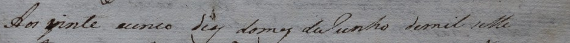
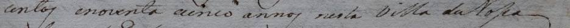
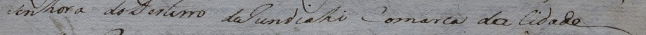
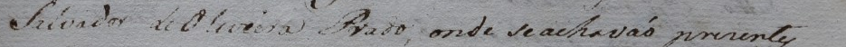
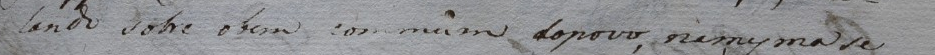

# Consolidação das oito linhas de 1795

Preparada em **03/11/2026**, após a observação 036. Revisor identificado nos registros: Rodolfo Vinicius Cima Takemoto.

Snapshot: `20261103T161812_55a981b3`. [Exportação correspondente](exportacao_apos_observacao_036/lines.jsonl), [verificação](verificacao_observacao_036.json) e [quadro estruturado com vínculos e hashes](consolidacao_linhas_20261103.json).

## Texto e situação atual

| Linha | Transcrição atual | Situação |
| --- | --- | --- |
| 1 | Aos vinte e cinco dias do mes de junho de mil sete | Para confirmação integral |
| 2 | centos e noventa e cinco annos nesta Villa de Nˢᵃ | Para confirmação integral |
| 3 | senhora do Desterro de jundiahy comarca da cidade | Para confirmação integral |
| 4 | de São Paulo, em casas de morada do Juiz Presidente | Texto validado |
| 5 | Salvador de Oliveira Prado, onde se achavão presentes | Para confirmação integral |
| 6 | os officiaes da Camara em acto de Vereança, trat- | Texto validado |
| 7 | ando sobre o bem commum do povo, na mesma se | Para confirmação integral |
| 8 | abriu huma carta do Snr Bernardo José de Lorena | Provável, excluída como alvo aprovado |

Nˢᵃ representa N com sa elevado, conforme descrição humana da observação 035. Snr preserva a abreviatura informada na observação 034. A grafia histórica, as iniciais e os sinais confirmados foram mantidos. A quebra trat- / ando permanece em duas linhas físicas.

**Linha 8:** abriu foi escolhido como **provável**, com a dúvida preservada e abrio mantido como alternativa histórica na observação 036. Não é necessário insistir em uma escolha definitiva nesta rodada. A linha permanece no bloco, explicitamente excluída como alvo aprovado para treino/avaliação.

## Consolidação pendente

As linhas **4 e 6** já estão validadas e não precisam de nova confirmação. As linhas **1, 2, 3, 5 e 7** estão preparadas abaixo para uma única conferência integral, aproveitando as decisões pontuais já recebidas. Corrigir qualquer trecho se necessário, identificando a linha.

Correspondência da página, cobertura parcial da região e partições por documentos independentes continuam pendentes. Essas tarefas são separadas da conferência textual. O bloco tem oito geometrias validadas, dois textos validados, seis textos pendentes e zero novos pares elegíveis para treino científico.

## Imagens para a conferência integral

### Linha 1

> Aos vinte e cinco dias do mes de junho de mil sete

### Linha 2

> centos e noventa e cinco annos nesta Villa de Nˢᵃ

### Linha 3

> senhora do Desterro de jundiahy comarca da cidade

### Linha 5

> Salvador de Oliveira Prado, onde se achavão presentes

### Linha 7

> ando sobre o bem commum do povo, na mesma se

## Comentários

Ferramenta: Codex, da OpenAI. Utilização: registro das decisões humanas, aplicação das alterações autorizadas no editor, preservação de evidências, conferência de integridade e organização deste quadro. A preparação do quadro não atribui novas leituras ao revisor.
