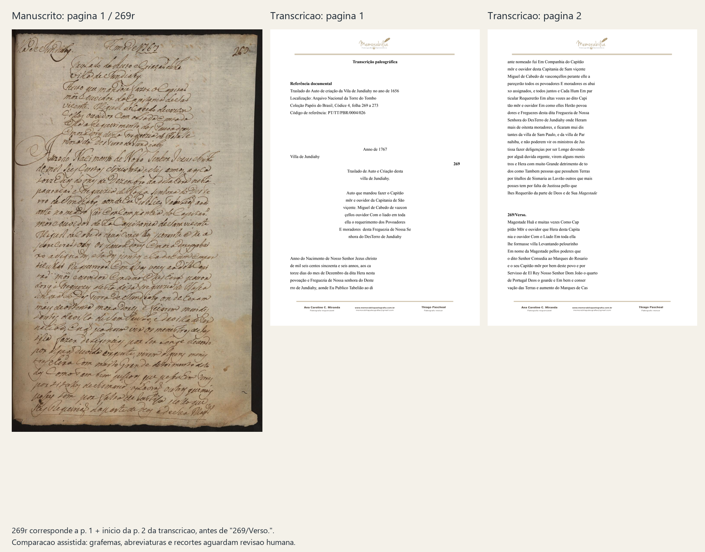
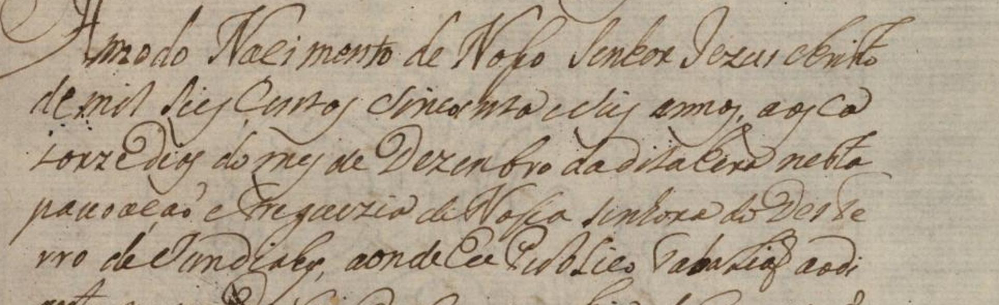
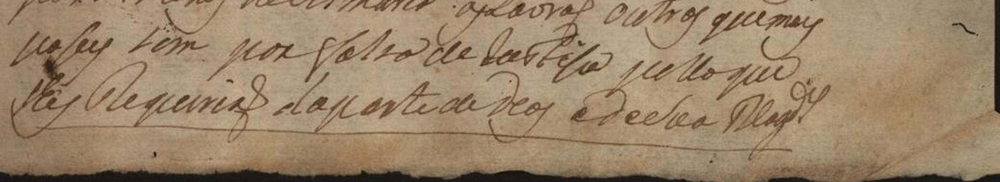

# Traslado: comparação inicial do fólio 269 reto

Comparação assistida em 16/10/2026. **O material é aproveitável como base de
revisão, com adaptações antes de ser referência de treino ou avaliação.**
A comparação foi visual, apoiada na extração textual da edição; não constitui
validação humana de cada grafema, caixa de linha ou cobertura.

**Estado mais recente da revisão:** foram confirmados parcialmente a sequência
`seis centos sincoenta e seis annos`, a quebra `ca / torze`, `Dias` com inicial
maiúscula e `da dita Hera nesta povoação`. A dúvida sobre `Hera` foi resolvida
pelo usuário ao consultar a página inteira. A abertura recebeu reconhecimento
parcial de conteúdo; as linhas completas e a cobertura seguem pendentes.
Os registros anteriores abaixo são preservados como histórico.

**Preparação para o editor:** as cinco primeiras linhas agora têm caixas e
catálogo candidatos, em workspace próprio. Abra o [bloco de revisão com os
cinco recortes, tabela e comandos](conferencia_bloco.md). Isso não altera os
estados pendentes das 24 linhas deste registro documental. A integridade dos
oito snapshots legados e o contrato dos novos estão em [integridade.md](integridade.md).

## Fontes e correspondência

- Manuscrito: `data/raw/import_20261015/6e82cef18b04_5b58a915f024a80e.pdf`,
  primeira página física, com número 269 visível. A imagem JPEG incorporada foi
  extraída sem alteração dos bytes: 1166 × 1873 pixels.
- Edição: `data/raw/import_20261015/6e82cef18b04_6b5c840cfc3b7381.pdf`,
  **página 1 e parte inicial da página 2**, até o marcador `269/Verso.`.
- A segunda página do manuscrito foi inspecionada somente para conferir a
  passagem ao verso; ela começa pelo trecho que a edição apresenta depois
  desse marcador.
- Os hashes dos PDFs e da imagem extraída estão em
  [comparacao.json](comparacao.json). Créditos visíveis na edição: Ana Caroline
  C. Miranda, paleógrafa responsável; Thiago Paschoal, paleógrafo revisor.

Para conferir o contexto, abra a [página inteira do manuscrito](images/manuscrito_269r_original.jpg).
A data indicada no cabeçalho do traslado é 1767; o corpo descreve o ato de
1656. Essas funções de data são mantidas separadas e não equivalem a uma
confirmação humana de todos os sinais do cabeçalho.
Os PDFs derivados locais podem ser recuperados a partir dos membros de
[`Transcrições.rar`](../../../data/raw/Transcrições.rar) registrados no inventário.



## O que corresponde

A sequência do título, resumo e corpo da página é reconhecível nas duas fontes.
O corpo foi alinhado provisoriamente em **24 linhas físicas candidatas**:
cinco estão na página 1 da edição e 19 estão na página 2. Os índices abaixo são
locais desta comparação; não são numeração editorial nem IDs do catálogo HTR.

| Região do manuscrito | Localização na edição | Observação |
|---|---|---|
| Data, local e fólio no alto | Página 1 | A edição reposiciona esses elementos; extrair em regiões próprias |
| Título em duas linhas | Página 1 | Correspondência de conteúdo aparente |
| Resumo em sete linhas candidatas | Página 1 | Há formas aparentemente abreviadas que exigem inspeção própria |
| Corpo, linhas candidatas 1–5 | Final da página 1 | De `Anno do Nacimento...` até `...ao di` |
| Corpo, linhas candidatas 6–24 | Início da página 2 | De `ante nomeado...` até `...Sua Magestade` |
| Texto depois de `269/Verso.` | Página 2 | Pertence à próxima página do manuscrito |

Há preservação de grafias históricas na edição, como `Jundiahy`, `sincoenta`,
`Freguezia`, `Hum` e `Sismaria`. A comparação visual também mostra quebras
compatíveis com o manuscrito em casos como `ca / torze`, `Deste / rro`,
`di / ante` e `abai / xo`. Essas evidências favorecem o uso da edição como
rascunho de apoio. Não demonstram equivalência de todos os sinais.

Primeiras cinco linhas do corpo **conforme a edição**, sem promovê-las a
transcrição diplomática validada:

```text
Anno do Nacimento de Nosso Senhor Jezus christo
de mil seis centos sincoenta e seis annos, aos ca
torze dias do mes de Dezembro da dita Hera nesta
povoação e Freguezia de Nossa senhora do Deste
rro de Jundiahy, aonde Eu Publico Tabelião ao di
```



## Diferenças que afetam o projeto

**Abreviatura desenvolvida.** Na última linha do reto, o manuscrito termina
com uma forma abreviada. A edição apresenta `Magestade`, em itálico. A inspeção
das fontes do PDF confirma fonte itálica nesse token, enquanto o trecho
anterior está em fonte regular. Isso é evidência local de tratamento editorial;
não foi estabelecida uma regra de que todo itálico da edição sempre indica
expansão. A sequência exata dos sinais da abreviatura ainda precisa de decisão
humana. Não substituir silenciosamente a forma visível pela palavra expandida.



**Texto simples perde informação tipográfica.** A extração comum do PDF
devolve `Magestade` sem informar, no próprio texto, o itálico. Guardar a edição
e a nota de expansão junto ao rascunho. A forma desenvolvida não deve preencher
automaticamente `text_diplomatic` sob a política atual.

**Paginação diferente.** Uma página do manuscrito ocupa partes de duas páginas
da edição. Associar número de página a número de página produziria uma
cobertura incompleta do reto e incluiria parte do verso indevidamente.
O trecho `ao di / ante` é uma quebra entre linhas do mesmo reto e, na edição,
também coincide com mudança de página do PDF.

**Paratexto e ordem de leitura.** Logotipo, referência documental, nomes dos
profissionais e ornamentos pertencem à edição. Já data, local, fólio e título
existem no manuscrito e precisam de uma decisão explícita de região/ordem.
O corpo pode ser selecionado como região própria, documentando o que ficou fora.

**Revisão de sinais permanece necessária.** Caixa, acentos, pontuação, espaços,
letras elevadas e eventuais expansões do cabeçalho precisam de confronto em
ampliação. Esta comparação não declara erros da edição, nem fornece uma lista
exaustiva de expansões ou uma taxa de fidelidade.

## Decisão e preparação realizada

| Uso | Decisão nesta etapa |
|---|---|
| Apoio à leitura e pesquisa textual | Adequado, mantendo autoria e proveniência |
| Rascunho de referência alinhada à imagem | Adequado, com revisão de abreviaturas e sinais |
| Alvo diplomático copiado diretamente do PDF | Incompatível no exemplo de expansão identificado |
| Treino, avaliação CER/WER ou validação de página completa | Ainda não apto; faltam revisão humana e geometria |

Foram preparados [24 trechos da edição em ordem](corpo_269r_edicao.txt), cada
qual com página de origem em [comparacao.json](comparacao.json). Os textos
continuam identificados como edição publicada e `pending_review`; as caixas
de linha estão nulas e nenhum item foi incorporado às linhas validadas do
projeto. Não se calculou CER/WER contra uma leitura inferida pelo agente.
O arquivo de consulta em texto remove somente espaços finais de linha;
`published_text` no JSON preserva a extração original, inclusive esses espaços.

O primeiro trecho indicado para revisão conjunta são as **cinco primeiras
linhas do corpo**, preservando quebras e deixando a leitura dos sinais em
aberto. Depois, conferir o restante do corpo e decidir uma convenção explícita
para a abreviatura final. O mesmo documento e seus derivados devem permanecer
no mesmo grupo de partição experimental.

As imagens e os recortes usados neste caderno têm cópias versionadas em
[`images/`](images/), com checksums em [arquivos.json](arquivos.json), para
visualização no GitHub. Os derivados locais completos continuam em
`data/processed/traslado_269r_conferencia/`, ignorado pelo Git. Recortes são
ampliações dos pixels disponíveis, sem reconstrução de letras. Os PDFs e a
transcrição fornecidos foram mantidos intactos.

## Leitura parcial recebida na revisão

Em 16/10/2026, o usuário observou: «Lendo oq foi trascrito me faz sentido essa
imagem, eu vejo o anno de nacimento de nosso senhor jesus cristo de mil....»

Foi registrado o reconhecimento parcial do conteúdo da abertura, abrangendo a
primeira linha e o início da segunda. A leitura foi feita com apoio da edição
e da imagem apresentada. A mensagem não fixa a grafia de cada palavra: a forma
`jesus cristo` usada pelo usuário não substitui automaticamente `Jezus christo`
da edição. Também não se acrescentou ao manuscrito o `o` inicial da mensagem.

Caixa, grafia exata, sinais, pontuação, continuação da segunda linha, geometria
e cobertura permanecem em conferência. Nenhuma linha completa foi validada.
A observação e sua mensagem original foram guardadas em `comparacao.json`;
a versão anterior do arquivo foi preservada em `revisions/`.

Na sequência, após a apresentação do trecho `seis centos sincoenta e seis annos`,
o usuário respondeu: «Simm leio exatamente isso». A sequência foi registrada
como confirmação textual parcial da segunda linha, preservando as separações
`seis centos` e a grafia `sincoenta`. Caixa, pontuação, sinais, restante da linha,
geometria e cobertura continuam em conferência. Nenhuma linha completa foi
validada. O registro anterior de `comparacao.json` também foi preservado.

O usuário confirmou em seguida a divisão `ca / torze`, perguntando se ela havia
sido observada na imagem ou apenas na transcrição. O recorte foi reaberto:
`ca` está no fim da segunda linha do corpo e `torze` no início da terceira,
na mesma página do manuscrito (269r). A comparação do agente foi assistida pela
edição, sem alegação de leitura independente. Foi registrada especificamente
a confirmação da quebra; o restante da terceira linha não foi automaticamente
promovido a texto confirmado.

Na etapa seguinte foi preparada a [inspeção do restante da terceira linha](linha_03.md),
com recortes de contexto e dúvidas explícitas sobre a caixa de `dias/Dias`,
a inicial de `Hera/Era`, acentuação e pontuação. São propostas assistidas do
agente; nenhuma nova confirmação humana ou validação foi inferida.

Posteriormente, o usuário confirmou `Dias`, indicando inicial maiúscula, e
`nesta`. A palavra que a edição apresenta como `Hera` não foi reconhecida pelo
usuário e continua em aberto, sem substituição por `Era` ou exclusão.
As confirmações parciais e a dúvida estão no registro da terceira linha;
nenhuma linha completa foi validada.

Ao retornar à página inteira, o usuário confirmou depois `da dita Hera nesta
povoação`, esclarecendo que o recorte havia dificultado a leitura. A dúvida
anterior sobre `Hera` foi resolvida por essa confirmação, preservando o histórico.
O trecho foi associado ao fim da linha 3 e ao início da linha 4, sem validar
integralmente nenhuma das duas linhas.
