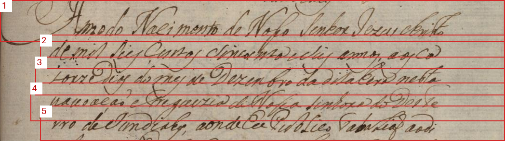
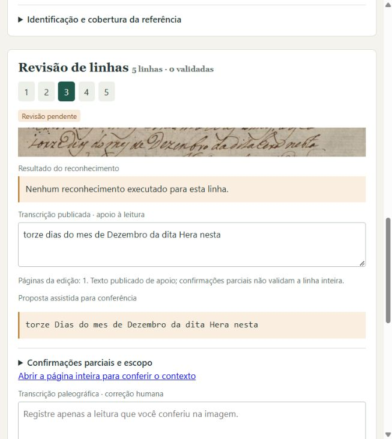

# Cinco primeiras linhas do corpo — fólio 269 reto

Preparação de 16/10/2026 para **Rodolfo Vinícius Cima Takemoto**, responsável
previsto pela revisão. Nenhuma nova revisão efetiva foi atribuída a esse nome:
texto, geometria, correspondência e cobertura continuam pendentes.



O bloco inteiro mantém o contexto da leitura:


[Abrir a página inteira](images/manuscrito_269r_original.jpg). O floreio da
inicial A se prolonga acima do bloco e há hastes/descendentes de linhas vizinhas
nos recortes. Conferir os limites antes de aprovar qualquer geometria; as
caixas são propostas retangulares, não uma separação perfeita da tinta.

## Texto, confirmações e pendências

Os números 1–5 são índices locais desta amostra. No esquema canônico,
`reading_order` é 0–4. O texto publicado conserva `dias` em minúscula. A proposta
assistida usa `Dias` conforme a confirmação recebida, sem modificar a edição.
Nenhuma proposta preenche automaticamente a transcrição humana no editor.

| Linha | Texto publicado (página 1 da edição) | Proposta assistida para conferência | Confirmações existentes | Pendências |
|---|---|---|---|---|
| 1 | `Anno do Nacimento de Nosso Senhor Jezus christo` | `Anno do Nacimento de Nosso Senhor Jezus christo` | Reconhecimento parcial do conteúdo da abertura | Grafia de cada palavra, caixa, sinais e pontuação; floreio inicial, limites e ordem |
| 2 | `de mil seis centos sincoenta e seis annos, aos ca` | `de mil seis centos sincoenta e seis annos, aos ca` | `seis centos sincoenta e seis annos`; quebra `ca / torze`; início `de mil` reconhecido na abertura | Restante, caixa, vírgula/sinais e geometria |
| 3 | `torze dias do mes de Dezembro da dita Hera nesta` | `torze Dias do mes de Dezembro da dita Hera nesta` | Quebra `ca / torze`; `Dias`, `nesta` e sequência `da dita Hera nesta povoação` | Restante da linha, acentuação/sinais/pontuação, limites e ordem |
| 4 | `povoação e Freguezia de Nossa senhora do Deste` | `povoação e Freguezia de Nossa senhora do Deste` | `povoação`, na sequência confirmada no contexto da página inteira | Restante da linha, grafia, caixa, sinais e geometria; `nesta / povoação` é mapeamento observado pelo agente |
| 5 | `rro de Jundiahy, aonde Eu Publico Tabelião ao di` | `rro de Jundiahy, aonde Eu Publico Tabelião ao di` | Nenhuma confirmação textual específica desta linha | Toda a linha e geometria; `Deste / rro` e `di / ante` observados pelo agente, sem nova confirmação humana |

As mensagens originais, escopos e horários permanecem em
[comparacao.json](comparacao.json) e foram associados às linhas canônicas em
`published_reference.human_observations`. A dificuldade inicial com `Hera` e
sua posterior resolução no contexto da página inteira continuam acessíveis.

### Recortes candidatos em pixels originais

1. Caixa `[12, 540, 1060, 628]`.

   

2. Caixa `[95, 612, 1060, 684]`.

   

3. Caixa `[85, 658, 1060, 739]`.

   

4. Caixa `[75, 712, 1060, 793]`.

   

5. Caixa `[95, 760, 1060, 834]`.

   

As coordenadas se referem exclusivamente ao JPEG original, 1166 × 1873 pixels,
SHA-256 `69f5b52cb74e0ea91e406ed0e1d8c6decd2af8ac1f93353fe5bdf619792417f0`.
A região candidata é `[12, 540, 1060, 834]`, com cobertura pendente, sem
aprovação do resto das 24 linhas ou da página. A data do ato (1656) e o ano
indicado para a cópia (1767) permanecem campos separados.

## Abrir esta amostra no editor

Comandos na raiz do repositório; nesta máquina usar `.\.venv\Scripts\python.exe`
no lugar de `python`. Não requer download de pesos ou nova inferência.

```powershell
python scripts/traslado_history.py verify
python scripts/prepare_traslado.py
python -m paleographia validate --manifest data/manifests/traslado_269r/lines.jsonl --pages data/manifests/traslado_269r/pages.jsonl --purpose catalog --report tmp/traslado_catalog.json
python -m paleographia import-catalog --pages data/manifests/traslado_269r/pages.jsonl --lines data/manifests/traslado_269r/lines.jsonl --config configs/traslado_269r.toml
python -m paleographia serve --config configs/traslado_269r.toml --host 127.0.0.1 --port 8011
```

Abra [o editor do Traslado](http://127.0.0.1:8011). Se o workspace
`data/workspace_traslado_269r` já tiver sido importado, **pule `import-catalog`**;
o comando recusa workspace ocupado. Não apague o workspace nem substitua o
piloto de 1831 em `data/workspace`. A preparação pode ser repetida quando o
catálogo permanece idêntico; alterações de revisão nos manifests causam recusa
sem sobrescrita. Revisões no workspace permanecem independentes da preparação.

Se a edição PDF local estiver ausente, a preparação recupera somente o membro
exato de `data/raw/Transcrições.rar`, verificando os hashes do arquivo e do
membro antes de gravar. Para RAR é necessário o suporte do `rarfile` e, quando
solicitado por ele, um descompactador compatível disponível no ambiente.
Fonte local divergente causa erro sem substituição. O JPEG e os recortes são
versionados; não é necessário extrair novamente todo o acervo.



No editor, confira a página e o bloco antes das palavras isoladas. O apoio
publicado é somente leitura; o campo humano começa vazio. Ajuste os limites,
ordem e texto, registre dúvidas e salve rascunhos. Marque cada conferência
somente quando realizada; confirmar palavras não valida automaticamente uma
linha, a região inteira ou o fólio.

## Exportar e preparar diagnóstico exploratório

Os comandos abaixo estão prontos para uso depois da conferência humana real.
Escolha nomes de saída novos em cada exportação. A validação para avaliação
**falha com código 2 enquanto a amostra permanecer pendente**.

```powershell
python -m paleographia export --config configs/traslado_269r.toml --output-dir data/manifests/traslado_269r_export_NEW
python -m paleographia validate --manifest data/manifests/traslado_269r_export_NEW/lines.jsonl --pages data/manifests/traslado_269r_export_NEW/pages.jsonl --purpose catalog --report tmp/traslado_export_catalog_NEW.json
python -m paleographia validate --manifest data/manifests/traslado_269r_export_NEW/lines.jsonl --pages data/manifests/traslado_269r_export_NEW/pages.jsonl --purpose evaluation --report tmp/traslado_export_evaluation_NEW.json
```

Somente após a validação aceitar texto, geometria e correspondência, e após
conferir **todas as cinco linhas** e a cobertura completa da região escolhida:

```powershell
python -m paleographia split --lines data/manifests/traslado_269r_export_NEW/lines.jsonl --exploratory --seed 1831 --output data/manifests/traslado_269r_exploratory_NEW.jsonl
python -m paleographia recognize --lines data/manifests/traslado_269r_exploratory_NEW.jsonl --config configs/traslado_269r.toml --output experiments/traslado_NEW/predictions.jsonl
python -m paleographia evaluate --reference data/manifests/traslado_269r_exploratory_NEW.jsonl --pages data/manifests/traslado_269r_export_NEW/pages.jsonl --predictions experiments/traslado_NEW/predictions.jsonl --output-dir experiments/traslado_NEW/evaluation
```

O reconhecedor configurado continua inadequado para leitura utilizável neste
acervo; esse roteiro é para um diagnóstico exploratório explícito, incluindo
resultados ruins. Ele não libera sugestões na interface. Todos os derivados
do Traslado mantêm o mesmo grupo documental; cinco recortes não permitem
criar treino, validação e teste independentes. Não foi executado diagnóstico
real, CER/WER, treino ou coleta em escala nesta preparação.
