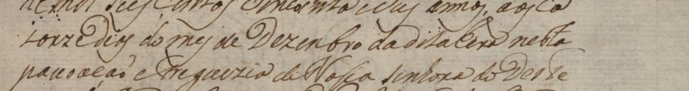
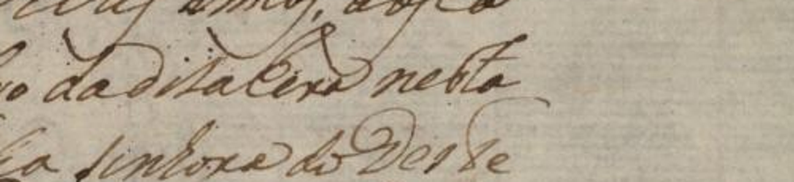

# Terceira linha do corpo — 269r

Inspeção assistida em 16/10/2026. A edição já havia sido consultada: esta leitura
não é independente. **Estado mais recente:** o usuário confirmou a quebra
`ca / torze`, `Dias` com inicial maiúscula e `da dita Hera nesta povoação`.
A dúvida sobre `Hera` foi resolvida ao consultar a página inteira. A linha
integral, demais sinais, geometria e cobertura continuam pendentes.

O [manuscrito inteiro](images/manuscrito_269r_original.jpg) mantém o contexto
que ajudou a esclarecer a palavra. As propostas e dúvidas abaixo são as etapas
iniciais, anteriores às confirmações registradas nas seções seguintes.



Texto publicado preservado no rascunho de origem:

```text
torze dias do mes de Dezembro da dita Hera nesta
```

Proposta visual inicial para discussão, antes das confirmações:

```text
torze <dias/Dias> do mes de Dezembro da dita <Hera/Era> nesta
```

Os delimitadores acima indicam alternativas desta conversa. Não são convenção
diplomática adotada nem texto para treino.

| Trecho | Observação visual inicial | Estado naquela etapa |
|---|---|---|
| `torze` | Começa a terceira linha, continuando `ca` da anterior | Quebra confirmada pelo usuário; linha integral pendente |
| `dias/Dias` | A inicial tem uma laçada alta; comparar antes de fixar caixa | Pendente; a edição usa minúscula |
| `do mes de Dezembro` | A sequência é compatível com os traços observados | Proposta do agente; acento de `mes` não estabelecido |
| `da dita` | Leitura proposta compatível com a sequência visível | Pendente de conferência humana |
| `Hera/Era` | A edição usa `Hera`; os traços iniciais ainda não permitem fixar com segurança uma das alternativas | Dúvida mantida |
| `nesta` | Proposta para a palavra final | Pendente de conferência humana |
| Pontuação | Não foi identificado sinal terminal inequívoco nesta inspeção | Não acrescentar pontuação inferida |



Os recortes incluem traços vizinhos para não ocultar prolongamentos das letras.
Suas caixas de contexto foram registradas em `comparacao.json`, referidas à
imagem JPEG incorporada original. Não são caixas de linha validadas.
O arquivo conserva o texto publicado, o histórico das confirmações e a proposta
visual em campos separados. Nenhuma alteração foi feita nas referências
diplomáticas ou nos dados de treino/avaliação.

## Confirmações posteriores do usuário

O usuário indicou: «Claramente é Dias, não sei se tem algo da epoca de usar as
maiusculas mas sim eu vejo um dias» e «Hera eu não vi, mas nesta eu vejo sim».

- `Dias`: leitura confirmada, com a inicial maiúscula indicada. Não foi
  atribuída uma regra histórica ao uso da caixa.
- `nesta`: leitura da palavra confirmada.
- Palavra publicada como `Hera`: permanece sem leitura confirmada. A observação
  não estabelece `Era`, não elimina a palavra e não comprova erro da edição.

Estado após a confirmação de `Dias` e `nesta`, antes da observação seguinte:

```text
torze Dias do mes de Dezembro da dita <leitura pendente> nesta
```

Esse quadro combina a quebra anteriormente confirmada, as duas palavras agora
confirmadas e o restante do rascunho assistido pela edição. Não confirma
implicitamente as outras palavras. O marcador `<leitura pendente>` é explicativo;
não é convenção diplomática adotada nem alvo de treino. Linha, geometria,
pontuação e cobertura continuam pendentes. O texto publicado e a leitura
anterior do agente foram preservados em campos separados e no histórico.

## Resolução de Hera no contexto da página inteira

O usuário esclareceu: «Vendo a pagina inteira, sim eu vejo Hera, porem no recorte
ficou dificil, mas sim eu vejo da dita Hera nesta povoação».

Foi confirmada a sequência `da dita Hera nesta povoação`, incluindo `Hera`
com H. A dificuldade anterior foi atribuída pelo usuário à visualização no
recorte. A observação anterior foi preservada como etapa da revisão, e sua
dúvida textual foi marcada como resolvida por esta nova confirmação.

O mapeamento visual situa `da dita Hera nesta` no fim da terceira linha e
`povoação` no início da quarta. A mensagem confirma a sequência; não foi
interpretada como validação adicional da geometria ou confirmação explícita
da quebra pelo usuário.

Estado atualizado para discussão, ainda combinando confirmações parciais
e o restante do rascunho assistido:

```text
torze Dias do mes de Dezembro da dita Hera nesta
povoação ...
```

As reticências acima indicam somente continuação não reproduzida neste quadro.
O texto publicado permanece intacto, e nenhuma linha completa foi validada.
