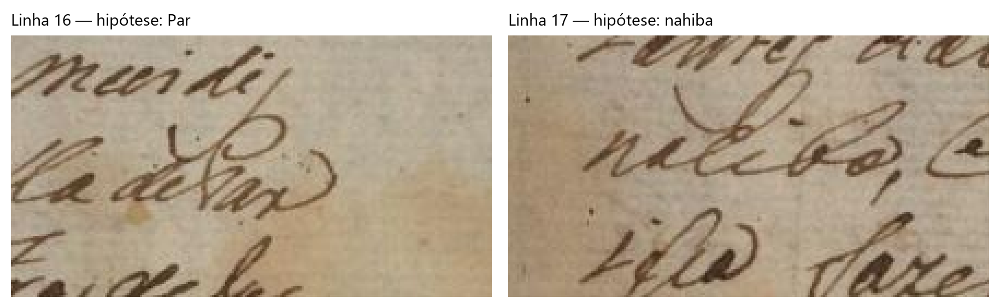
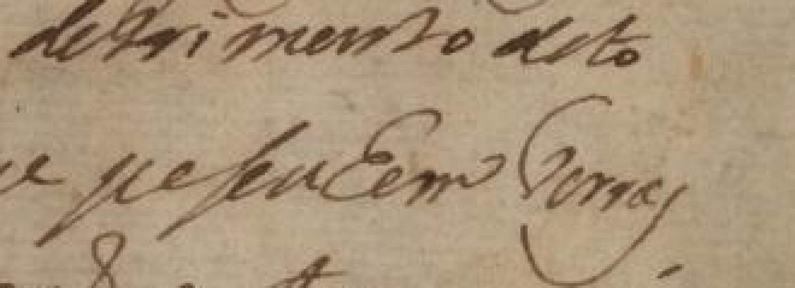

# Conferência humana do fólio 269 reto - 19/10/2026

A sessão avançou da linha 11 até parte da linha 21. O ponto de retomada é
**Pesueem / pessuhem**, na linha 21: a sequência central e o possível **h**
permanecem em aberto. **Terras** ainda não recebeu confirmação específica.
Depois dessa conferência, seguir para a linha 22.

Revisor: **Rodolfo Vinícius Cima Takemoto**, identificado pelo usuário.
O editor conserva literalmente o nome `Rodolfo Vinicius Cima Takemoto`.
As decisões abaixo provêm das mensagens desta conversa; não foram inventados
horários individuais de confirmação. O arquivo [conferencia.json](conferencia.json)
guarda os segmentos, mensagens de apoio, alternativas e limites de cada decisão.

## Leitura proposta e pendências

Esta tabela é um roteiro de conferência. Não constitui catálogo validado para
treino ou avaliação. Grafias prováveis e trechos propostos continuam separados
das confirmações explícitas, mesmo quando uma resposta breve parece concordar
com uma frase maior.

| Linha | Leitura proposta | Estado nesta conferência |
|---|---|---|
| 11 | ticular Requererão Em altas vozes ao dito Capi | `Requererão` provável; sinal superior/final e pontuação em aberto. `ao dito` permanece proposto. |
| 12 | tão mõr e ouvidor Em como elles Herão povoa | Leitura completa confirmada na conversa. |
| 13 | dores e Freguezes desta dita Freguezia de Nossa | Leitura completa confirmada na conversa. |
| 14 | Senhora do DesTerro de Jundiahy onde Eram | Leitura completa confirmada, incluindo **Eram**, com E. |
| 15 | mais de oitenta moradores, e ficaram mui dis | Confirmados `mais de oitenta moradores` e `mui dis`; `, e ficaram` continua proposto. |
| 16 | tantes da villa de Sam Paulo, e da villa de Par | Confirmados o início até `Paulo` e `Par`; preservar limites das confirmações e conferir a pontuação/ligação intermediária. |
| 17 | nahiba, e não poderem vir os ministros de Jus | `nahiba` confirmado; **ministros** provável, com primeira vogal i/e em dúvida. Restante ainda proposto. |
| 18 | tissa fazer deligençias por ser Longe devendo | Leitura completa confirmada na conversa. |
| 19 | por alguã duvida orgente, virem alguns menis | Confirmados `por alguã duvida`, `virem alguns` e `menis`; **orgente** provável, com inicial o/e em aberto. Vírgula ainda sem confirmação específica. |
| 20 | tros e Hera Com muito Grande detrimento de to | Confirmados `tros e Hera` e **Com**, com C maiúsculo. A resposta enfatizou C; manter o restante como proposta, sem ampliar essa confirmação. |
| 21 | dos Como Tambem pessoas que [palavra em aberto] Terras | Confirmados `dos Como Tambem` e `pessoas que`. Usuário propôs **Pesueem**; edição traz **pessuhem**, reconhecedor **peseuhem**. `Terras` ainda proposto. |

As quebras físicas são preservadas: `Capi / tão`, `povoa / dores`,
`Nossa / Senhora`, `dis / tantes`, **`Par / nahiba`**, `Jus / tissa`,
`menis / tros` e a proposta `to / dos`. A junção **Parnahiba** foi confirmada
após comparação do manuscrito com a edição e dos recortes entre si.
As hipóteses anteriores `Sam`, `San` e `naiba` são histórico superado nesse nome.





## Estado preservado do editor

A revisão local encontrada e preservada é **20261019T153953_c011dcd6**,
posterior à sessão publicada em 16/10. Ela já contém **15 linhas marcadas como
validadas**, com geometria validada. O navegador mostrou **sem alterações locais
pendentes** ao encerrar. Esse estado não foi revertido nem reescrito.

Há diferenças importantes entre esse estado salvo e esta conferência:

- A linha 14 continua no editor com `Heram`; a leitura recebida nesta conversa é
  **Eram**. A divergência está documentada, sem sobrescrever o registro anterior.
- Os estados validados do editor não resolvem automaticamente as dúvidas sobre
  `Requererão` ou a pontuação levantadas nesta conversa.
- A cobertura completa continua confirmada somente para os blocos **1-5 e 6-10**.
  O bloco 11-15 conserva cobertura pendente. Não se confirmou cobertura nova,
  geometria ou ordem de leitura das linhas 16-21 nesta conversa.
- As linhas 16-21 foram reconhecidas separadamente e não foram incorporadas ao
  catálogo original. Os dados desta pasta são notas e evidências de conferência.

Veja a [revisão salva literal](editor/revisao_salva.json), o
[ponteiro](editor/ponteiro.json), a [configuração](editor/configuracao.toml) e a
[evidência visual do editor](evidencias/editor_encerramento_20261019.png).

## Reconhecimento e proveniência

Foram executadas **seis inferências individuais**, nas linhas 16-21, com o mesmo
PP-OCRv6 medium, Kraken 7.1, CPU/float32, pesos e imagem Docker fixados na
configuração existente. As seis execuções terminaram com status `ok`.
O modelo recebeu somente os recortes, sem transcrição da edição ou correções.
Os textos brutos e metadados originais foram copiados sem mudança de bytes.

| Linha | Saída bruta literal |
|---|---|
| 16 | tantes da villa de Sam PauLo, e davilla desar |
| 17 | nacibe, e naõ poderem vir os menistros delas |
| 18 | iisca fazer deLigencias por sen Longe devendo |
| 19 | por alguaõ duvila ergente, virem Rguens menis |
| 20 | tros chera Com maito Grande detrimento dito |
| 21 | dos ComoTam bem pessoos que peseuhem Torras |

[conferencia.json](conferencia.json) lista as pastas das seis execuções.
Cada uma contém `predictions.jsonl`, recibo do reconhecedor, recorte original,
ampliação 3x, coordenadas, hash da fonte e recibo de preservação do editor.
Os caminhos locais nos arquivos originais são históricos; o verificador resolve
as cópias nesta pasta sem depender desses caminhos da máquina do revisor.

As demais imagens e notas em [evidencias/](evidencias/) preservam os recortes
apresentados durante a sessão. Notas antigas de uma imagem podem refletir o
estado daquele momento; as decisões finais desta sessão estão em
**conferencia.json**, sem apagar alternativas anteriores.
As ampliações repetem os pixels originais por vizinho mais próximo, sem
reconstrução de letras, nitidez ou contraste artificial.

A [página inteira e a edição](../images/comparacao_paginas.png) e o
[texto do corpo conforme a edição](../corpo_269r_edicao.txt) permanecem fontes
de apoio separadas. A edição ocupa a página 1 e o início da página 2 do PDF,
até `269/Verso.`; o texto após esse marcador pertence ao verso.
Créditos: Ana Caroline C. Miranda, paleógrafa responsável; Thiago Paschoal,
paleógrafo revisor, Memorabilia Paleografia e Diplomática.

Não houve nova métrica CER/WER, treino, adaptação do modelo ou funcionalidade.
Esta sessão não constitui amostra reservada nem referência pronta para avaliação.

## Integridade e retomada

- [preservacao.json](preservacao.json): 549 arquivos preexistentes de dados,
  experimentos e documentação conferidos por SHA-256 antes/depois do
  empacotamento, sem mudanças. É recibo histórico desse momento; revisões
  futuras legítimas no editor não devem ser revertidas para satisfazê-lo.
- [editor/workspace.zip](editor/workspace.zip): cópia literal dos **72 arquivos**
  do workspace, incluindo **30 revisões** e seu histórico completo disponível.
  [arquivos_workspace.json](editor/arquivos_workspace.json) registra os hashes.
- [inventario.json](inventario.json): hashes de todos os arquivos deste pacote,
  exceto ele próprio. O verificador também confere ZIP, cadeia de revisões,
  coordenadas/pixels dos seis recortes e separação entre hipóteses e validação.

Na raiz do repositório, execute:

```powershell
python docs/revisao_humana/traslado_269r/sessao_20261019/verificar.py
```

Para inspecionar o histórico em outra máquina, abra o ZIP ou extraia-o somente
em **uma pasta nova de inspeção**. Não extraia sobre workspaces existentes.
O ZIP contém o prefixo `data/workspace_traslado_269r/`; as notas desta conversa
continuam externas ao catálogo até reconciliação explícita dos segmentos e dúvidas.

Na próxima sessão, retomar a **linha 21**, comparar **Pesueem / pessuhem** com
outras formas de e/h do mesmo escriba e conferir **Terras**. Depois continuar
a linha 22. Antes de qualquer avaliação, reconciliar as pendências textuais,
geometria, ordem, identificação e cobertura dos blocos correspondentes.

## Verificações desta publicação

- **90 testes Python e 29 testes JavaScript passaram**. Permanece um aviso de
  depreciação Starlette/AnyIO, sem falha.
- Verificador do pacote aprovado: inventário, ZIP com 72 arquivos e 30 revisões,
  seis predições brutas, coordenadas e pixels originais, ampliações e pendências.
- Em duas cópias descartáveis, alteração do texto bruto e alteração de um pixel
  foram recusadas, mesmo recalculando o inventário de cada cópia para exercitar
  a conferência do conteúdo.
- O pacote lexical anterior passou pelo verificador existente; compilação do
  novo verificador e conferência de espaços do Git passaram.
- Esta publicação acrescenta o verificador desta sessão à matriz de CI existente
  para Windows/Linux e Python 3.11/3.12. Aprovação local não antecipa o resultado
  da execução remota iniciada pelo push.

Os comandos e resultados locais estão em [verificacoes.json](verificacoes.json).
