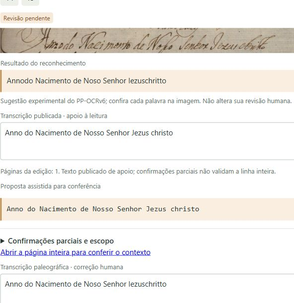
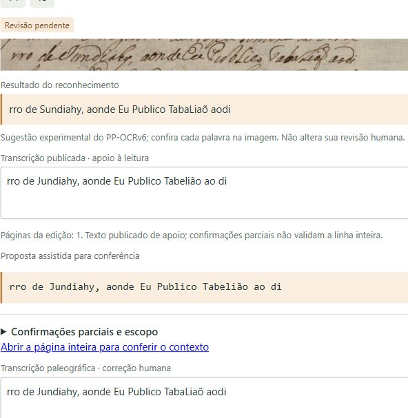

# Teste de salvamento lexical — cópia isolada do fólio 269r

Data: 2026-10-19T15:17:24.194388+00:00 (UTC). Código: commit `a59f38a86516acd841b2e20ea24db6952caf782c`, branch `codex/refatoracao-piloto`.

## Resultado

Os dois rascunhos foram salvos **somente na cópia de teste**, usando o botão normal do editor. Cada linha recebeu um evento `lexical_assistance` persistido no snapshot. Os IDs das entradas, a versão e o SHA-256 do léxico permitem resolver as fontes do acervo. A saída bruta, as revisões originais e os snapshots anteriores da cópia permaneceram intactos.

As linhas 1 e 5 da cópia ficaram `pending_review`, sem aprovação textual automática. O campo `reviewer` dos novos salvamentos identifica **Codex · teste de salvamento em cópia isolada**; não atribui o teste ao revisor humano original. O tipo `reference_kind="human_diplomatic"` foi herdado da cópia e não equivale a validação: o estado continua pendente e os outros erros do bruto continuam presentes.

## Escopo e histórico

- Editor original: `http://127.0.0.1:8011/`.
- Editor da cópia: `http://127.0.0.1:8002/`, identificado como “cópia de teste”.
- Workspace original: `data/workspace_traslado_269r`.
- Workspace da cópia: `tmp/lexico_20261019/aplicacao_20261019T145251/copia/data/workspace_traslado_269r`.
- Revisão original preservada: `20261016T191933_07d31bad`.
- Os rascunhos da cópia foram iniciados com as predições brutas já existentes. Não se executou HTR nem se revisou o restante das frases.

| Etapa | Revisão | Revisão anterior | Operação |
| --- | --- | --- | --- |
| Estado inicial | `20261016T191933_07d31bad` | Histórico preexistente | Dez linhas validadas, cinco pendentes |
| Primeiro salvamento | `20261019T151442_7b41793f` | `20261016T191933_07d31bad` | Linha 5: Sundiahy → Jundiahy |
| Segundo salvamento | `20261019T151448_c676f483` | `20261019T151442_7b41793f` | Linha 1: Annodo → Anno do |

Os três snapshots estão em [evidencias/revisions/](evidencias/revisions/). O snapshot inicial da cópia continua idêntico ao original por SHA-256. A cópia termina com oito linhas validadas e sete pendentes, porque as duas linhas de teste voltaram a pendentes. **O original continua com dez validadas e cinco pendentes.** A cobertura foi herdada sem alteração; não representa nova confirmação dos textos de teste.

## Proveniência registrada por linha

### Linha 1 — `l_traslado_269r_body_01`

| Campo | Valor |
| --- | --- |
| Consulta e substituição | `Annodo` → `Anno do` |
| Critério | `word_split`, distância `1`; sem probabilidade de acerto |
| Revisão que introduziu o evento | `20261019T151448_c676f483` |
| Horário do evento no servidor | `2026-10-19T15:14:48.909654+00:00` |
| Estado após salvar | `pending_review` |
| Identificação do teste | `Codex · teste de salvamento em cópia isolada` |
| Texto humano original preservado | `Anno do Nacimento de Nosso Senhor Jezus christo` |
| Saída bruta preservada | `Annodo Nacimento de Noso Senhor Iezuschritto` |
| Texto salvo somente na cópia | `Anno do Nacimento de Noso Senhor Iezuschritto` |

Evento literal persistido em `lexical_assistance`:

```json
{
  "version": "2026-10-19.1",
  "fingerprint": "647189123701c535ab9444790689b0d89c2721f38e581e2b2b671ef7d4da3670",
  "candidate_id": "c2a500ddf656a9f8bcfac9ad",
  "entry_ids": [
    "acervo_269r_01_03",
    "acervo_269r_01_04"
  ],
  "query": "Annodo",
  "repertoire": "acervo",
  "match": "word_split",
  "distance": 1,
  "replacement": "Anno do",
  "before": "Annodo Nacimento de Noso Senhor Iezuschritto",
  "after": "Anno do Nacimento de Noso Senhor Iezuschritto",
  "start": 0,
  "end": 6,
  "recorded_at": "2026-10-19T15:14:48.909654+00:00"
}
```

Fontes resolvidas a partir dos IDs e do catálogo preservado:

- **Anno** — entrada `acervo_269r_01_03`, fonte `acervo_269r_20261016`; fólio 269r, linha 1, ID l_traslado_269r_body_01, revisão 20261016T191933_07d31bad.
  - [Abrir a revisão publicada](https://github.com/aj1no/paleographia-htr/blob/3284e070285cac462bf38140618e053fe7161650/docs/revisao_humana/traslado_269r/sessao_20261016/lines.jsonl#L1).
  - Revisor humano de origem: **Rodolfo Vinicius Cima Takemoto**, em `2026-10-16T16:59:49.388536+00:00`; revisão `20261016T191933_07d31bad`.
  - Repertório: `acervo`; evidência: `atestado_no_acervo`. Atestação no acervo, sem definição lexicográfica nova.
  - Arquivo de origem: `docs/revisao_humana/traslado_269r/sessao_20261016/lines.jsonl`; SHA-256 `28484eb93239061734ccce93376f8869d993643488ee8d31eb5f62f2ecfae5b9`.
  - Grupo de origem: `tt_pbr_0004_026_traslado_1767`; papel `development`; partição `None`.

- **do** — entrada `acervo_269r_01_04`, fonte `acervo_269r_20261016`; fólio 269r, linha 1, ID l_traslado_269r_body_01, revisão 20261016T191933_07d31bad.
  - [Abrir a revisão publicada](https://github.com/aj1no/paleographia-htr/blob/3284e070285cac462bf38140618e053fe7161650/docs/revisao_humana/traslado_269r/sessao_20261016/lines.jsonl#L1).
  - Revisor humano de origem: **Rodolfo Vinicius Cima Takemoto**, em `2026-10-16T16:59:49.388536+00:00`; revisão `20261016T191933_07d31bad`.
  - Repertório: `acervo`; evidência: `atestado_no_acervo`. Atestação no acervo, sem definição lexicográfica nova.
  - Arquivo de origem: `docs/revisao_humana/traslado_269r/sessao_20261016/lines.jsonl`; SHA-256 `28484eb93239061734ccce93376f8869d993643488ee8d31eb5f62f2ecfae5b9`.
  - Grupo de origem: `tt_pbr_0004_026_traslado_1767`; papel `development`; partição `None`.

### Linha 5 — `l_traslado_269r_body_05`

| Campo | Valor |
| --- | --- |
| Consulta e substituição | `Sundiahy` → `Jundiahy` |
| Critério | `edit_distance`, distância `1`; sem probabilidade de acerto |
| Revisão que introduziu o evento | `20261019T151442_7b41793f` |
| Horário do evento no servidor | `2026-10-19T15:14:42.347170+00:00` |
| Estado após salvar | `pending_review` |
| Identificação do teste | `Codex · teste de salvamento em cópia isolada` |
| Texto humano original preservado | `rro de Jundiahy, aonde Eu Publico Tabelião ao di` |
| Saída bruta preservada | `rro de Sundiahy, aonde Eu Publico TabaLiaõ aodi` |
| Texto salvo somente na cópia | `rro de Jundiahy, aonde Eu Publico TabaLiaõ aodi` |

Evento literal persistido em `lexical_assistance`:

```json
{
  "version": "2026-10-19.1",
  "fingerprint": "647189123701c535ab9444790689b0d89c2721f38e581e2b2b671ef7d4da3670",
  "candidate_id": "3e6500863cfbccb09afb7954",
  "entry_ids": [
    "acervo_269r_05_11"
  ],
  "query": "Sundiahy",
  "repertoire": "acervo",
  "match": "edit_distance",
  "distance": 1,
  "replacement": "Jundiahy",
  "before": "rro de Sundiahy, aonde Eu Publico TabaLiaõ aodi",
  "after": "rro de Jundiahy, aonde Eu Publico TabaLiaõ aodi",
  "start": 7,
  "end": 15,
  "recorded_at": "2026-10-19T15:14:42.347170+00:00"
}
```

Fontes resolvidas a partir dos IDs e do catálogo preservado:

- **Jundiahy** — entrada `acervo_269r_05_11`, fonte `acervo_269r_20261016`; fólio 269r, linha 5, ID l_traslado_269r_body_05, revisão 20261016T191933_07d31bad.
  - [Abrir a revisão publicada](https://github.com/aj1no/paleographia-htr/blob/3284e070285cac462bf38140618e053fe7161650/docs/revisao_humana/traslado_269r/sessao_20261016/lines.jsonl#L5).
  - Revisor humano de origem: **Rodolfo Vinicius Cima Takemoto**, em `2026-10-16T17:03:13.133936+00:00`; revisão `20261016T191933_07d31bad`.
  - Repertório: `acervo`; evidência: `atestado_no_acervo`. Atestação no acervo, sem definição lexicográfica nova.
  - Arquivo de origem: `docs/revisao_humana/traslado_269r/sessao_20261016/lines.jsonl`; SHA-256 `28484eb93239061734ccce93376f8869d993643488ee8d31eb5f62f2ecfae5b9`.
  - Grupo de origem: `tt_pbr_0004_026_traslado_1767`; papel `development`; partição `None`.

## Como as fontes ficam registradas

O evento guarda **IDs de entrada, ID do candidato, versão e fingerprint do léxico**, consulta, repertório, critério, distância, antes/depois, intervalo e horário. As posições são pontos de código Unicode, com limite final exclusivo.

URLs, páginas, créditos, condições de uso e a autoria humana da fonte ficam nas entradas e no catálogo referenciados. **Esses dados bibliográficos não são duplicados integralmente dentro de cada evento.** Para reconstituir o vínculo no futuro, é necessário preservar a versão exata do léxico. Este relatório inclui os bytes usados de [sources.json](evidencias/sources.json) e [entries.jsonl](evidencias/entries.jsonl), além dos eventos com suas fontes resolvidas no [recibo JSON](evidencias/verificacao.json).

- Versão: `2026-10-19.1`.
- Fingerprint: `647189123701c535ab9444790689b0d89c2721f38e581e2b2b671ef7d4da3670`.
- Cálculo: SHA-256 dos bytes UTF-8/LF de `sources.json`, byte nulo, bytes de `entries.jsonl`.
- As duas aplicações escolheram o repertório **acervo**. O verbete `ANNO` de Bluteau, mostrado na consulta anterior, **não foi usado nestes dois eventos**; `Anno` e `do` vêm da linha humana 1 e `Jundiahy` da linha humana 5.

## Verificações realizadas

| Verificação | Resultado |
| --- | --- |
| Salvamento normal no navegador, porta 8002 | Dois salvamentos concluídos; nenhum na porta 8011 |
| Recarregamento/retorno ao editor | Dados persistidos, sem rascunhos locais pendentes |
| Histórico da cópia | Duas revisões novas encadeadas, sem substituir revisões anteriores |
| Arquivos originais específicos deste teste | 78 arquivos com os mesmos hashes anteriores |
| Inventário amplo preexistente | 557 arquivos de dados, revisões e experimentos inalterados |
| Arquivos antigos da cópia | 77 inalterados; somente o ponteiro `current.json` foi atualizado |
| Predições brutas | Lista completa idêntica em todas as revisões |
| Páginas, identificação e cobertura | Idênticas em todas as revisões |
| Linha alterada em cada salvamento | Somente a esperada: primeiro 5, depois 1 |
| Fontes e candidatos | IDs resolvidos; versão/hash coincidem; candidato reconsultado e conferido |
| Geometria, ordem, recortes e apoio publicado | Preservados |
| Aprovação textual | Desmarcada nas duas linhas de teste; ambas pendentes |

Esta etapa é uma verificação funcional real de interface, persistência e hashes. Não houve alteração de código de produção, execução da suíte automatizada novamente, nova inferência ou cálculo de CER/WER. A suíte aprovada na entrega do código permanece documentada separadamente.

## Evidências visuais após persistência

Linha 1, após reabrir o editor:



Linha 5, após reabrir o editor:



## Limites para análise

1. Este teste comprova persistência e rastreabilidade; não mede qualidade paleográfica ou melhora automática do reconhecedor.
2. As fontes do acervo são derivadas das próprias linhas humanas já revisadas. Recuperá-las não é confirmação independente e não autoriza avaliar generalização sobre o mesmo grupo.
3. Só os trechos `Annodo` e `Sundiahy` foram substituídos. Os outros erros do bruto foram mantidos deliberadamente no teste.
4. O histórico conserva os identificadores e a identidade da base, mas a resolução bibliográfica depende da preservação dos arquivos lexicais correspondentes. Este pacote os acompanha; não é uma cópia autossuficiente de todas as imagens do acervo.
5. A publicação autorizada contém somente este relatório e as evidências do teste em cópia. As mudanças da cópia não foram incorporadas às revisões originais; os artefatos publicados são identificados como teste e permanecem separados do acervo de produção.


## Publicação das evidências

Esta é a versão preparada para publicação na branch `codex/refatoracao-piloto`. Caminhos locais foram convertidos para relativos ao repositório. Os snapshots, o catálogo e as imagens mantêm os bytes do teste. O [inventário publicado](evidencias/sha256.json), o [registro das adaptações](publicacao.json) e as [instruções de conferência](README.md) acompanham o pacote.
