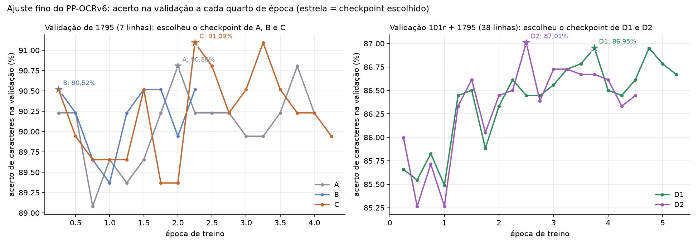
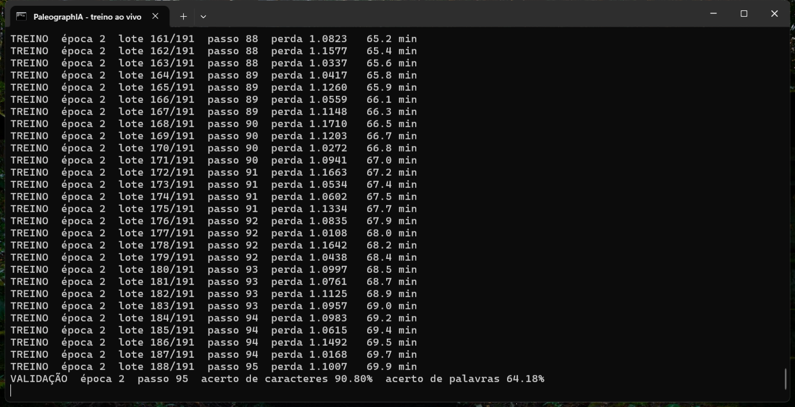
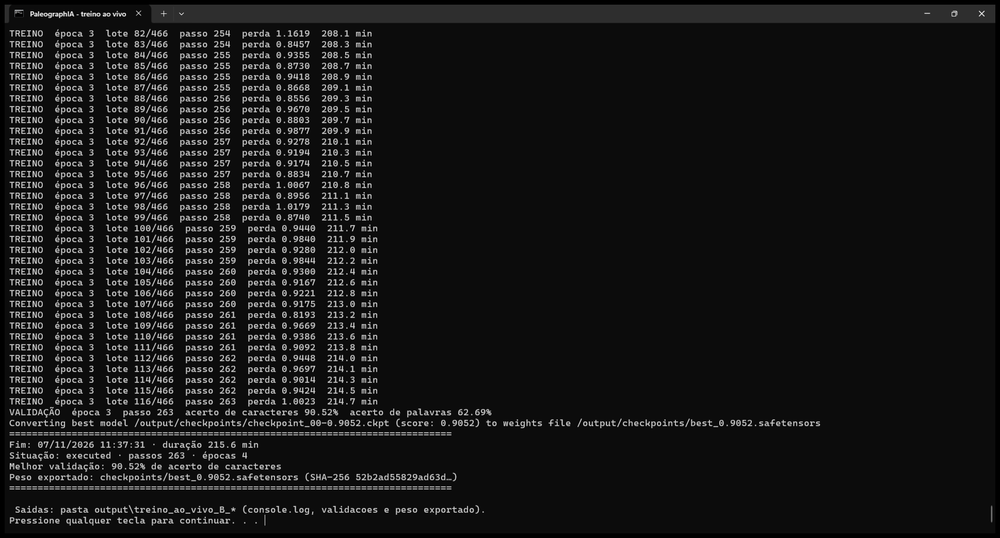
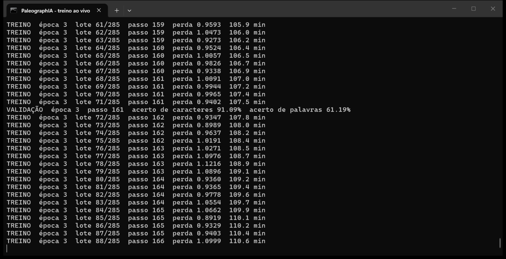
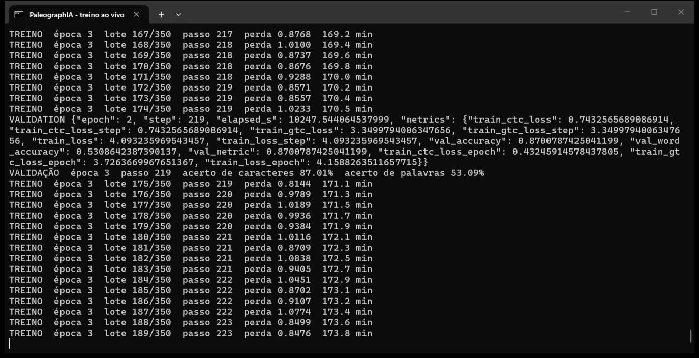

# Os treinos do PaleographIA, época por época

Entre 6 e 11/11/2026, a equipe fez cinco ajustes finos do reconhecedor PP-OCRv6 medium numa GTX 1650
de 4 GB. Quatro foram acompanhados ao vivo, com prints automáticos da janela do treino a cada 10 minutos
e logo depois das validações. Esta página reúne os prints e explica o que aconteceu em cada época. O
modelo que está na aplicação é o **D1**: no teste reservado, ele baixou o erro de 64,0% (modelo base)
para 55,4%.

| Treino | Data | O que mudou | Duração | Melhor validação | Resultado |
| --- | --- | --- | ---: | --- | --- |
| [A](#treino-a-só-o-traslado) | 06/11 | 191 linhas do Traslado de 1767 | 142 min | 90,80% (passo 95) | Primeiro ganho sobre o base |
| [B](#treino-b-traslado--inquisição) | 07/11 | A + 550 linhas públicas da Inquisição | 216 min | 90,52% (passo 29) | Empata com o A: dados de fora não ajudaram |
| [C](#treino-c-traslado--posturas-de-1831) | 10/11 | A + 94 linhas validadas das Posturas de 1831 | 205 min | 91,09% (passo 161) | Escolhido só em 1795, ficou no nível do B |
| [D1](#treino-d1-a-receita-da-entrega) | 10–11/11 | Como o C, com o fólio 101r fora do treino e na validação | 228 min | 86,95% (passo 239) | **Modelo da entrega**: passou o B no teste reservado |
| [D2](#treino-d2-mais-aumento-de-dados) | 11/11 | Como o D1, com 2 variações por linha | 382 min | 87,01% (passo 219) | Empatou com o D1, gastando 50% mais tempo |

Os dois painéis não se comparam entre si: o da esquerda valida em 7 linhas de 1795, e o da direita em
38 linhas (o fólio 101r das Posturas mais as mesmas 7 de 1795). No eixo horizontal, 1 é o fim da
primeira época. A estrela marca o checkpoint que o treino guardou: o primeiro a atingir o melhor acerto.
O gráfico é gerado por `scripts/grafico_treinos.py` a partir dos registros.

## Como ler os prints

Cada linha `TREINO` é um **lote** de 2 imagens de linha. A cada 4 lotes o modelo dá um **passo**, que
é quando os pesos mudam (lote 2, acumulando 4). Uma **época** é uma passada por todas as linhas de
treino. A **perda** mede o quanto o modelo erra nas linhas de treino; ela deve cair. A cada quarto de
época sai uma linha `VALIDAÇÃO`, com o **acerto de caracteres** e **de palavras** em linhas que o modelo
não usa para aprender. O treino guarda o melhor ponto e **para sozinho** depois de 8 validações (duas
épocas) sem passar o recorde por pelo menos 0,1 ponto.

O acerto mostrado no print é o do `ketos`, a ferramenta de treino. Os resultados finais do projeto são
medidos de outro jeito: CER e WER em Unicode NFC, com o mesmo worker do editor.

Todos os treinos usam a mesma receita: taxa de aprendizado 2e-5 com cosseno, BatchNorm congelada (com
lotes tão pequenos, ela desandava), rótulos em NFD e 1 variação aumentada por linha (2 no D2). Na
mesma placa, cada época levou de 35 a 96 minutos, conforme o número de linhas e de variações.

## Treino A: só o Traslado

Primeiro treino gravado (06/11, 12h57 às 15h19). Treinou com 191 linhas do Traslado do Auto de Criação
da Vila (cópia de 1767), cujos rótulos vêm da transcrição publicada pelo Arquivo. Validou nas 7 linhas
humanas da sessão da Câmara de 1795, que é outra mão. [Registro completo](../experimentos/ppocrv6_ajuste_fino_20261105/gravacao_20261106/treino_A/README.md).

| Época | Fim (min) | Acerto nas validações da época | Melhor da época | Perda média da época | Print |
| ---: | ---: | --- | --- | ---: | --- |
| 1 | 35 | 89,08–90,23% | 90,23% (passo 11) | 6,61 | os prints começaram na época 2 |
| 2 | 70 | 89,37–90,80% | **90,80% (passo 95)** | 4,72 | [passo 95](../experimentos/ppocrv6_ajuste_fino_20261105/gravacao_20261106/treino_A/prints/treino_A_validacao_passo095.png) |
| 3 | 105 | 89,94–90,23% | 90,23% (passo 107) | 4,11 | [passo 143](../experimentos/ppocrv6_ajuste_fino_20261105/gravacao_20261106/treino_A/prints/treino_A_validacao_passo143.png) |
| 4 | 141 | 89,94–90,80% | 90,80% (passo 179) | — | [passo 191](../experimentos/ppocrv6_ajuste_fino_20261105/gravacao_20261106/treino_A/prints/treino_A_validacao_passo191.png), [resumo final](../experimentos/ppocrv6_ajuste_fino_20261105/gravacao_20261106/treino_A/prints/treino_A_151930_final.png) |

- **Época 1:** o acerto oscila perto do ponto de partida (cerca de 90%). O modelo ainda está se ajustando à letra nova.
- **Época 2:** a perda cai de 6,6 para 4,7, e no fim da época sai o melhor ponto do treino, **90,80%**.
- **Épocas 3 e 4:** a perda continua caindo, mas a validação não passa o recorde (o 90,80% do passo 179
  só empatou). Depois de 8 validações sem melhora, o treino parou.
- **Na métrica do projeto**, a validação de 1795 caiu de 14,2% de CER (base) para 10,7%.

## Treino B: Traslado + Inquisição

07/11, das 8h01 às 11h37. Somou ao A 550 linhas públicas da Inquisição portuguesa (dataset do Zenodo,
CC BY 4.0), para ver se mais dados de fora ajudam. São 931 amostras por época, quase três vezes o A.
[Registro completo](../experimentos/ppocrv6_ajuste_fino_20261105/gravacao_20261107/treino_B/README.md).

| Época | Fim (min) | Acerto nas validações da época | Melhor da época | Perda média da época | Print |
| ---: | ---: | --- | --- | ---: | --- |
| 1 | 96 | 89,37–90,52% | **90,52% (passo 29)** | 5,40 | [passo 29](../experimentos/ppocrv6_ajuste_fino_20261105/gravacao_20261107/treino_B/prints/treino_B_validacao_passo0029.png), [passo 116](../experimentos/ppocrv6_ajuste_fino_20261105/gravacao_20261107/treino_B/prints/treino_B_validacao_passo0116.png) |
| 2 | 191 | 89,94–90,52% | 90,52% (passo 175) | 3,98 | [passo 233](../experimentos/ppocrv6_ajuste_fino_20261105/gravacao_20261107/treino_B/prints/treino_B_validacao_passo0233.png) |
| 3 | 215 | 90,52% | 90,52% (passo 263) | — | [passo 263](../experimentos/ppocrv6_ajuste_fino_20261105/gravacao_20261107/treino_B/prints/treino_B_validacao_passo0263.png), [resumo final](../experimentos/ppocrv6_ajuste_fino_20261105/gravacao_20261107/treino_B/prints/treino_B_final_113806.png) |

- **Época 1:** o melhor ponto sai logo na primeira validação (passo 29). Depois o acerto cai até 89,37%,
  porque as linhas da Inquisição puxam o modelo para outra letra.
- **Época 2:** volta a 90,52%, mas só empata. A perda cai de 5,4 para 4,0.
- **Época 3:** a oitava validação sem melhora encerra o treino.
- **Conclusão:** em 1795, o B fica 2 caracteres à frente do A (10,1% × 10,7% de CER). No teste reservado,
  os dois se equivalem (60,9% × 60,5%). Mais dados, quando são de outro acervo, não trouxeram ganho
  mensurável.

## Treino C: Traslado + Posturas de 1831

10/11, das 18h28 às 21h53. Trocou a Inquisição por 94 linhas das Posturas Municipais de Jundiaí de 1831
(fólios 100r, 100v e 101r), lidas e validadas pela equipe na aplicação. É o primeiro treino com um
segundo documento do próprio acervo. [Registro completo](../experimentos/ppocrv6_ajustado_C/gravacao_20261110/treino_C/README.md).

| Época | Fim (min) | Acerto nas validações da época | Melhor da época | Perda média da época | Print |
| ---: | ---: | --- | --- | ---: | --- |
| 1 | 48 | 89,66–90,52% | 90,52% (passo 17) | 6,16 | [19h19](../experimentos/ppocrv6_ajustado_C/gravacao_20261110/treino_C/prints/treino_C_191910.png) |
| 2 | 96 | 89,37–90,52% | 90,52% (passo 107) | 4,42 | [20h09](../experimentos/ppocrv6_ajustado_C/gravacao_20261110/treino_C/prints/treino_C_200924.png) |
| 3 | 145 | 90,23–91,09% | **91,09% (passo 161)** | 3,95 | [20h19, o melhor ponto](../experimentos/ppocrv6_ajustado_C/gravacao_20261110/treino_C/prints/treino_C_201927.png), [20h59](../experimentos/ppocrv6_ajustado_C/gravacao_20261110/treino_C/prints/treino_C_205948.png) |
| 4 | 192 | 90,23–91,09% | 91,09% (passo 233) | 3,72 | [21h50](../experimentos/ppocrv6_ajustado_C/gravacao_20261110/treino_C/prints/treino_C_215001.png) |
| 5 | 204 | 89,94% | 89,94% (passo 305) | — | [resumo final](../experimentos/ppocrv6_ajustado_C/gravacao_20261110/treino_C/prints/treino_C_final_215357.png) |

- **Épocas 1 e 2:** o mesmo desenho do A e do B. O acerto cai um pouco e volta, sem passar 90,52%.
- **Época 3:** sai o melhor ponto, **91,09%** no passo 161, o maior acerto em 1795 entre A, B e C.
- **Épocas 4 e 5:** a perda segue caindo (de 3,95 para 3,72), e a validação empata e depois recua. O
  treino parou no começo da 5ª época.
- **O que se aprendeu:** com a métrica do projeto, o C ficou empatado com o B em 1795 (11,0% × 10,1% de
  CER, 3 caracteres). As 7 linhas de 1795 são de outro documento e não mostram o ganho nas Posturas. Por
  isso o D1 passou a validar também num fólio das Posturas.

## Treino D1: a receita da entrega

Rodou de 10 para 11/11, de madrugada, numa fila automática e sem gravação de tela. Por isso não há
prints; o [log completo](../experimentos/ppocrv6_ajustado_C/noturno_20261110/D1/console.log) mostra as
mesmas linhas. É o C com uma mudança de método: o fólio **101r** das Posturas (31 linhas) saiu do treino e
entrou na validação, junto com 1795. Assim, o checkpoint é escolhido olhando também para um fólio das
Posturas que o modelo nunca viu. [Registro completo](../experimentos/ppocrv6_ajustado_C/noturno_20261110/README.md).

| Época | Fim (min) | Acerto nas validações da época | Melhor da época | Perda média da época |
| ---: | ---: | --- | --- | ---: |
| 1 | 43 | 85,49–85,83% | 85,83% (passo 47) | 6,30 |
| 2 | 86 | 85,88–86,50% | 86,50% (passo 95) | 4,52 |
| 3 | 130 | 86,45–86,61% | 86,61% (passo 143) | 4,01 |
| 4 | 173 | 86,50–86,95% | **86,95% (passo 239)** | 3,79 |
| 5 | 217 | 86,45–86,95% | 86,95% (passo 303) | 3,70 |
| 6 | 228 | 86,67% | — | — |

- **Ao contrário de A, B e C, a curva sobe de forma regular**, de 85,5% para 86,95%. Com 38 linhas
  na validação, o sinal fica mais claro, e o ganho de aprender as Posturas aparece.
- **Época 6:** uma atualização do Windows reiniciou o computador à 01h51, no meio da última época. O
  melhor checkpoint, já salvo, foi convertido depois com `ketos convert`. O episódio levou ao
  `scripts/recuperar_checkpoint.py`.
- **Resultado:** no 101r, o CER cai de 17,1% (B) para 15,7%. **No teste reservado**, o D1 erra 55,4%
  dos caracteres, contra 60,9% do B; a diferença pareada vai de −8,1 a −3,3 pontos (IC 95%). Por isso o
  D1 substituiu o B na aplicação.

## Treino D2: mais aumento de dados

11/11, das 8h05 às 14h29. Igual ao D1, mas cada linha de treino ganhou 2 variações aumentadas (com
pequenas distorções de imagem) em vez de 1. A pergunta era se mais variações compensam o pouco dado.
[Registro](../experimentos/ppocrv6_ajustado_C/noturno_20261110/README.md#d2-em-11112026-duas-variantes-aumentadas-por-linha).

| Época | Fim (min) | Acerto nas validações da época | Melhor da época | Perda média da época | Print |
| ---: | ---: | --- | --- | ---: | --- |
| 1 | 67 | 85,26–86,00% | 86,00% (passo 21) | 5,86 | [9h19](../experimentos/ppocrv6_ajustado_C/noturno_20261110/D2/prints/treino_D2_091941.png) |
| 2 | 135 | 86,05–86,61% | 86,61% (passo 131) | 4,16 | [10h29](../experimentos/ppocrv6_ajustado_C/noturno_20261110/D2/prints/treino_D2_102958.png) |
| 3 | 205 | 86,39–87,01% | **87,01% (passo 219)** | 3,73 | [11h00, o melhor ponto](../experimentos/ppocrv6_ajustado_C/noturno_20261110/D2/prints/treino_D2_110011.png), [11h30](../experimentos/ppocrv6_ajustado_C/noturno_20261110/D2/prints/treino_D2_113019.png) |
| 4 | 330 | 86,61–86,73% | 86,73% (passo 285) | 3,57 | prints só até 12h |
| 5 | 382 | 86,33–86,45% | 86,45% (passo 395) | — | — |

- **Épocas 1 a 3:** anda um pouco à frente do D1 e chega a **87,01%** no passo 219.
- **Épocas 4 e 5:** a vantagem some, e o treino para por falta de melhora. As três primeiras épocas levaram
  cerca de 70 minutos cada, contra 43 do D1.
- **Resultado:** com a métrica do projeto, o D2 empata com o D1 no 101r (15,6% × 15,7% de CER) e fica
  atrás em 1795. Com tão poucas linhas, mais aumento não muda o resultado. O D1 continuou na aplicação, e
  o teste reservado não foi usado de novo.

## O que os cinco treinos ensinaram

1. **Dados do próprio acervo valem mais que dados de fora.** 550 linhas da Inquisição (B) não mudaram
   nada; 63 linhas das Posturas (D1) baixaram o teste em 5,4 pontos.
2. **Uma validação pequena engana.** Com 7 linhas, o melhor ponto oscila por 1 ou 2 caracteres e às vezes
   cai na primeira validação (B). Com 38 linhas, de dois documentos, a curva passou a mostrar o aprendizado.
3. **Mexer na receita não substitui dado novo.** O D2 mostrou que mais aumento de dados não compensa a
   falta de linhas. O próximo passo é validar mais fólios: a carta de 1767 e o contrato do livro 13.

## Todos os prints

- [Treino A, 26 prints](../experimentos/ppocrv6_ajuste_fino_20261105/gravacao_20261106/treino_A/prints/)
- [Treino B, 33 prints](../experimentos/ppocrv6_ajuste_fino_20261105/gravacao_20261107/treino_B/prints/), com [gráfico de desempenho do notebook](../experimentos/ppocrv6_ajuste_fino_20261105/gravacao_20261107/treino_B/desempenho.svg)
- [Treino C, 44 prints](../experimentos/ppocrv6_ajustado_C/gravacao_20261110/treino_C/prints/), com [gráfico de desempenho](../experimentos/ppocrv6_ajustado_C/gravacao_20261110/treino_C/desempenho.svg)
- [Treino D2, 32 prints](../experimentos/ppocrv6_ajustado_C/noturno_20261110/D2/prints/), com [gráfico de desempenho](../experimentos/ppocrv6_ajustado_C/noturno_20261110/D2/desempenho.svg)

Os prints `docker_*.png` mostram o Docker Desktop nos mesmos horários, com o contêiner do treino em uso.
